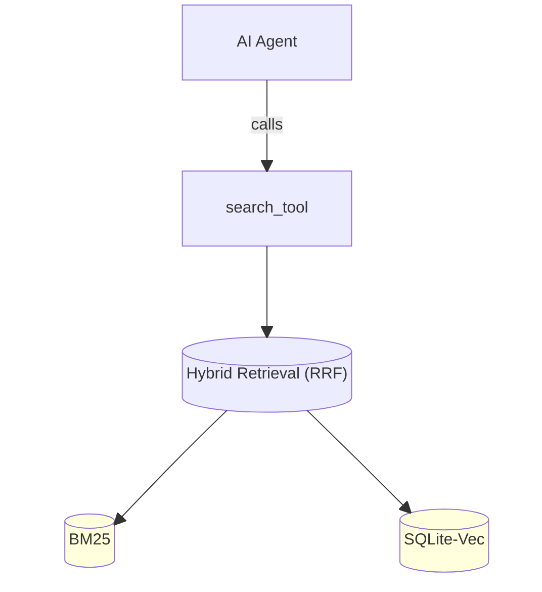

## Intent

The BM25-based search must be improved by optional, configurable vectors/embeddings. The user turns embeddings on in Global settings. A project can turn them off for itself in Project settings. The user can also reindex a project. When they are on, search for specifications and documents combines BM25 and vector ranking. When they are off, search works as it does today. The vector index is branch-aware: BM25 always covers the active worktree only, but the vectors of specifications are the root branch layer plus a diff layer of the active branch.

## Concept

Hybrid retrieval (Reciprocal Rank Fusion, RRF) combines the BM25 index with the embeddings/vector index (SQLite-Vec). Two surfaces use it: the `search_specifications` and `search_documents` agent tools, and the new **Semantic** mode of the search bar in the top chrome. Drafts are also shown in Semantic mode, but they are ranked by BM25 only.

## User journey

- User opens the Settings window and selects the new **Indexing** section in the Global group.
- User sees that embeddings are disabled (fresh-install default). Nothing is downloaded yet.
- User enables embeddings. The default model (BGE-small-en-v1.5) downloads from HuggingFace, then the project is indexed. A download bar and then an indexing count show the progress inside the Indexing section.
- User can choose another model from the list of FastEmbed-supported models. The four recommended models are marked. The app asks the user to confirm, then re-embeds in the background.
- User opens the search bar in the top chrome, keeps the default **Semantic** mode, and types a query. User sees ranked specifications, documents, and drafts, and opens a result.
- User can disable embeddings at any time. Search then uses BM25 only.
- User opens the **Indexing** section in the Project group. User sees the index status of the open project and sets the embeddings switch for this project: Use Global, On, or Off.
- User starts **Reindex** in that section, chooses the scope in a confirmation dialog, and sees the progress in the section and in the status bar.
- User opens a project that has embeddings on. The app keeps the stored vectors and compares content hashes in the background. Only the changed chunks are embedded.
- User switches the active worktree or branch. Semantic search then sees the root branch vectors with the chunks that this branch changed laid over them. Only the changed chunks are embedded, in the background. Until that ends, search uses BM25 only.
- User works with a draft and starts a discussion with conversational AI agent.
- AI agent uses `search_specifications` and/or `search_documents` tool, and it uses new RRF mechanis that’s built on top of BM25 and vector indexes.

## Requirements

- Use `FastEmbed` (`fastembed-rs`) for embeddings calculations. Use the Candle backend when it can run the selected model. If Candle cannot run a model, fall back to FastEmbed with ONNX Runtime for that model. Do not stop the work for this gap.
- Use `sqlite-vec` for embedding storage. Keep one database file per project in the user-global `app_data_dir()`. Never write it into the repository or into `.synthesis/`. Key each stored vector by its stable chunk ID and the hash of the chunk content, so an unchanged chunk is never embedded again.
- Embeddings are disabled on a fresh install. The model download and all embedding work start only after the user enables embeddings in the Indexing section.
- BM25 indexing stays always on and has no toggle. Only embeddings can be enabled or disabled.
- The search bar (`SCH-search.md`) gets a fourth query mode, **Semantic**, next to case-insensitive literal, smart-case literal, and regular expression. Semantic is the default mode when the user has no stored mode. The three existing modes and the file-walking search of `SCC-search.md` stay unchanged and keep searching all files.
- Semantic mode queries the indexes and does not walk files. It returns only: specifications (RRF over the `spec` index), documents (RRF over the `documents` index), and drafts (BM25 over the `drafts` index, no embeddings). It returns no other file. Hits are shown in the existing overlay and full-results tab, with one group for each of these three kinds (add the Documents and Drafts groups). Each hit shows the matching chunk as its snippet.
- Activating a Semantic hit: a specification opens in the Editor as a file hit does today; a document opens in the in-app document viewer by its document id (a document has no project path); a draft opens as the Drafts panel opens it.
- The `search_specifications` and `search_documents` agent tools use the same RRF. Their parameters, `limit` rules, one-result-per-file rule, and output shape do not change. `search_drafts`, `search_notes`, and `search_skills` stay BM25 only.
- RRF fuses the ranked BM25 list and the ranked vector list of the same index by reciprocal rank (use the usual constant k = 60). It works on chunks and then keeps the best chunk of each file or document. When embeddings are disabled (Globally or for the project), not yet ready (model downloading, first indexing running, project-open check running, model switch running, stale-store rebuild running, Reindex running, or the root layer or the active branch layer still building), or the vector store is unavailable, every RRF search returns the BM25-only result, like today, and raises no error.
- Stable chunk IDs must be used for both BM25 and Embeddings indexes. One chunk has the same ID in both indexes, so RRF can match the two rank lists. A chunk ID comes from the project-relative path of the file and the position of the chunk in the file. It never depends on the branch, so a chunk of a branch can replace the chunk of the root branch that has the same ID.
- Branch-aware vectors (specifications only). BM25 stays as today: it always covers the active worktree only. The vector index is built from layers, all in the per-project database:
  - **Root branch:** the repository's default branch (`get_default_branch()`, `specifications/core/CHC-changes.md` CHC-FR-13). The root branch is the parent of every branch. Work streams are not considered, because the IDE works only with the project opened through the project picker.
  - **Root layer:** the embedded specification chunks of the root branch tip. Read them from the Git objects of the repository (the tree and the blobs of the tip commit), so no checkout is needed. This is the only case where chunks do not come from a checked-out working copy. Classify the files of that tree as `spec` with the same rules as the project scan (ASC-FR-06). The layer records its tip commit id. When the root branch tip moves, update the layer by content hash.
  - **Branch layer:** exists only for the active worktree while it is on a named branch. Build it from the checked-out working copy, uncommitted edits included. It holds only the difference from the root layer: each chunk that is new or whose content hash differs from the root chunk with the same ID, and a deletion marker for each root chunk that the working copy no longer has. A chunk that exists unchanged in the root layer is never stored again. When the active worktree is on the root branch itself, its layer holds only what its working copy changes against the root tip. A branch with no worktree has no layer.
  - **Current vector index:** the root layer, without the root chunks that the branch layer replaces or marks as deleted, plus the chunks of the branch layer. Search sees this view only. It does not see other branches.
  - A detached HEAD has no branch layer: vector search uses the root layer only. When the project is not inside a Git repository, one layer is built from the working copy and there are no branches.
  - A vector is reused by chunk content hash across all layers, so a diff never embeds a chunk that is already in the store.
  - Each branch layer records the root tip it was compared with. When its worktree becomes active again and the root tip has moved, rebuild its diff. Delete the layer of a branch that no longer exists.
  - Re-evaluate the layers when the active worktree changes (`WTC-worktree-context.md` WTC-FR-08), when the checked-out branch or HEAD changes, and when the root branch tip moves.
  - Document embeddings are not branch-aware. The Documents sources belong to the repository (`DCL-documents-collection.md` DCL-FR-XHSJ), so documents have one layer. Drafts have no embeddings.
- Model picker: list all FastEmbed-supported models. Mark these four as recommended, and show BGE-small-en-v1.5 first (it is the default):
  - BGE-small-en-v1.5 (should be default)
  - all-MiniLM-L6-v2
  - EmbeddingGemma 300M
  - BGE-M3
- Embeddings exist only for specifications (resolved artifact type `spec`) and documents (the Documents collection). Drafts, notes, skills, and other files have no embeddings.
- The Global **Indexing** section is a new 13th section of the Global group in the Settings window. It holds the Global embeddings switch, the model picker, and the download and indexing progress. Progress of every embedding job (model download, first indexing, project-open check, model switch, Reindex, stale-store rebuild) shows in the Global and Project Indexing sections and also in the status bar progress region, as BM25 indexing does (`PRG-progress-reporting.md`, `STB-status-bar.md`). Incremental updates after an edit may use the same channel.
- Switching the model while embeddings are enabled first asks the user to confirm. After the confirmation, delete the branch layers of all branches that are not active, and re-embed the root layer, the active branch layer, and the documents in the background. Use BM25-only results until it finishes. Each deleted layer is rebuilt (diff only) when its worktree becomes active again.
- Download models from HuggingFace into a cache in the user-global `app_data_dir()`. Reuse a cached model. A failed download shows an error in the Indexing section and leaves embeddings not ready (BM25-only search).
- Per-project switch. Each project has an embeddings switch with three states: **Use Global** (default), **On**, and **Off**. Embeddings work for a project only when the Global switch is on and the project switch is not Off. Global Off is a master switch: a project set to On does nothing while Global is Off and starts no download. When embeddings do not work for a project, no embedding work runs for it and search uses BM25 only. The project switch is stored in a user-global per-project slot in `app_data_dir()`. It is not committed and not written to the repository or to `.synthesis/`, so each user chooses for self, and the value is the same in every worktree of the project.
- Project **Indexing** section: a new 11th section of the Project group in the Settings window. It holds the per-project switch, the index status and progress of the open project, and the **Reindex** action. It shows when Global embeddings are off. The model picker and the model download stay in the Global Indexing section.
- **Reindex**: one button in the Project Indexing section. It opens a confirmation dialog with a scope choice. **Current branch** drops and re-embeds the active branch layer and the documents; the root layer stays. **Whole trace** drops and re-embeds the root layer, the active branch layer, and the documents. After the confirmation, the work runs in the background and search uses BM25 only until it ends. The button is disabled when embeddings do not work for the project. On a detached HEAD, Current branch re-embeds the documents only. When the project is not in Git, the one layer counts as the branch layer.
- Project open. When embeddings work for the project and the store already holds vectors, keep the store. Compare content hashes in the background (the root layer by its recorded tip commit id, the active branch layer, and the documents) and embed only the changed chunks. Search uses BM25 only until this first check ends.
- Root tip checks. Check whether the root branch tip moved: when the project watcher reports a Git change, when the app window regains focus, when the user switches the worktree or the branch, and at project open. When the tip moved, update the root layer by content hash and rebuild the diff of the active branch layer.
- Stale store. The store records the embeddings model and the store schema version. When either differs from the selected model or from the app's version (for example after an app update), treat the store as stale: delete it and re-embed everything in the background, as for a model switch, with no confirmation.
- Debounce. Collect edits to specifications and changes to documents for about 2 seconds, then embed only the changed chunks in one pass (this adds to BMI-FR-21, which collapses BM25 passes in the same way).
- Automatic updates. The user does nothing to start them. The vector index follows these sources, and it adds no watcher of its own:
  - **Local edits and Git-written changes in the active worktree.** A content change, a create, a delete, or a rename of a specification file reaches the embeddings index on the internal channel of `ASC-artifact-scanning.md` (ASC-FR-15), as it reaches BM25 (BMI-FR-16). A `git pull`, a checkout, or a merge is a filesystem change like any other (BMI-FR-18), so it uses the same channel. A batch with only `.gitignore`-excluded paths starts no pass (ASC-FR-RSGA, BMI-FR-GJLW). A file whose resolved type changes (BMI-FR-17) enters or leaves the embeddings index with it.
  - **Changes to the Documents collection.** Use the `"documents changed"` channel (DCL-FR-QGLH): an added document is embedded, a document with a new `revision` is compared by chunk hash, and a removed or unavailable document loses its vectors.
  - **Root branch tip.** The root tip checks above are the only trigger for the root layer. The root branch is the local default branch. A fetch that moves only a remote-tracking ref does not move it. A pull that moves the local root branch does, and so does a merge into it.
  - **Missed events.** Changes made while the app was closed are found by the project-open hash check.
- How an update works. A pass compares the content hash of each changed chunk with the stored chunk of the same ID, embeds only the chunks that differ, and deletes the vectors of removed chunks. For the active branch layer, a pass compares each changed chunk with the root chunk of the same ID. A chunk that again equals the root chunk leaves the branch layer, and an edit that removes a root chunk adds a deletion marker. A pass registers one progress operation (`PRG-progress-reporting.md`), and the status bar shows it only on the terms of STB-FR-NAEX, so a short pass does not flash the bar. A pass that fails leaves the stored vectors as they were, writes an `ERROR` record, and raises no error in search. The next trigger tries again.
- A chunk with no current vector. Until a pass embeds a changed chunk, the stored vector of its old content is never used, because a vector is keyed by chunk ID and content hash. In that time RRF ranks the chunk by its BM25 rank only. Search stays available during an incremental pass and does not fall back to BM25-only for the whole index.

## Expected deliverables

- New global configuration: embeddings enabled flag (default off) and selected model (default BGE-small-en-v1.5).
- New **Indexing** section in Global settings.
- New **Indexing** section in Project settings, with the per-project embeddings switch (Use Global, On, Off) and the Reindex action with its scope dialog.
- Per-project switch stored in a user-global per-project slot in `app_data_dir()`.
- Progress of embedding jobs in the status bar progress region.
- Project-open hash check, root tip checks, stale-store detection (model and schema version), and the 2-second debounce.
- Embeddings model download/caching mechanism with progress.
- Per-project SQLite-Vec store in `app_data_dir()`.
- Branch-aware vector layers: the root layer from the Git objects of the default branch tip, and the diff layer of the active branch, with the current vector index computed from both.
- New RRF search that combines BM25 with SQLite-Vec when embeddings are enabled and ready, used by the two agent tools and by the Semantic mode of the search bar.
- Semantic search mode in the search bar, with draft (BM25 only), specification, and document hits.
- Incremental reindexing: when a specification or document changes, embed only the chunks whose content hash changed and delete the vectors of removed chunks. Do the same when documents are added to or removed from the Documents collection.
- Tests for RRF fusion, the BM25-only fallback, model switch, incremental reindexing with debounce, Reindex scopes, the three-state project switch with the Global master switch, the stale store, the project-open hash check, root tip checks, and for branch layers: building the root layer without a checkout, the diff-only branch layer, replaced and deleted chunks in the current vector index, detached HEAD, a moved root tip, layer deletion on a model switch, and automatic updates (a local edit, a pull, a file type change, a document change, a failed pass, a branch chunk that again equals the root chunk, and a chunk with no current vector).

## Specifications to update

- `specifications/core/BMI-bm25-indexing.md`: stable chunk IDs shared with the vector index; the rule that nothing is persisted (the vector store is the only persisted index, in `app_data_dir()`); the RRF search. BM25 stays current-worktree only (BMI-FR-25) and still observes no Git state (BMI-FR-18); only the new embeddings index is branch-aware.
- `specifications/tools/SPS-specification-search-tool.md` and `specifications/tools/SDT-search-documents-tool.md`: ranking becomes RRF with BM25-only fallback (replaces the BM25-only rules, for example SPS-FR-03, SPS-FR-05).
- `specifications/ui/SCH-search.md` and `specifications/core/SCC-search.md`: the fourth Semantic mode, its default, its result kinds, groups, and activation, and the hit payload for documents and drafts. Update the stored query mode rule (SCH-FR-12, SCH-FR-13) and `specifications/ui/EFR-editor-find-replace.md` only where it refers to the three modes of the search bar.
- `specifications/ui/GLS-global-settings.md` and `specifications/ui/SWN-settings-windows.md` (SWN-FR-QXTV): 13 Global sections, with Indexing added, and 11 Project sections, with Indexing added. `specifications/ui/SET-project-settings.md` (SET-FR-03): the new Project Indexing section, its switch, and Reindex. `specifications/core/GSS-global-settings-storage.md`: the embeddings flag, the model, and the per-project embeddings switch slot. `specifications/core/PRG-progress-reporting.md` and `specifications/ui/STB-status-bar.md`: progress of embedding jobs, only where the kinds or the labels need a change.
- `specifications/core/DCL-documents-collection.md`: the documents feed for the vector index.
- `specifications/core/ASC-artifact-scanning.md`: name the embeddings index as a consumer of the content-modification channel (ASC-FR-15) and of the `.gitignore` rule (ASC-FR-RSGA), next to BMI.
- `specifications/core/GTC-git.md`: a read-only primitive that lists and reads files at the tip of a branch from the Git objects, without a checkout.
- `specifications/core/WTC-worktree-context.md` and `specifications/core/CHC-changes.md`: the new core specification uses the active worktree and branch (WTC-FR-08) and the default branch (CHC-FR-13). Name them there as its sources.
- Add a new core specification for the embeddings index, the model cache, and RRF.
- The drafts "Single settings window" and "Additional context" also change `SWN`, `GLS`, `BMI`, and `DCL`. Apply this work after them, or merge the edits.