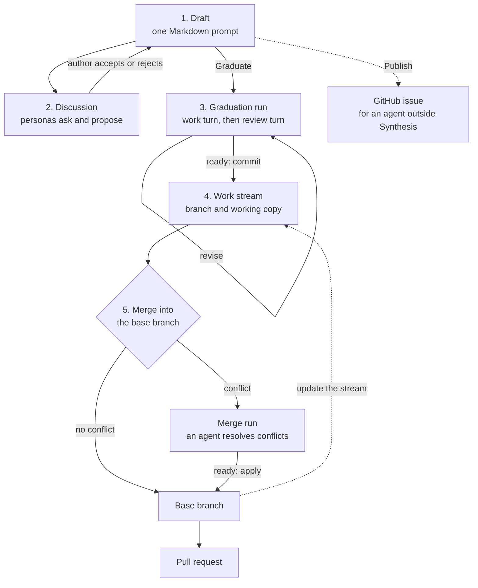
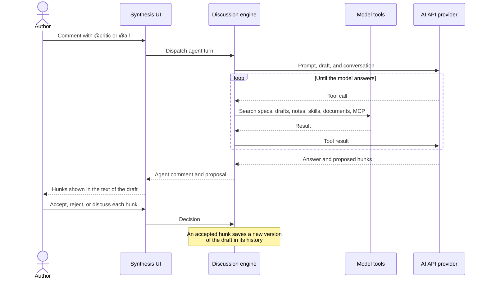
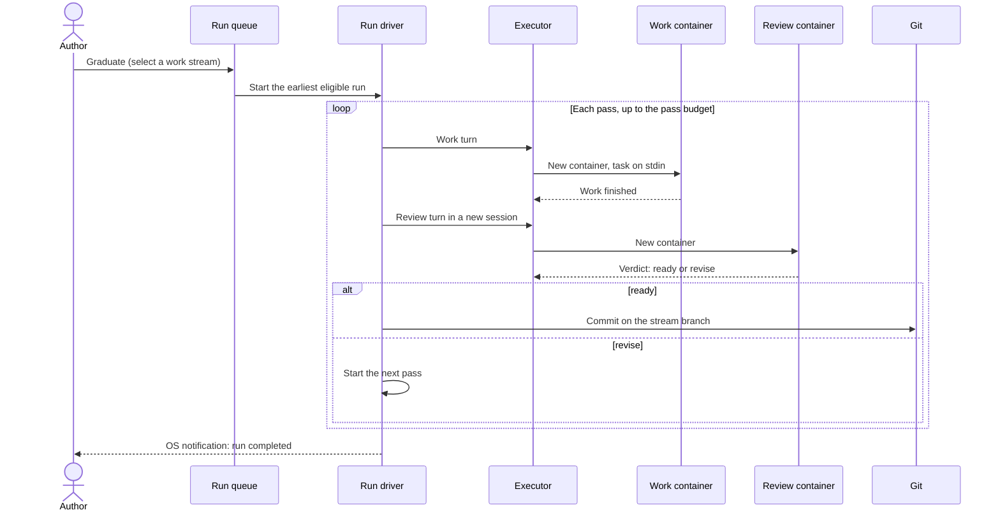
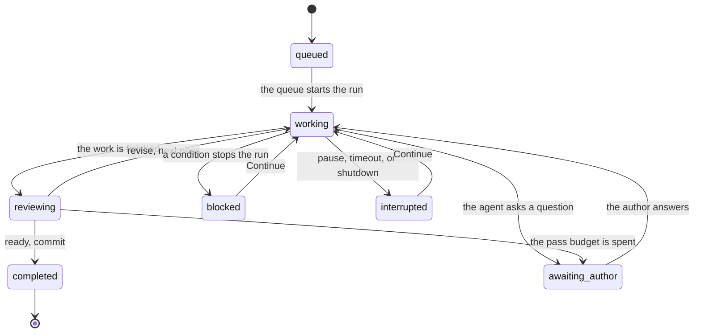
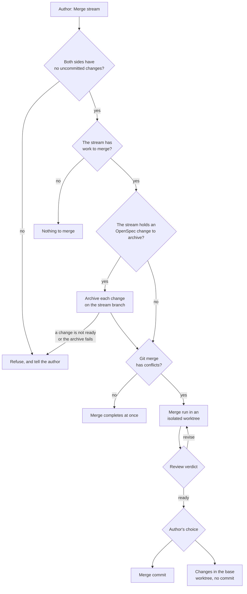
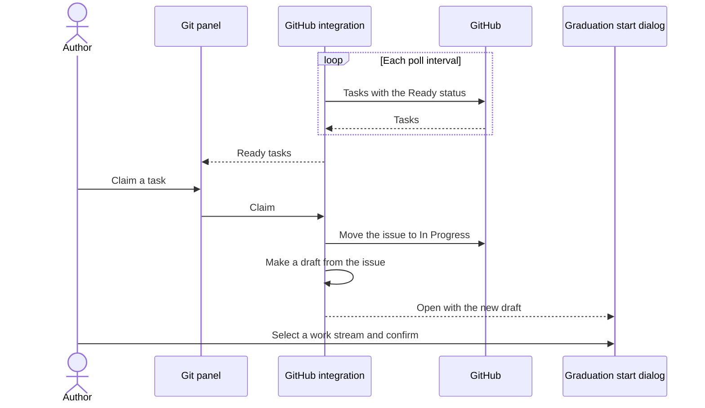
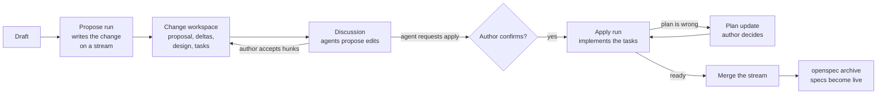
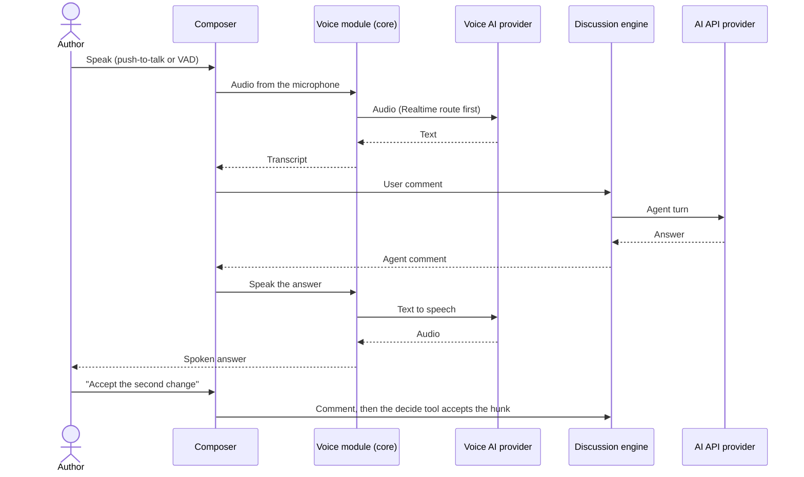

# Synthesis: High-Level Design

## Purpose and scope

This document gives the high-level design of Synthesis. It shows the business features of the product and the parts of the architecture that supply each feature.

| Item | Value |
| --- | --- |
| Audience | Product owners, architects, and new contributors. |
| Product version | 0.1.0, in early development. |
| Scope | The features on the `main` branch. |
| Out of scope | Planned features, build commands, and module internals. |

For the technical detail, read `docs/README.md`. For each rule of behavior, read the specification that this document names. The specifications in `specifications/` are the source of truth.

<!-- %% -->
## Product summary

Synthesis is a desktop IDE for software engineers who work with AI in a spec-driven way. The engineer writes a feature as a prompt. AI personas help to make the prompt correct. A coding agent does the work in an isolated environment. Then a second agent session reviews the result.

The product gives five main values:

| Value | How the architecture supplies it |
| --- | --- |
| **The author makes each decision.** | An agent only proposes. The author accepts or rejects each edit, each run, and each write to a main branch. |
| **The author selects the AI.** | The author selects the AI providers, the models, and the coding agent. Synthesis contains no model and sells no tokens. |
| **AI is isolated during the discussion.** | A discussion agent has no access to the source code, the raw files, or a shell. It uses only a small set of tools that the application supplies. |
| **Execution is unattended, but reviewed.** | Each turn runs in a new hardened Docker container, or as a new process in a Microsandbox microVM. A new agent session reviews the work before the application commits it. |
| **All work stays in Git.** | Drafts, notes, plans, and results are committed to the repository. The team gets them with a normal checkout. |

## Users and roles

| Role | Goal | Main surfaces |
| --- | --- | --- |
| **Author** (engineer) | Turns an idea into a correct prompt, and then into committed work. | New Artifact tab, discussions, Runs panel, Changes panel. |
| **Architect** | Plans the delivery, and keeps the specifications and the architecture complete. | Map tab, Flow canvas, CALM diagrams, Specification map. |
| **Reviewer** | Examines what an agent changed before the work reaches the base branch. | Diff viewer, run region, pull request window. |
| **Team member** | Shares drafts, notes, and plans, and picks up published work. | Git, GitHub issues, GitHub Projects. |

In this version, one author uses the application on one computer. Team work goes through Git and GitHub.

## Business capability map

| Capability | Customer value | Main architectural parts | Owner specifications |
| --- | --- | --- | --- |
| **Project workspace** | Open a repository, move between worktrees, and find each artifact by its type. | Project picker, worktree context, artifact scanning, Project panel, rich Markdown editor, tabs, Dashboard, universal search. | `PPK`, `WTC`, `ASC`, `LIB`, `EDT`, `TAB`, `DSH`, `SCH` |
| **Draft authoring with AI personas** | Make a prompt correct before any code exists. Agents ask questions and propose edits. The author decides each edit in the text. | Draft storage, discussions, agent registry, agent groups, conversation loop, change proposals, question sets, decomposition into new drafts, draft history, images, draft statistics. | `NAW`, `DRS`, `CMS`, `AGR`, `AGC`, `CVL`, `DCP`, `DCR`, `ADQ`, `PND`, `DHS`, `DAS`, `DSS` |
| **Knowledge grounding** | Agents answer from the decisions of the project and from current sources, not from memory. | BM25 indexes, optional embeddings, skills registry, Documents collection, notes, model tools, web search and fetch, MCP servers. | `BMI`, `EMB`, `DSL`, `DCL`, `NTC`, `TLC`, `WST`, `WFT`, `MCS` |
| **Voice mode** | Talk to agents and decide their proposals with no keyboard. | Voice AI providers with Realtime speech, the shared composer, decide tools. | `VOM`, `VOP`, `VAI`, `DDC` |
| **Graduation** | A finished prompt becomes committed and reviewed work, with no supervision. | Run queue and state machine, executor, agent CLI protocols, escalation to the author, observability, run logs, restart. | `GRD`, `GRL`, `GSU`, `GXD`, `EAC`, `ESU`, `GOB`, `GRS`, `GRU` |
| **Work streams and Git** | Many runs share one branch and do not diverge. The author updates, merges, and opens a pull request from the application. | Work streams, update and merge runs, Changes panel, commit, push, pull requests, main-branch guard, history viewer. | `WKS`, `GRB`, `CHC`, `CHG`, `GTC`, `GIT`, `CPR`, `MBW`, `HVW` |
| **Delivery planning** | See what the project delivers, in which order, how far each part is, and which tasks can conflict. | Map tab with the Delivery lens and the Specifications lens, Flow documents, GitHub delivery plan, overlap analysis, delivery links. | `SMP`, `MDL`, `DSR`, `FGV`, `FDL`, `GDP`, `FOA`, `SDL`, `FLO` |
| **GitHub collaboration** | Give work to agents outside the application, and take ready work in. | Issue publication from drafts and notes, polling of ready tasks, pull requests, token storage. | `GHP`, `NIP`, `GPP`, `CPR`, `GTS`, `GHA` |
| **OpenSpec mode** | Teams that use OpenSpec keep their own process, with the same discussion and run features. | OpenSpec seam, change workspace, change edit proposals, apply and rework runs, plan updates, archive at merge. | `OSM`, `OCW`, `CEP`, `OCR`, `OPU`, `OAR` |
| **Architecture and documents** | Keep the architecture as code next to the prose, and give documents to people who do not use the IDE. | CALM and Mermaid diagrams, Architecture artifact, PDF and DOCX export, PDF viewer. | `CAD`, `CLM`, `DXP`, `EXD`, `PDV` |
| **Trust and operations** | Secrets stay safe, agents stay inside their limits, and the author knows when work needs them. | Secret vault, filesystem access, container isolation, OS notifications, logs, progress reports. | `ASV`, `FSA`, `EAC`, `NTD`, `LGC`, `PRG` |
| **Remote access** (partial) | Reach a running IDE from a phone. | `synthesis-server`: application service, relay, WebSocket transport. | `BMS`, `SAS`, `SRB`, `RSN`, `WSK` |

<!-- %% -->
## Architecture overview

Synthesis is a Tauri 2 desktop application with two processes:

- The **Synthesis UI** (React 19, TypeScript) runs in the webview. It has no direct access to the disk, to Git, or to the network.
- The **Synthesis core** (Rust) does all the work. It reads and writes the repository, keeps the secrets, calls the AI providers, starts the agent containers, and calls GitHub.

The UI sends each request to the core as a command. The core sends updates back as events. Each external system is behind a trait in the core. Tests replace each external system with a fake. A new vendor needs only one new adapter.

### System context and deployment

The diagram shows where each part runs. Select the flow "Draft to committed work" in the diagram viewer to see the main path of value.

```calm
{
  "$schema": "https://calm.finos.org/release/1.3/meta/calm.json",
  "metadata": {
    "title": "Synthesis system context",
    "version": "0.1.0"
  },
  "nodes": [
    {
      "unique-id": "author",
      "node-type": "actor",
      "name": "Author",
      "description": "The engineer who writes the prompts and decides each proposal."
    },
    {
      "unique-id": "authors-computer",
      "node-type": "ecosystem",
      "name": "Author's computer",
      "description": "The machine that runs the desktop application."
    },
    {
      "unique-id": "synthesis-ui",
      "node-type": "webclient",
      "name": "Synthesis UI",
      "description": "React and TypeScript in the Tauri webview. It has no direct access to the disk or the network.",
      "metadata": {
        "customer-value": "One workspace for prompts, discussions, runs, plans, and Git."
      }
    },
    {
      "unique-id": "synthesis-core",
      "node-type": "service",
      "name": "Synthesis core",
      "description": "The Rust backend. It owns all files, Git, secrets, AI calls, and agent containers.",
      "metadata": {
        "customer-value": "One trusted place that enforces the limits of each agent."
      }
    },
    {
      "unique-id": "project-repository",
      "node-type": "data-asset",
      "name": "Project repository",
      "description": "The Git repository of the project, with its .synthesis folder of drafts, notes, and settings.",
      "metadata": {
        "customer-value": "The team shares all the work with a normal Git checkout."
      }
    },
    {
      "unique-id": "graduation-store",
      "node-type": "database",
      "name": "Graduation store",
      "description": "The run queues, run records, run logs, and stream worktrees in the ~/.synthesis folder."
    },
    {
      "unique-id": "os-keyring",
      "node-type": "database",
      "name": "OS keyring",
      "description": "One keyring entry that holds every secret of the application."
    },
    {
      "unique-id": "container-runtime",
      "node-type": "network",
      "name": "Container runtime",
      "description": "Docker, or a Microsandbox microVM, on the author's computer."
    },
    {
      "unique-id": "agent-container",
      "node-type": "service",
      "name": "Agent sandbox",
      "description": "A new hardened Docker container for each turn, or a process in the microVM of the queue. It runs Claude Code or Codex on the working copy of the run.",
      "metadata": {
        "customer-value": "Unattended work that cannot write outside its working copy."
      }
    },
    {
      "unique-id": "cloud-services",
      "node-type": "ecosystem",
      "name": "Cloud services",
      "description": "The services that the author selects and pays for."
    },
    {
      "unique-id": "ai-api-providers",
      "node-type": "system",
      "name": "AI API providers",
      "description": "OpenRouter, Anthropic, OpenAI, or a custom gateway. They answer the discussion turns."
    },
    {
      "unique-id": "agent-vendors",
      "node-type": "system",
      "name": "Agent vendor services",
      "description": "The services that Claude Code and Codex call from the container."
    },
    {
      "unique-id": "voice-providers",
      "node-type": "system",
      "name": "Voice AI providers",
      "description": "Speech-to-text and text-to-speech, Realtime first. A local server is also possible."
    },
    {
      "unique-id": "github",
      "node-type": "system",
      "name": "GitHub",
      "description": "Issues, GitHub Projects, pull requests, and Git over HTTPS."
    },
    {
      "unique-id": "mcp-servers",
      "node-type": "system",
      "name": "MCP servers",
      "description": "Local or remote tools of the team, for example a tracker or a database."
    },
    {
      "unique-id": "synthesis-server",
      "node-type": "service",
      "name": "synthesis-server",
      "description": "An optional service for remote access. In this version the desktop application only checks its health."
    }
  ],
  "relationships": [
    {
      "unique-id": "local-parts",
      "description": "Runs on",
      "relationship-type": {
        "deployed-in": {
          "container": "authors-computer",
          "nodes": ["synthesis-ui", "synthesis-core", "project-repository", "graduation-store", "os-keyring", "container-runtime"]
        }
      }
    },
    {
      "unique-id": "agent-in-runtime",
      "description": "Runs in",
      "relationship-type": {
        "deployed-in": {
          "container": "container-runtime",
          "nodes": ["agent-container"]
        }
      }
    },
    {
      "unique-id": "remote-parts",
      "description": "Hosted by vendors",
      "relationship-type": {
        "deployed-in": {
          "container": "cloud-services",
          "nodes": ["ai-api-providers", "agent-vendors", "voice-providers", "github"]
        }
      }
    },
    {
      "unique-id": "author-uses-ui",
      "description": "Writes, discusses, and decides",
      "relationship-type": {
        "interacts": { "actor": "author", "nodes": ["synthesis-ui"] }
      }
    },
    {
      "unique-id": "ui-to-core",
      "description": "Commands and events over Tauri IPC",
      "relationship-type": {
        "connects": { "source": { "node": "synthesis-ui" }, "destination": { "node": "synthesis-core" } }
      }
    },
    {
      "unique-id": "core-to-repository",
      "description": "Files through FsAccess, Git through libgit2",
      "relationship-type": {
        "connects": { "source": { "node": "synthesis-core" }, "destination": { "node": "project-repository" } }
      }
    },
    {
      "unique-id": "core-to-store",
      "description": "Keeps runs and stream worktrees",
      "relationship-type": {
        "connects": { "source": { "node": "synthesis-core" }, "destination": { "node": "graduation-store" } }
      }
    },
    {
      "unique-id": "core-to-keyring",
      "description": "Reads and writes secrets",
      "relationship-type": {
        "connects": { "source": { "node": "synthesis-core" }, "destination": { "node": "os-keyring" } }
      }
    },
    {
      "unique-id": "core-to-container",
      "description": "Starts one container for each turn",
      "protocol": "HTTP",
      "relationship-type": {
        "connects": { "source": { "node": "synthesis-core" }, "destination": { "node": "agent-container" } }
      }
    },
    {
      "unique-id": "container-to-vendors",
      "description": "Model calls of the agent CLI",
      "protocol": "HTTPS",
      "relationship-type": {
        "connects": { "source": { "node": "agent-container" }, "destination": { "node": "agent-vendors" } }
      }
    },
    {
      "unique-id": "core-to-ai-api",
      "description": "Discussion turns",
      "protocol": "HTTPS",
      "relationship-type": {
        "connects": { "source": { "node": "synthesis-core" }, "destination": { "node": "ai-api-providers" } }
      }
    },
    {
      "unique-id": "core-to-voice",
      "description": "Speech in and speech out",
      "protocol": "WebSocket",
      "relationship-type": {
        "connects": { "source": { "node": "synthesis-core" }, "destination": { "node": "voice-providers" } }
      }
    },
    {
      "unique-id": "core-to-github",
      "description": "Issues, plans, pull requests, push",
      "protocol": "HTTPS",
      "relationship-type": {
        "connects": { "source": { "node": "synthesis-core" }, "destination": { "node": "github" } }
      }
    },
    {
      "unique-id": "core-to-mcp",
      "description": "Tools for discussion agents",
      "relationship-type": {
        "connects": { "source": { "node": "synthesis-core" }, "destination": { "node": "mcp-servers" } }
      }
    },
    {
      "unique-id": "core-to-server",
      "description": "Health check",
      "protocol": "HTTPS",
      "relationship-type": {
        "connects": { "source": { "node": "synthesis-core" }, "destination": { "node": "synthesis-server" } }
      }
    }
  ],
  "flows": [
    {
      "unique-id": "draft-to-committed-work",
      "name": "Draft to committed work",
      "description": "The author refines a prompt with AI, and an agent turns it into a reviewed commit.",
      "transitions": [
        { "relationship-unique-id": "author-uses-ui", "sequence-number": 1, "description": "The author writes a draft and asks an agent persona." },
        { "relationship-unique-id": "ui-to-core", "sequence-number": 2, "description": "The UI sends the comment to the core." },
        { "relationship-unique-id": "core-to-ai-api", "sequence-number": 3, "description": "The persona answers and proposes edits." },
        { "relationship-unique-id": "core-to-repository", "sequence-number": 4, "description": "The author accepts edits, and the core saves the draft." },
        { "relationship-unique-id": "core-to-store", "sequence-number": 5, "description": "The author graduates the draft, and the core queues a run." },
        { "relationship-unique-id": "core-to-container", "sequence-number": 6, "description": "The core starts the work turn and then the review turn." },
        { "relationship-unique-id": "container-to-vendors", "sequence-number": 7, "description": "The agent does the work with its own model." },
        { "relationship-unique-id": "core-to-repository", "sequence-number": 8, "description": "After a ready review, the core commits on the stream branch." },
        { "relationship-unique-id": "core-to-github", "sequence-number": 9, "description": "The author pushes and opens a pull request." }
      ]
    }
  ]
}
```

### Capability components

The diagram shows the capability areas inside the desktop application. Each area is a group of backend modules. The UI has one surface set for each area. Select the flow "Discuss a draft with an agent" to see how the areas work together.

```calm
{
  "$schema": "https://calm.finos.org/release/1.3/meta/calm.json",
  "metadata": {
    "title": "Synthesis capability components",
    "version": "0.1.0"
  },
  "nodes": [
    {
      "unique-id": "author",
      "node-type": "actor",
      "name": "Author",
      "description": "The engineer who uses the application."
    },
    {
      "unique-id": "frontend",
      "node-type": "system",
      "name": "Synthesis UI",
      "description": "The surfaces of the main window and of the Settings window."
    },
    {
      "unique-id": "workspace-surfaces",
      "node-type": "webclient",
      "name": "Workspace surfaces",
      "description": "Editor, New Artifact tab, discussions, Map tab, Runs panel, Changes panel, Git panel."
    },
    {
      "unique-id": "backend",
      "node-type": "system",
      "name": "Synthesis core",
      "description": "The Rust crate synthesis_lib."
    },
    {
      "unique-id": "authoring",
      "node-type": "service",
      "name": "Authoring",
      "description": "Drafts, artifacts, notes, comments, proposals, version history, and statistics.",
      "metadata": { "customer-value": "Prompts that the author refines safely and can compare with earlier versions." }
    },
    {
      "unique-id": "discussion-engine",
      "node-type": "service",
      "name": "Discussion engine",
      "description": "Agent personas, agent groups, the conversation loop, and the model tools.",
      "metadata": { "customer-value": "AI collaborators that ask, advise, and propose, but never decide." }
    },
    {
      "unique-id": "knowledge",
      "node-type": "service",
      "name": "Knowledge indexes",
      "description": "BM25 indexes, optional embeddings, skills, the Documents collection, and MCP connections.",
      "metadata": { "customer-value": "Answers that use the decisions of the project." }
    },
    {
      "unique-id": "voice",
      "node-type": "service",
      "name": "Voice",
      "description": "Speech-to-text and text-to-speech for discussions."
    },
    {
      "unique-id": "graduation-engine",
      "node-type": "service",
      "name": "Graduation engine",
      "description": "The run queue, the state machine, the executor, escalation, and run logs.",
      "metadata": { "customer-value": "Reviewed work with no supervision, which survives a restart." }
    },
    {
      "unique-id": "streams-git",
      "node-type": "service",
      "name": "Work streams and Git",
      "description": "Streams, update and merge runs, changes, commits, push, and history."
    },
    {
      "unique-id": "delivery",
      "node-type": "service",
      "name": "Delivery planning",
      "description": "Flow documents, the GitHub delivery plan, overlap analysis, and the specification index."
    },
    {
      "unique-id": "github-integration",
      "node-type": "service",
      "name": "GitHub integration",
      "description": "Issue publication, ready tasks, pull requests, and tokens."
    },
    {
      "unique-id": "openspec",
      "node-type": "service",
      "name": "OpenSpec mode",
      "description": "The OpenSpec CLI seam, change runs, plan updates, and archive."
    },
    {
      "unique-id": "foundation",
      "node-type": "service",
      "name": "Security foundation",
      "description": "FsAccess, the secret vault, logging, progress, and notifications."
    },
    {
      "unique-id": "repository",
      "node-type": "data-asset",
      "name": "Project repository",
      "description": "The files and the .synthesis folder of the project."
    },
    {
      "unique-id": "ai-provider",
      "node-type": "system",
      "name": "AI API provider",
      "description": "The provider that the project uses for discussions."
    }
  ],
  "relationships": [
    {
      "unique-id": "frontend-parts",
      "description": "Contains",
      "relationship-type": {
        "composed-of": { "container": "frontend", "nodes": ["workspace-surfaces"] }
      }
    },
    {
      "unique-id": "backend-parts",
      "description": "Contains",
      "relationship-type": {
        "composed-of": {
          "container": "backend",
          "nodes": ["authoring", "discussion-engine", "knowledge", "voice", "graduation-engine", "streams-git", "delivery", "github-integration", "openspec", "foundation"]
        }
      }
    },
    {
      "unique-id": "author-uses-surfaces",
      "description": "Works in",
      "relationship-type": {
        "interacts": { "actor": "author", "nodes": ["workspace-surfaces"] }
      }
    },
    {
      "unique-id": "surfaces-to-authoring",
      "description": "Comments and decisions",
      "relationship-type": {
        "connects": { "source": { "node": "workspace-surfaces" }, "destination": { "node": "authoring" } }
      }
    },
    {
      "unique-id": "authoring-to-discussion",
      "description": "Starts an agent turn",
      "relationship-type": {
        "connects": { "source": { "node": "authoring" }, "destination": { "node": "discussion-engine" } }
      }
    },
    {
      "unique-id": "discussion-to-knowledge",
      "description": "Searches and reads",
      "relationship-type": {
        "connects": { "source": { "node": "discussion-engine" }, "destination": { "node": "knowledge" } }
      }
    },
    {
      "unique-id": "discussion-to-provider",
      "description": "Model calls",
      "protocol": "HTTPS",
      "relationship-type": {
        "connects": { "source": { "node": "discussion-engine" }, "destination": { "node": "ai-provider" } }
      }
    },
    {
      "unique-id": "voice-to-discussion",
      "description": "Speech as comments",
      "relationship-type": {
        "connects": { "source": { "node": "voice" }, "destination": { "node": "discussion-engine" } }
      }
    },
    {
      "unique-id": "authoring-to-graduation",
      "description": "Graduates a draft",
      "relationship-type": {
        "connects": { "source": { "node": "authoring" }, "destination": { "node": "graduation-engine" } }
      }
    },
    {
      "unique-id": "graduation-to-streams",
      "description": "Commits results",
      "relationship-type": {
        "connects": { "source": { "node": "graduation-engine" }, "destination": { "node": "streams-git" } }
      }
    },
    {
      "unique-id": "openspec-to-graduation",
      "description": "Apply and rework runs",
      "relationship-type": {
        "connects": { "source": { "node": "openspec" }, "destination": { "node": "graduation-engine" } }
      }
    },
    {
      "unique-id": "delivery-to-authoring",
      "description": "Links tasks to drafts",
      "relationship-type": {
        "connects": { "source": { "node": "delivery" }, "destination": { "node": "authoring" } }
      }
    },
    {
      "unique-id": "github-to-delivery",
      "description": "Plan and ready tasks",
      "relationship-type": {
        "connects": { "source": { "node": "github-integration" }, "destination": { "node": "delivery" } }
      }
    },
    {
      "unique-id": "streams-to-github",
      "description": "Push and pull requests",
      "relationship-type": {
        "connects": { "source": { "node": "streams-git" }, "destination": { "node": "github-integration" } }
      }
    },
    {
      "unique-id": "foundation-to-repository",
      "description": "All disk access",
      "relationship-type": {
        "connects": { "source": { "node": "foundation" }, "destination": { "node": "repository" } }
      }
    },
    {
      "unique-id": "authoring-to-foundation",
      "description": "Saves drafts and proposals",
      "relationship-type": {
        "connects": { "source": { "node": "authoring" }, "destination": { "node": "foundation" } }
      }
    }
  ],
  "flows": [
    {
      "unique-id": "discuss-a-draft",
      "name": "Discuss a draft with an agent",
      "description": "The author asks a persona about a draft, and accepts the edits that the persona proposes.",
      "transitions": [
        { "relationship-unique-id": "author-uses-surfaces", "sequence-number": 1, "description": "The author types @critic in a comment." },
        { "relationship-unique-id": "surfaces-to-authoring", "sequence-number": 2, "description": "The comment is added to the discussion." },
        { "relationship-unique-id": "authoring-to-discussion", "sequence-number": 3, "description": "The discussion engine starts a turn for the persona." },
        { "relationship-unique-id": "discussion-to-knowledge", "sequence-number": 4, "description": "The persona searches the specifications and skills." },
        { "relationship-unique-id": "discussion-to-provider", "sequence-number": 5, "description": "The model writes the answer and a proposal." },
        { "relationship-unique-id": "authoring-to-discussion", "sequence-number": 6, "description": "The proposal returns to the draft.", "direction": "destination-to-source" },
        { "relationship-unique-id": "authoring-to-foundation", "sequence-number": 7, "description": "The author accepts a hunk, and the draft and its history are saved." }
      ]
    }
  ]
}
```

<!-- %% -->
## Key business flows

### Development lifecycle

**Value:** one path from an idea to a pull request. Each stage keeps its data. The author can stop and continue later.



### Discuss a draft with an agent

**Value:** the prompt improves before any code exists. The agent cannot change the prompt. Only the author can accept a change.



An agent can also ask a set of multiple-choice questions, or propose to split a large draft into new drafts. The author answers each question and accepts each new draft.

### Graduate a draft

**Value:** the work happens with no supervision, but a second agent session checks it before the commit.



If an agent needs an answer, the run stops in `awaiting_author`. It keeps its checkpoint. The author answers in the run region, and the run continues.

### States of a graduation run

**Value:** the author always knows if a run works, waits, or needs them.



The diagram is simplified. A stopped run keeps its place in the queue. When it continues, it starts again at once from its checkpoint, in the phase where it stopped. The author can discard a run in each state except `completed` and `discarded`. A merge run, a pull run, or a PR summary run can also end in `failed`.

### Merge a work stream

**Value:** Git settles the simple merges at once. An agent settles only the conflicts, and a review checks its result.



### Claim a ready GitHub task

**Value:** the team plans in GitHub, and the author takes ready work into the same graduation path.



### Build an OpenSpec change

**Value:** a team that uses OpenSpec keeps its files and commands. It also gets AI discussion, reviewed runs, and the archive at merge.



### Talk to an agent by voice

**Value:** the author speaks and decides on proposals with no keyboard. Voice adds no new conversation surface. Each speech is a normal comment.



<!-- %% -->
## Data ownership

| Data | Location | Shared with the team | Customer value |
| --- | --- | --- | --- |
| Drafts: prompt, images, record | `.synthesis/drafts/` in the repository | Yes, through Git | A teammate opens the same drafts. |
| Notes | `.synthesis/notes/` | Yes | Small follow-ups travel with the code. |
| Project settings, agent images, team MCP servers | `.synthesis/project.toml` | Yes | Each contributor runs agents in the same image. |
| Artifact type overrides | `.synthesis/library.toml` | Yes | The team sees the same artifact types. |
| Delivery plan | A GitHub Project, or a Flow file in the repository | Yes | The plan has one source. The plan has no merge conflicts. |
| Draft history, proposals, conversation logs, statistics | Repository store in the application data folder, and ignored paths in `.synthesis/` | No | Work in progress stays private until the author commits it. |
| Plan layout and GitHub plan overlay | Repository store | No | Each person arranges the canvas in their own way. |
| Embeddings | SQLite store in the repository store | No | Better search, with no change to the repository. |
| Global settings, Personal agents, AI providers | `synthesis.toml` in the application data folder | No | One configuration for all projects of the author. |
| Graduation store: queues, runs, logs, stream worktrees | `~/.synthesis/` | No | Runs survive a restart of the application. |
| Secrets: tokens and API keys | One OS keyring entry | No | The OS asks for authentication one time. The application stores no secret in a file. |

<!-- %% -->
## External integrations

| System | Purpose | Required | Customer value |
| --- | --- | --- | --- |
| AI API provider (OpenRouter, Anthropic, OpenAI, custom gateway) | Discussion turns of the personas. | For discussions | The author selects the model and pays the vendor directly. |
| Coding agent CLI (Claude Code, Codex) | Work, review, and merge turns. | For graduation | The author uses the subscription that they already have. |
| Docker or Microsandbox | An isolated container or microVM for each run. | For graduation | The agent cannot change the host. |
| Git and GitHub | Push, pull requests, issues, GitHub Projects. | Optional | Team work and code review in the tools the team already uses. |
| Voice AI provider (Realtime or HTTP, cloud or local) | Speech-to-text and text-to-speech. | Optional | Work with no keyboard. |
| MCP servers | Extra tools for discussion agents. | Optional | Agents reach the tracker, the database, or the docs of the team. |
| OpenSpec CLI | Read and validate OpenSpec specs and changes. | Optional | OpenSpec teams keep their process. |
| `synthesis-server` | Relay and application service for remote clients. | Optional | Remote access from a phone (not complete). |

<!-- %% -->
## Quality attributes

| Attribute | Design decision | Customer value |
| --- | --- | --- |
| **Author control** | Agents propose, the author decides. A run is queued only after the author confirms the start dialog. A write to a main branch asks once for each branch and session. | No change reaches the code without the approval of the author. |
| **Privacy** | The UI has no direct disk or network access. A discussion agent has no source code access. Logs hold no user content and no secrets. | The author decides what leaves the computer. |
| **Isolation** | With Docker, each turn runs in a new container with `--cap-drop ALL` and `no-new-privileges`, as the host user. With Microsandbox, the turns of a queue run in one microVM. Git metadata is mounted read-only. The host makes all commits. `FsAccess` refuses each path outside its allowed roots. | An agent cannot write outside its working copy. |
| **Durability** | The run state, the checkpoint, and the escalation questions are on disk. A stopped run continues from its checkpoint. | A restart or a long question loses no work. |
| **Transparency** | Agent activity streams, run logs for each pass, observability records, and cost statistics for each draft and change. | The author sees what an agent did and what it cost. |
| **Offline work** | BM25 indexes, CALM diagrams, and the GitHub plan cache work with no network. | The author can read and plan with no network. |
| **Vendor neutrality** | Each AI provider, agent CLI, voice provider, and tracker is behind one adapter. | The author can change a vendor with no change to the workflow. |
| **Traceability** | Each requirement has an identifier. Code comments and test names cite it. A check in CI finds each broken citation. | Each behavior has a written reason. |
| **Testability** | Each external system is behind a trait. A mock agent CLI plays recorded scenarios. | Tests use a mock agent CLI, so they spend no real tokens. |

<!-- %% -->
## Current limits

- One author on one computer. There are no signed builds and no published releases.
- The supported hosts are macOS, Linux, and Windows. You build the application from source.
- **Open from a Git URL** does not clone the repository.
- An API agent integration cannot do graduation work. Only Claude Code and Codex can.
- Remote sessions are not complete. The desktop application only checks the health of the server, and the server keeps all records in memory.
- The reference agent images are not published.
- Microsandbox isolation is not available on all platforms.
- The webview has no content security policy.

<!-- %% -->
## Glossary

| Term | Meaning |
| --- | --- |
| Artifact | A file with a type: Skill, Agent, Prompt, Spec, Flow, Architecture, Instructions, Scenario, Scratchpad, or Document. |
| Draft | One Markdown prompt that the author develops before the work exists. |
| Discussion | One conversation about a passage, a file, a draft, or a note. |
| Agent persona | An AI agent with a nickname, a title, a model, and optional instructions. A Project agent is shared. A Personal agent is private. |
| Proposal | Edits that an agent proposes. The author accepts or rejects each hunk. |
| Graduation run | The queued job that turns a draft into committed work. |
| Pass | One work turn and one review turn of a run. |
| Work stream | A branch and working copy that the application owns and that many runs share. |
| Merge run | A run that resolves the conflicts of a stream merge. |
| Flow | A delivery plan: milestones, epics, features, tasks, defects, and the edges between them. |
| Delivery source | The one system that holds the plan: a GitHub Project or a Flow file. |
| OpenSpec change | A planned change in `openspec/changes/<name>/`: proposal, deltas, design, and tasks. |
| CALM | FINOS Common Architecture Language Model. An architecture as JSON, which Synthesis shows as a diagram. |

<!-- %% -->
## References

- `README.md`: the product and the development lifecycle.
- `docs/README.md`: the technical architecture, persistence, and security boundaries.
- `docs/development.md`: the build, test, and check commands.
- `server/README.md`: the server.
- `specifications/`: the source of truth for all behavior.