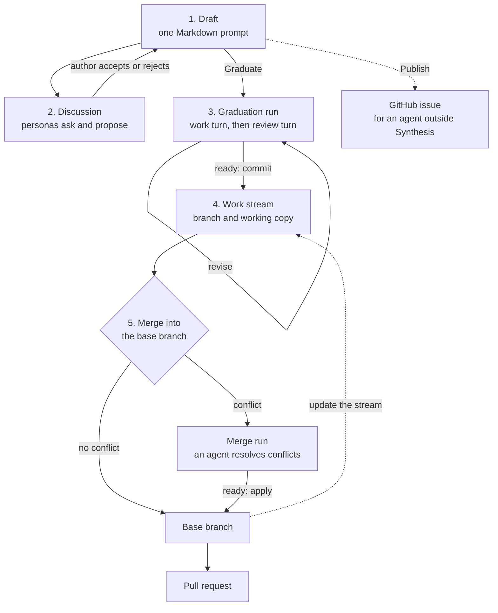
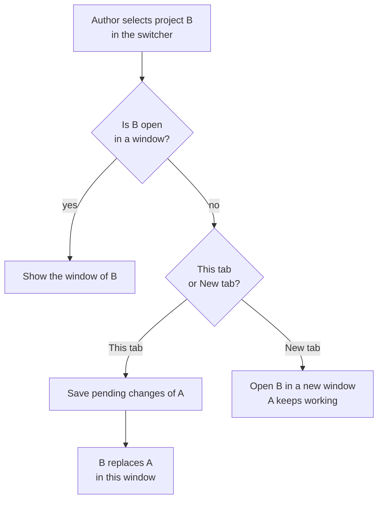
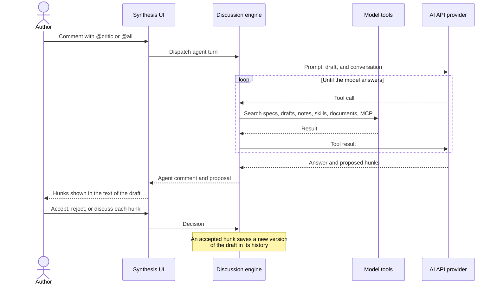
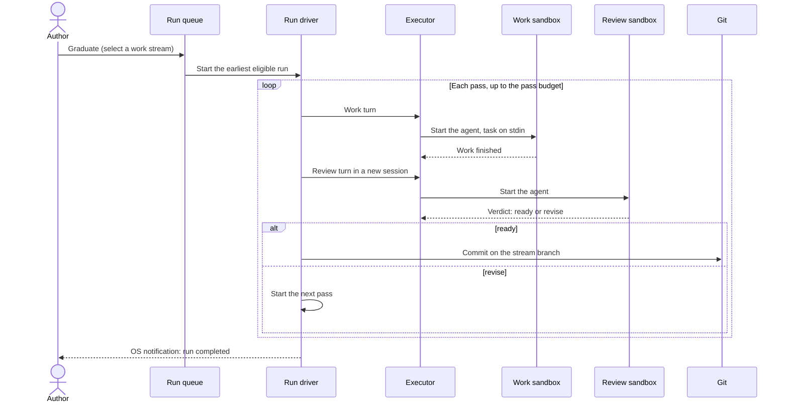
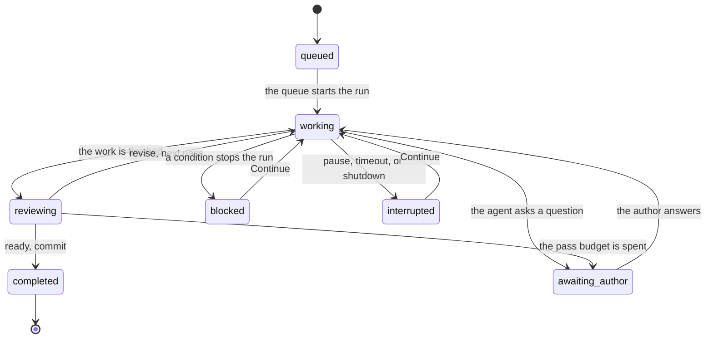
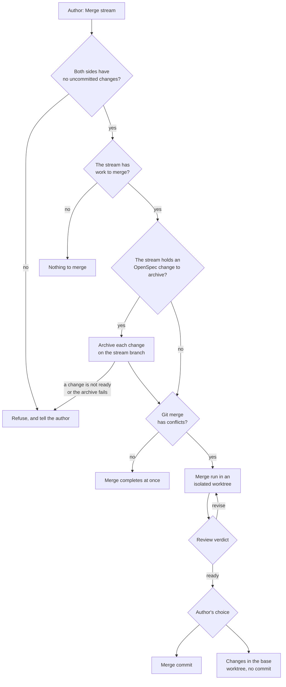
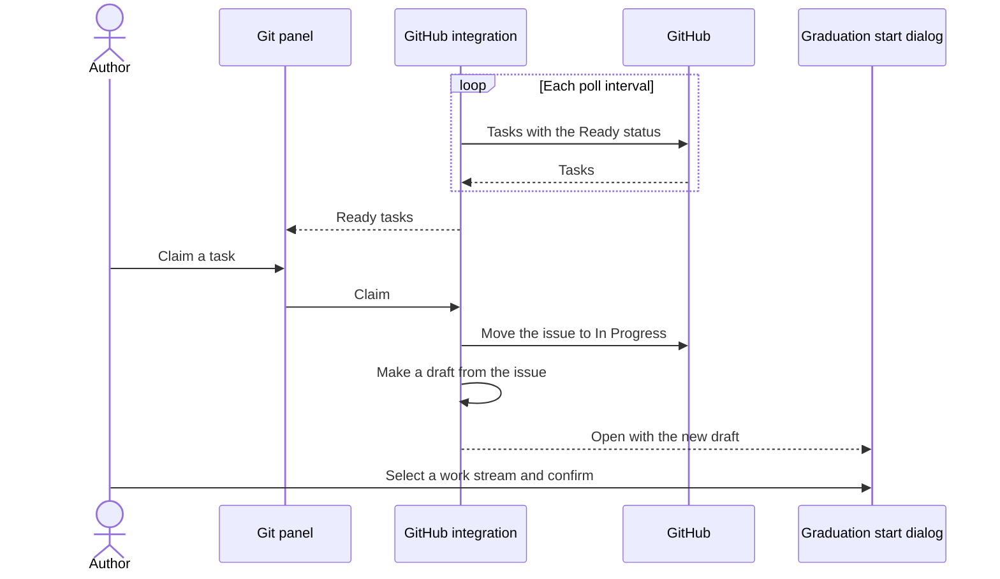
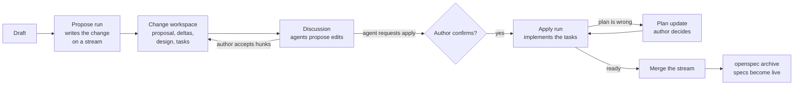
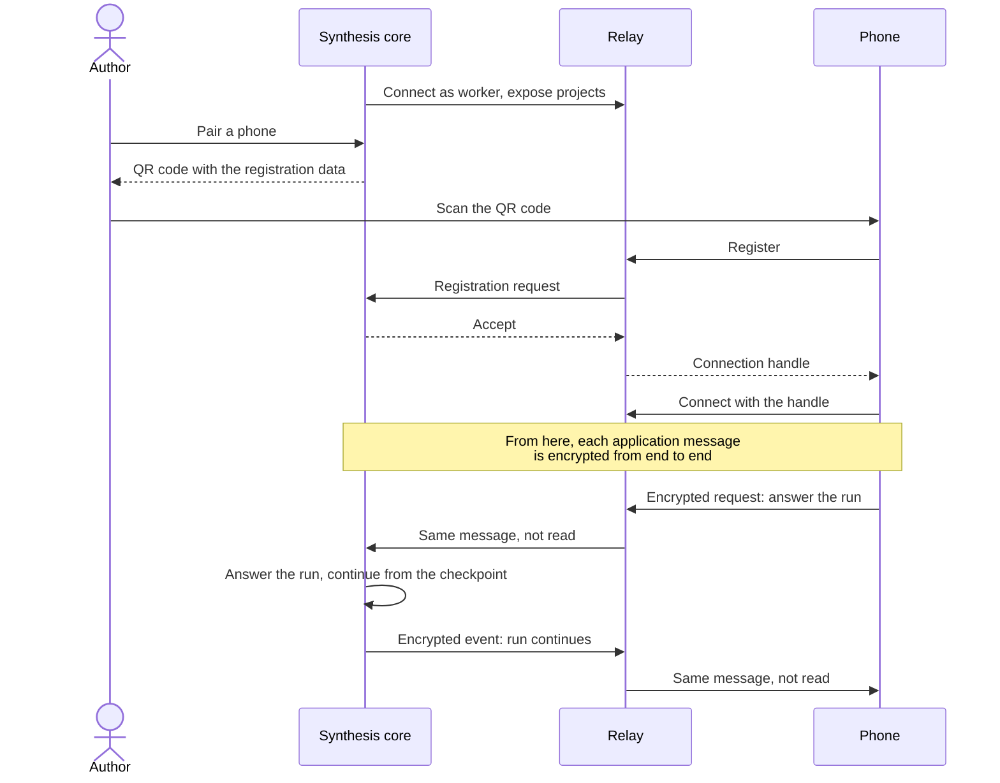
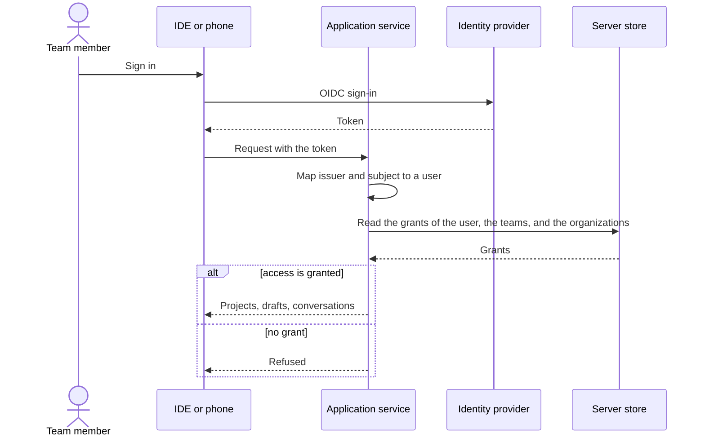

# Synthesis: High-Level Design

This document is the north star of Synthesis. It states what the product must do, why each feature has value for the customer, and which parts of the architecture supply it. It holds the features that exist and the features that are planned.

The document is describes the target state from high-level perspective.

<!-- %%% -->
## Vision

An engineer turns an idea into reviewed, committed work with AI, and stays the person who makes each decision. The engineer can do this at the desk, in several projects at the same time, or from a phone. A team shares one view of the projects, the plans, and the access rules.

The product follows these principles:

- **The author makes each decision.** An agent only asks and proposes. The author accepts or rejects each edit, each run, and each write to a main branch.
- **The author selects the AI.** The author selects the AI providers, the models, and the coding agent. Synthesis contains no model and sells no tokens.
- **AI is isolated during the discussion.** A discussion agent has no access to the source code, the raw files, or a shell. It uses only the tools that the application supplies.
- **Execution is unattended, but reviewed.** A coding agent works in an isolated sandbox. A second agent session reviews the work before the application commits it.
- **All work stays in Git.** Drafts, notes, plans, and results are committed to the repository. The team gets them with a normal checkout.
- **The work continues when the author is away.** The author sees and controls the work of the IDE from a phone. The relay that carries this traffic cannot read it.

<!-- %%% -->
## Users and roles

- **Author.** An engineer who turns an idea into a correct prompt, and then into committed work. The author works in the New Artifact tab, the discussions, the Runs panel, and the Changes panel.
- **Architect.** Plans the delivery, and keeps the specifications and the architecture complete. The architect works in the Map tab, the Flow canvas, and the CALM diagrams.
- **Reviewer.** Examines what an agent changed before the work reaches the base branch. The reviewer uses the Diff viewer, the run region, and the pull request window.
- **Remote author** (target). The author away from the desk. The remote author follows the work, answers agents, and starts graduations from a phone.
- **Team member** (target). A person in a team or an organization on the team server. A team member gets access to a project through a grant to them, to their team, or to their organization.
- **Team administrator** (target). Manages the teams, the organizations, the invitations, and the access to projects.

Today one author uses the application on one computer. Team work goes through Git and GitHub.

<!-- %%% -->
## Architecture

### Components

Synthesis has three main parts:

- **The desktop application.** A Tauri 2 application with two processes. The **Synthesis UI** (React 19, TypeScript) runs in the webview. It has no direct access to the disk, to Git, or to the network. The **Synthesis core** (Rust) does all the work: files, Git, secrets, AI calls, agent sandboxes, and GitHub. The UI sends each request to the core as a command, and the core sends updates back as events.
- **The agent sandbox.** A Docker container, or a Microsandbox microVM, on the computer of the author or remotely. A coding agent CLI runs in it and can write only to the working copy of its run.
- **The Synthesis server** (partial). A Rust service in a Linux container image. It has two halves. The **relay** connects IDE workers and remote clients, and routes encrypted traffic that it cannot read. The **application service** owns identity, teams, organizations, project access, and the project data that a remote client reads.

### Architecture principles

These decisions stay true in the target state:

- The core owns all disk, network, and process access. The UI and the remote clients only send requests to it.
- All disk access of the core goes through `FsAccess`. It refuses each path outside its allowed roots.
- All secrets are in one entry of the OS keyring. No secret goes to a file, a log, or the UI.
- Each external system is behind a trait in the core. Tests replace it with a fake. A new vendor needs only one new adapter.
- Git is the store of all shared work. The application commits drafts, notes, and results to the repository.
- Each remote message is encrypted from end to end. The relay reads only the routing data.
- The server uses a hexagonal design. A durable store replaces the memory store with no change to the API.
- Each requirement in `specifications/` has an identifier. Code and tests cite it, and a check in CI finds each broken citation.

### System context

The diagram shows the target state. 

```calm
{
  "$schema": "https://calm.finos.org/release/1.3/meta/calm.json",
  "metadata": {
    "title": "Synthesis system context, target state",
    "version": "0.1.0"
  },
  "nodes": [
    {
      "unique-id": "author",
      "node-type": "actor",
      "name": "Author",
      "description": "The engineer who writes the prompts and decides each proposal, at the desk or on a phone."
    },
    {
      "unique-id": "team-member",
      "node-type": "actor",
      "name": "Team member",
      "description": "A person who gets access to a project through the team server."
    },
    {
      "unique-id": "authors-computer",
      "node-type": "ecosystem",
      "name": "Author's computer",
      "description": "The machine that runs the desktop application."
    },
    {
      "unique-id": "synthesis-ui",
      "node-type": "webclient",
      "name": "Synthesis UI",
      "description": "React and TypeScript in the Tauri webview. One OS window for each open project.",
      "metadata": { "status": "partial", "customer-value": "One workspace for prompts, discussions, runs, plans, and Git." }
    },
    {
      "unique-id": "synthesis-core",
      "node-type": "service",
      "name": "Synthesis core",
      "description": "The Rust backend. It owns all files, Git, secrets, AI calls, and agent sandboxes. It is also the relay worker of the IDE.",
      "metadata": { "status": "partial", "customer-value": "One trusted place that enforces the limits of each agent." }
    },
    {
      "unique-id": "project-repository",
      "node-type": "data-asset",
      "name": "Project repository",
      "description": "The Git repository of the project, with its .synthesis folder of drafts, notes, and settings.",
      "metadata": { "status": "delivered" }
    },
    {
      "unique-id": "graduation-store",
      "node-type": "database",
      "name": "Graduation store",
      "description": "The run queues, run records, run logs, and stream worktrees in the ~/.synthesis folder.",
      "metadata": { "status": "delivered" }
    },
    {
      "unique-id": "os-keyring",
      "node-type": "database",
      "name": "OS keyring",
      "description": "One keyring entry that holds every secret of the application.",
      "metadata": { "status": "delivered" }
    },
    {
      "unique-id": "container-runtime",
      "node-type": "network",
      "name": "Sandbox runtime",
      "description": "Docker, or a Microsandbox microVM, on the computer of the author."
    },
    {
      "unique-id": "agent-sandbox",
      "node-type": "service",
      "name": "Agent sandbox",
      "description": "A hardened Docker container for each turn, or a process in the microVM of the queue. It runs Claude Code or Codex on the working copy of the run.",
      "metadata": { "status": "delivered", "customer-value": "Unattended work that cannot write outside its working copy." }
    },
    {
      "unique-id": "phone",
      "node-type": "webclient",
      "name": "Remote client",
      "description": "The app on the phone of the author. It pairs with one IDE by a QR code.",
      "metadata": { "status": "planned", "customer-value": "The author follows and controls the work when away from the desk." }
    },
    {
      "unique-id": "server-host",
      "node-type": "network",
      "name": "Server host",
      "description": "The container platform where the team runs the Synthesis server."
    },
    {
      "unique-id": "synthesis-server",
      "node-type": "system",
      "name": "Synthesis server",
      "description": "One Rust service with two halves: the relay and the application service.",
      "metadata": { "status": "partial" }
    },
    {
      "unique-id": "relay",
      "node-type": "service",
      "name": "Relay",
      "description": "Connects IDE workers and remote clients. It routes encrypted messages and cannot read them.",
      "metadata": { "status": "partial" }
    },
    {
      "unique-id": "application-service",
      "node-type": "service",
      "name": "Application service",
      "description": "Users, teams, organizations, invitations, devices, project access, drafts, and conversations.",
      "metadata": { "status": "partial", "customer-value": "One access model for each project, team, and device." }
    },
    {
      "unique-id": "server-store",
      "node-type": "database",
      "name": "Server store",
      "description": "The durable store of the application service. Today the records are in memory.",
      "metadata": { "status": "planned" }
    },
    {
      "unique-id": "identity-provider",
      "node-type": "system",
      "name": "Identity provider",
      "description": "The OIDC provider of the team.",
      "metadata": { "status": "planned" }
    },
    {
      "unique-id": "cloud-services",
      "node-type": "ecosystem",
      "name": "Cloud services",
      "description": "The services that the author selects and pays for."
    },
    {
      "unique-id": "ai-api-providers",
      "node-type": "system",
      "name": "AI API providers",
      "description": "OpenRouter, Anthropic, OpenAI, or a custom gateway. They answer the discussion turns.",
      "metadata": { "status": "delivered" }
    },
    {
      "unique-id": "agent-vendors",
      "node-type": "system",
      "name": "Agent vendor services",
      "description": "The services that Claude Code and Codex call from the sandbox.",
      "metadata": { "status": "delivered" }
    },
    {
      "unique-id": "voice-providers",
      "node-type": "system",
      "name": "Voice AI providers",
      "description": "Speech-to-text and text-to-speech, Realtime first. A local server is also possible.",
      "metadata": { "status": "delivered" }
    },
    {
      "unique-id": "github",
      "node-type": "system",
      "name": "GitHub",
      "description": "Issues, GitHub Projects, pull requests, and Git over HTTPS.",
      "metadata": { "status": "delivered" }
    },
    {
      "unique-id": "mcp-servers",
      "node-type": "system",
      "name": "MCP servers",
      "description": "Local or remote tools of the team, for example a tracker or a database.",
      "metadata": { "status": "delivered" }
    }
  ],
  "relationships": [
    {
      "unique-id": "local-parts",
      "description": "Runs on",
      "relationship-type": {
        "deployed-in": {
          "container": "authors-computer",
          "nodes": ["synthesis-ui", "synthesis-core", "project-repository", "graduation-store", "os-keyring", "container-runtime"]
        }
      }
    },
    {
      "unique-id": "agent-in-runtime",
      "description": "Runs in",
      "relationship-type": {
        "deployed-in": { "container": "container-runtime", "nodes": ["agent-sandbox"] }
      }
    },
    {
      "unique-id": "server-parts",
      "description": "Runs on",
      "relationship-type": {
        "deployed-in": { "container": "server-host", "nodes": ["synthesis-server", "server-store"] }
      }
    },
    {
      "unique-id": "server-halves",
      "description": "Contains",
      "relationship-type": {
        "composed-of": { "container": "synthesis-server", "nodes": ["relay", "application-service"] }
      }
    },
    {
      "unique-id": "remote-parts",
      "description": "Hosted by vendors",
      "relationship-type": {
        "deployed-in": {
          "container": "cloud-services",
          "nodes": ["ai-api-providers", "agent-vendors", "voice-providers", "github"]
        }
      }
    },
    {
      "unique-id": "author-uses-ui",
      "description": "Writes, discusses, and decides",
      "relationship-type": {
        "interacts": { "actor": "author", "nodes": ["synthesis-ui"] }
      }
    },
    {
      "unique-id": "author-uses-phone",
      "description": "Follows and controls the work",
      "relationship-type": {
        "interacts": { "actor": "author", "nodes": ["phone"] }
      }
    },
    {
      "unique-id": "team-member-signs-in",
      "description": "Signs in and gets access",
      "relationship-type": {
        "interacts": { "actor": "team-member", "nodes": ["application-service"] }
      }
    },
    {
      "unique-id": "ui-to-core",
      "description": "Commands and events over Tauri IPC",
      "relationship-type": {
        "connects": { "source": { "node": "synthesis-ui" }, "destination": { "node": "synthesis-core" } }
      }
    },
    {
      "unique-id": "core-to-repository",
      "description": "Files through FsAccess, Git through libgit2",
      "relationship-type": {
        "connects": { "source": { "node": "synthesis-core" }, "destination": { "node": "project-repository" } }
      }
    },
    {
      "unique-id": "core-to-store",
      "description": "Keeps runs and stream worktrees",
      "relationship-type": {
        "connects": { "source": { "node": "synthesis-core" }, "destination": { "node": "graduation-store" } }
      }
    },
    {
      "unique-id": "core-to-keyring",
      "description": "Reads and writes secrets",
      "relationship-type": {
        "connects": { "source": { "node": "synthesis-core" }, "destination": { "node": "os-keyring" } }
      }
    },
    {
      "unique-id": "core-to-sandbox",
      "description": "Starts one sandbox turn at a time",
      "relationship-type": {
        "connects": { "source": { "node": "synthesis-core" }, "destination": { "node": "agent-sandbox" } }
      }
    },
    {
      "unique-id": "sandbox-to-vendors",
      "description": "Model calls of the agent CLI",
      "protocol": "HTTPS",
      "relationship-type": {
        "connects": { "source": { "node": "agent-sandbox" }, "destination": { "node": "agent-vendors" } }
      }
    },
    {
      "unique-id": "core-to-ai-api",
      "description": "Discussion turns",
      "protocol": "HTTPS",
      "relationship-type": {
        "connects": { "source": { "node": "synthesis-core" }, "destination": { "node": "ai-api-providers" } }
      }
    },
    {
      "unique-id": "core-to-voice",
      "description": "Speech in and speech out",
      "protocol": "WebSocket",
      "relationship-type": {
        "connects": { "source": { "node": "synthesis-core" }, "destination": { "node": "voice-providers" } }
      }
    },
    {
      "unique-id": "core-to-github",
      "description": "Issues, plans, pull requests, push",
      "protocol": "HTTPS",
      "relationship-type": {
        "connects": { "source": { "node": "synthesis-core" }, "destination": { "node": "github" } }
      }
    },
    {
      "unique-id": "core-to-mcp",
      "description": "Tools for discussion agents",
      "relationship-type": {
        "connects": { "source": { "node": "synthesis-core" }, "destination": { "node": "mcp-servers" } }
      }
    },
    {
      "unique-id": "core-to-relay",
      "description": "Worker connection, encrypted messages",
      "protocol": "WebSocket",
      "relationship-type": {
        "connects": { "source": { "node": "synthesis-core" }, "destination": { "node": "relay" } }
      }
    },
    {
      "unique-id": "phone-to-relay",
      "description": "Client connection, encrypted messages",
      "protocol": "WebSocket",
      "relationship-type": {
        "connects": { "source": { "node": "phone" }, "destination": { "node": "relay" } }
      }
    },
    {
      "unique-id": "phone-to-application-service",
      "description": "REST API for projects, drafts, and conversations",
      "protocol": "HTTPS",
      "relationship-type": {
        "connects": { "source": { "node": "phone" }, "destination": { "node": "application-service" } }
      }
    },
    {
      "unique-id": "application-service-to-store",
      "description": "Keeps all records",
      "relationship-type": {
        "connects": { "source": { "node": "application-service" }, "destination": { "node": "server-store" } }
      }
    },
    {
      "unique-id": "application-service-to-identity",
      "description": "OIDC sign-in",
      "protocol": "HTTPS",
      "relationship-type": {
        "connects": { "source": { "node": "application-service" }, "destination": { "node": "identity-provider" } }
      }
    }
  ],
  "flows": [
    {
      "unique-id": "draft-to-committed-work",
      "name": "Draft to committed work",
      "description": "The author refines a prompt with AI, and an agent turns it into a reviewed commit.",
      "transitions": [
        { "relationship-unique-id": "author-uses-ui", "sequence-number": 1, "description": "The author writes a draft and asks an agent persona." },
        { "relationship-unique-id": "ui-to-core", "sequence-number": 2, "description": "The UI sends the comment to the core." },
        { "relationship-unique-id": "core-to-ai-api", "sequence-number": 3, "description": "The persona answers and proposes edits." },
        { "relationship-unique-id": "core-to-repository", "sequence-number": 4, "description": "The author accepts edits, and the core saves the draft." },
        { "relationship-unique-id": "core-to-store", "sequence-number": 5, "description": "The author graduates the draft, and the core queues a run." },
        { "relationship-unique-id": "core-to-sandbox", "sequence-number": 6, "description": "The core starts the work turn and then the review turn." },
        { "relationship-unique-id": "sandbox-to-vendors", "sequence-number": 7, "description": "The agent does the work with its own model." },
        { "relationship-unique-id": "core-to-repository", "sequence-number": 8, "description": "After a ready review, the core commits on the stream branch." },
        { "relationship-unique-id": "core-to-github", "sequence-number": 9, "description": "The author pushes and opens a pull request." }
      ]
    },
    {
      "unique-id": "control-a-run-from-a-phone",
      "name": "Control a run from a phone",
      "description": "Planned. The author answers a run that waits for them, from the phone.",
      "transitions": [
        { "relationship-unique-id": "core-to-relay", "sequence-number": 1, "description": "The IDE sends the question of the run as an encrypted message." },
        { "relationship-unique-id": "phone-to-relay", "sequence-number": 2, "description": "The relay gives the message to the phone.", "direction": "destination-to-source" },
        { "relationship-unique-id": "author-uses-phone", "sequence-number": 3, "description": "The author reads the question and answers." },
        { "relationship-unique-id": "phone-to-relay", "sequence-number": 4, "description": "The phone sends the answer as an encrypted message." },
        { "relationship-unique-id": "core-to-relay", "sequence-number": 5, "description": "The relay gives the answer to the IDE.", "direction": "destination-to-source" },
        { "relationship-unique-id": "core-to-sandbox", "sequence-number": 6, "description": "The run continues from its checkpoint." }
      ]
    }
  ]
}
```

### Capability components

The diagram shows the capability areas inside the desktop application, in the target state. Each area is a group of backend modules with its own surfaces in the UI. Select the flow "Discuss a draft with an agent" to see how the areas work together.

```calm
{
  "$schema": "https://calm.finos.org/release/1.3/meta/calm.json",
  "metadata": {
    "title": "Synthesis capability components, target state",
    "version": "0.1.0"
  },
  "nodes": [
    {
      "unique-id": "author",
      "node-type": "actor",
      "name": "Author",
      "description": "The engineer who uses the application."
    },
    {
      "unique-id": "frontend",
      "node-type": "system",
      "name": "Synthesis UI",
      "description": "The project windows and the Settings window."
    },
    {
      "unique-id": "workspace-surfaces",
      "node-type": "webclient",
      "name": "Workspace surfaces",
      "description": "Editor, New Artifact tab, discussions, Map tab, Runs panel, Changes panel, Git panel.",
      "metadata": { "status": "delivered" }
    },
    {
      "unique-id": "backend",
      "node-type": "system",
      "name": "Synthesis core",
      "description": "The Rust crate synthesis_lib."
    },
    {
      "unique-id": "project-sessions",
      "node-type": "service",
      "name": "Project sessions",
      "description": "One isolated session for each open project. Today the core holds one session.",
      "metadata": { "status": "partial", "customer-value": "Several projects work at the same time and never mix." }
    },
    {
      "unique-id": "authoring",
      "node-type": "service",
      "name": "Authoring",
      "description": "Drafts, artifacts, notes, comments, proposals, version history, and statistics.",
      "metadata": { "status": "delivered", "customer-value": "Prompts that the author refines safely and can compare with earlier versions." }
    },
    {
      "unique-id": "discussion-engine",
      "node-type": "service",
      "name": "Discussion engine",
      "description": "Agent personas, agent groups, the conversation loop, and the model tools.",
      "metadata": { "status": "delivered", "customer-value": "AI collaborators that ask, advise, and propose, but never decide." }
    },
    {
      "unique-id": "knowledge",
      "node-type": "service",
      "name": "Knowledge indexes",
      "description": "BM25 indexes, optional embeddings, skills, the Documents collection, and MCP connections.",
      "metadata": { "status": "delivered" }
    },
    {
      "unique-id": "voice",
      "node-type": "service",
      "name": "Voice",
      "description": "Speech-to-text and text-to-speech for discussions.",
      "metadata": { "status": "delivered" }
    },
    {
      "unique-id": "graduation-engine",
      "node-type": "service",
      "name": "Graduation engine",
      "description": "The run queue, the state machine, the executor, escalation, and run logs.",
      "metadata": { "status": "delivered", "customer-value": "Reviewed work with no supervision, which survives a restart." }
    },
    {
      "unique-id": "streams-git",
      "node-type": "service",
      "name": "Work streams and Git",
      "description": "Streams, update and merge runs, changes, commits, push, pull, and history.",
      "metadata": { "status": "delivered" }
    },
    {
      "unique-id": "delivery",
      "node-type": "service",
      "name": "Delivery planning",
      "description": "Flow documents, the GitHub delivery plan, overlap analysis, and the specification index.",
      "metadata": { "status": "delivered" }
    },
    {
      "unique-id": "github-integration",
      "node-type": "service",
      "name": "GitHub integration",
      "description": "Issue publication, ready tasks, pull requests, and tokens.",
      "metadata": { "status": "delivered" }
    },
    {
      "unique-id": "openspec",
      "node-type": "service",
      "name": "OpenSpec mode",
      "description": "The OpenSpec CLI seam, change runs, plan updates, and archive.",
      "metadata": { "status": "delivered" }
    },
    {
      "unique-id": "remote-worker",
      "node-type": "service",
      "name": "Remote worker",
      "description": "Connects the IDE to the relay, exposes the open projects, and runs each remote request through the same operations as the UI.",
      "metadata": { "status": "planned", "customer-value": "The phone uses the same rules as the desktop." }
    },
    {
      "unique-id": "foundation",
      "node-type": "service",
      "name": "Security foundation",
      "description": "FsAccess, the secret vault, logging, progress, and notifications.",
      "metadata": { "status": "delivered" }
    },
    {
      "unique-id": "repository",
      "node-type": "data-asset",
      "name": "Project repository",
      "description": "The files and the .synthesis folder of the project."
    },
    {
      "unique-id": "ai-provider",
      "node-type": "system",
      "name": "AI API provider",
      "description": "The provider that the project uses for discussions."
    },
    {
      "unique-id": "relay",
      "node-type": "service",
      "name": "Relay",
      "description": "The relay half of the Synthesis server."
    }
  ],
  "relationships": [
    {
      "unique-id": "frontend-parts",
      "description": "Contains",
      "relationship-type": {
        "composed-of": { "container": "frontend", "nodes": ["workspace-surfaces"] }
      }
    },
    {
      "unique-id": "backend-parts",
      "description": "Contains",
      "relationship-type": {
        "composed-of": {
          "container": "backend",
          "nodes": ["project-sessions", "authoring", "discussion-engine", "knowledge", "voice", "graduation-engine", "streams-git", "delivery", "github-integration", "openspec", "remote-worker", "foundation"]
        }
      }
    },
    {
      "unique-id": "author-uses-surfaces",
      "description": "Works in",
      "relationship-type": {
        "interacts": { "actor": "author", "nodes": ["workspace-surfaces"] }
      }
    },
    {
      "unique-id": "surfaces-to-sessions",
      "description": "Commands of one project window",
      "relationship-type": {
        "connects": { "source": { "node": "workspace-surfaces" }, "destination": { "node": "project-sessions" } }
      }
    },
    {
      "unique-id": "sessions-to-authoring",
      "description": "Comments and decisions",
      "relationship-type": {
        "connects": { "source": { "node": "project-sessions" }, "destination": { "node": "authoring" } }
      }
    },
    {
      "unique-id": "authoring-to-discussion",
      "description": "Starts an agent turn",
      "relationship-type": {
        "connects": { "source": { "node": "authoring" }, "destination": { "node": "discussion-engine" } }
      }
    },
    {
      "unique-id": "discussion-to-knowledge",
      "description": "Searches and reads",
      "relationship-type": {
        "connects": { "source": { "node": "discussion-engine" }, "destination": { "node": "knowledge" } }
      }
    },
    {
      "unique-id": "discussion-to-provider",
      "description": "Model calls",
      "protocol": "HTTPS",
      "relationship-type": {
        "connects": { "source": { "node": "discussion-engine" }, "destination": { "node": "ai-provider" } }
      }
    },
    {
      "unique-id": "voice-to-discussion",
      "description": "Speech as comments",
      "relationship-type": {
        "connects": { "source": { "node": "voice" }, "destination": { "node": "discussion-engine" } }
      }
    },
    {
      "unique-id": "authoring-to-graduation",
      "description": "Graduates a draft",
      "relationship-type": {
        "connects": { "source": { "node": "authoring" }, "destination": { "node": "graduation-engine" } }
      }
    },
    {
      "unique-id": "graduation-to-streams",
      "description": "Commits results",
      "relationship-type": {
        "connects": { "source": { "node": "graduation-engine" }, "destination": { "node": "streams-git" } }
      }
    },
    {
      "unique-id": "openspec-to-graduation",
      "description": "Apply and rework runs",
      "relationship-type": {
        "connects": { "source": { "node": "openspec" }, "destination": { "node": "graduation-engine" } }
      }
    },
    {
      "unique-id": "delivery-to-authoring",
      "description": "Links tasks to drafts",
      "relationship-type": {
        "connects": { "source": { "node": "delivery" }, "destination": { "node": "authoring" } }
      }
    },
    {
      "unique-id": "github-to-delivery",
      "description": "Plan and ready tasks",
      "relationship-type": {
        "connects": { "source": { "node": "github-integration" }, "destination": { "node": "delivery" } }
      }
    },
    {
      "unique-id": "streams-to-github",
      "description": "Push and pull requests",
      "relationship-type": {
        "connects": { "source": { "node": "streams-git" }, "destination": { "node": "github-integration" } }
      }
    },
    {
      "unique-id": "remote-to-sessions",
      "description": "Remote requests of one project",
      "relationship-type": {
        "connects": { "source": { "node": "remote-worker" }, "destination": { "node": "project-sessions" } }
      }
    },
    {
      "unique-id": "remote-to-relay",
      "description": "Worker connection",
      "protocol": "WebSocket",
      "relationship-type": {
        "connects": { "source": { "node": "remote-worker" }, "destination": { "node": "relay" } }
      }
    },
    {
      "unique-id": "foundation-to-repository",
      "description": "All disk access",
      "relationship-type": {
        "connects": { "source": { "node": "foundation" }, "destination": { "node": "repository" } }
      }
    },
    {
      "unique-id": "authoring-to-foundation",
      "description": "Saves drafts and proposals",
      "relationship-type": {
        "connects": { "source": { "node": "authoring" }, "destination": { "node": "foundation" } }
      }
    }
  ],
  "flows": [
    {
      "unique-id": "discuss-a-draft",
      "name": "Discuss a draft with an agent",
      "description": "The author asks a persona about a draft, and accepts the edits that the persona proposes.",
      "transitions": [
        { "relationship-unique-id": "author-uses-surfaces", "sequence-number": 1, "description": "The author types @critic in a comment." },
        { "relationship-unique-id": "surfaces-to-sessions", "sequence-number": 2, "description": "The window sends the comment to the session of its project." },
        { "relationship-unique-id": "sessions-to-authoring", "sequence-number": 3, "description": "The comment is added to the discussion." },
        { "relationship-unique-id": "authoring-to-discussion", "sequence-number": 4, "description": "The discussion engine starts a turn for the persona." },
        { "relationship-unique-id": "discussion-to-knowledge", "sequence-number": 5, "description": "The persona searches the specifications and skills." },
        { "relationship-unique-id": "discussion-to-provider", "sequence-number": 6, "description": "The model writes the answer and a proposal." },
        { "relationship-unique-id": "authoring-to-discussion", "sequence-number": 7, "description": "The proposal returns to the draft.", "direction": "destination-to-source" },
        { "relationship-unique-id": "authoring-to-foundation", "sequence-number": 8, "description": "The author accepts a hunk, and the draft and its history are saved." }
      ]
    }
  ]
}
```

### The main path of value

All the capabilities serve one path: from an idea to a pull request. Each stage keeps its data, so the author can stop and continue later.



<!-- %% -->
## Capabilities

Each capability starts with its value for the customer. Then it lists its features with their IDs and status. The architecture notes name the main parts and the owner specifications.

### WS: Project workspace

**Value:** the author opens a repository, moves between its worktrees, and finds each artifact by its type. With several projects open, each project keeps its own state and its work continues in the background.

- **WS-1 Open a project** `partial`The author opens a recent project, a folder on disk, or a new project. Missing: **Open from a Git URL** does not clone the repository.
- **WS-2 Worktrees and branches** `delivered`One worktree of the repository is the content root at a time. The author changes the worktree or the branch from the top chrome.
- **WS-3 Typed artifacts** `delivered`The Project panel shows the files of the project as a tree. Each file has a type: Skill, Agent, Prompt, Spec, Flow, Architecture, Instructions, Scenario, Scratchpad, or Document. The author can change the type.
- **WS-4 Editor** `delivered`One editor for Markdown and source files, with a rich mode and a source mode, Mermaid and CALM diagrams, find and replace, and protection against a change on disk.
- **WS-5 Universal search** `delivered`One search box on each screen. The Semantic mode ranks specifications, documents, and drafts by relevance. The literal modes match the text of each file.
- **WS-6 Dashboard** `delivered`The first tab of a project shows recent edits, active drafts, agent activity, pending Git work, reminders, health signals, and the delivery timeline.
- **WS-7 Several projects open** `planned`Each open project is one OS window. On macOS the windows are native tabs. On Windows and Linux, a tab strip in the top chrome lists the project windows. When the author selects another project, the application asks: **This tab** or **New tab**. A project opens in one window only.
- **WS-8 Background projects** `planned`A project in a window that is not in front continues its agent turns, runs, file watching, and indexing. When it needs the author, its tab shows a dot and an OS notification names the project. It shows no toast. A click on the notification opens that project.
- **WS-9 Close one project** `planned`The author closes one project tab with its close control, **Close Project**, or ⌘W (Ctrl+W). The application saves pending changes first. If a run is active, it asks for confirmation. The last close shows the Project picker. A restart does not open the earlier tabs again.

**Architecture:** project storage, worktree context, artifact scanning, and search in the core. Each open project has its own session in the core, and each event goes only to the window of its project (WS-7 to WS-9). Settings stay one child window, and its Project group edits the project of the window that opened it. Specs: `PPK`, `PST`, `WTC`, `ASC`, `LIB`, `EDT`, `TAB`, `DSH`, `SCH`, `SNV`, `NTF`.



### DR: Drafts and discussions

**Value:** the author makes a prompt correct before any code exists. Agents ask questions and propose edits. Only the author changes the prompt.

- **DR-1 Drafts** `delivered`A draft is one Markdown prompt in `.synthesis/drafts/`, with its images. The author files drafts in folders. The application commits each draft to Git.
- **DR-2 Agent personas** `delivered`An agent has a nickname, a title, a model, and optional instructions. A Project agent is shared through the repository. A Personal agent is on the machine of the author and works in each project. With the agent group switch on, a message to `@all` or to several agents is answered as a group.
- **DR-3 Discussions** `delivered`A discussion is about a passage, a file, a draft, or a note. The author calls an agent with its nickname in a comment. The Comments panel lists each active and resolved discussion.
- **DR-4 Proposals in the text** `delivered`An agent proposes hunks to a draft, a prompt, or a project document. The author accepts, rejects, corrects, or discusses each hunk in the text that it changes.
- **DR-5 Question sets** `delivered`An agent asks up to ten multiple-choice questions at once. The author answers one question at a time.
- **DR-6 Decompose a draft** `delivered`An agent proposes new drafts that replace a large draft, one at a time. The application makes nothing until the author accepts.
- **DR-7 History and cost** `delivered`Each accepted proposal saves a version of the draft. The Information view shows the time, the agent turns, and the tokens that the draft used.
- **DR-8 Notes** `delivered`A note of at most 1 KiB on an artifact, a Flow, or the project. Notes are committed, and agents can search them.

**Architecture:** draft storage, comments storage, agent registry, agent conversations, and the conversation loop in the core. The conversation loop calls the AI API provider directly and lends the model a fixed set of tools. Specs: `NAW`, `DRS`, `CMS`, `AGR`, `AGC`, `CVL`, `DCP`, `DCR`, `ADQ`, `PND`, `DHS`, `DSS`, `NTC`.



### KN: Knowledge for agents

**Value:** agents answer from the decisions of the project and from current sources, not from what the model remembers.

- **KN-1 Ranked search** `delivered`Agents rank the specifications, drafts, notes, skills, and documents of the project. BM25 indexes work offline. An optional vector index makes the ranking better.
- **KN-2 Skills** `delivered`Agents find and load built-in skills, the skills of `.synthesis/skills/`, and the skills of the agent ecosystems in the project.
- **KN-3 Reference documents** `delivered`The author selects PDF, Markdown, and text files from any place on the machine. Agents search and read them. The application never changes them.
- **KN-4 Web search and fetch** `delivered`On OpenRouter, agents search the web and read pages through the tools of the provider.
- **KN-5 MCP servers** `delivered`A project connects to MCP servers, and each discussion agent of the project can use their tools. A local command must be trusted before it runs.

**Architecture:** BM25 indexes, the embeddings index, the skills registry, the Documents collection, and MCP connections in the core. Specs: `BMI`, `EMB`, `DSL`, `DCL`, `TLC`, `WST`, `WFT`, `MCS`.

### VO: Voice

**Value:** the author speaks and decides on proposals with no keyboard. Each speech is a normal comment, so the discussion stays the record of the work.

- **VO-1 Talk in a discussion** `delivered`Push-to-talk or voice activity detection. The agent answers aloud.
- **VO-2 Decide by voice** `delivered`"Accept the second change" makes the agent decide the hunk with the same rules as a click.
- **VO-3 Speech providers** `delivered`Realtime routes come first. HTTP routes serve the other servers. Local servers such as llama.cpp, vLLM, and Ollama also work.

**Architecture:** the WebView captures the microphone. The voice module of the core calls the provider. Specs: `VOM`, `VOP`, `VAI`.

### GR: Graduation

**Value:** a finished prompt becomes committed and reviewed work, with no supervision. A restart or a long question loses no work.

- **GR-1 Work and review passes** `delivered`An execution agent does the work. A new agent session reviews it. A `ready` review commits the result. A `revise` review starts the next pass, up to the pass budget of the project.
- **GR-2 Questions to the author** `delivered`An agent that cannot decide stops the run in `awaiting_author`. The author answers in the run region, and the run continues from its checkpoint.
- **GR-3 Isolation** `delivered`Each Docker turn runs in a new container with `--cap-drop ALL` and `no-new-privileges`, as the host user. With Microsandbox, the turns of a queue run in one microVM. Git metadata is mounted read-only. The host makes all commits. Docker-in-Docker is optional for each project.
- **GR-4 Watch a run** `delivered`The author sees the stage, the condition, and the passes of each run, the live agent output, and the log of each phase.
- **GR-5 Control a run** `delivered`Pause, continue, discard, and restart. Each project sets its concurrency limit, its time limits, and its pass budget.
- **GR-6 Coding agents** `delivered`Claude Code and Codex, each in the image that the project names.

**Architecture:** the run queue and state machine, the driver, and the executor in the core. The executor is the only part that starts an agent CLI. Specs: `GRD`, `GRL`, `GSU`, `GXD`, `EAC`, `ESU`, `GOB`, `GRS`, `GRU`, `CCP`, `CDX`.





The state diagram is simplified. A stopped run keeps its place in the queue. When it continues, it starts again at once from its checkpoint, in the phase where it stopped. The author can discard a run in each state except `completed` and `discarded`. A merge run, a pull run, or a PR summary run can also end in `failed`.

### ST: Work streams and Git

**Value:** many runs share one branch and never diverge. The author updates, merges, and opens a pull request with no terminal.

- **ST-1 Work streams** `delivered`A stream is a branch and a working copy that the application owns. Each run of a stream starts from the commit of the run before it. A temporary stream is merged and removed when its work is done.
- **ST-2 Update from the base** `delivered`The author brings a stream up to its base branch. An agent settles what Git cannot.
- **ST-3 Merge** `delivered`Git merges first. A conflict starts a merge run. After a `ready` review, the author selects a merge commit or uncommitted changes in the base worktree.
- **ST-4 Changes and history** `delivered`The Changes panel shows uncommitted and branch changes by artifact type. The Diff viewer and the History viewer show each change. The author restores an earlier version as a new commit.
- **ST-5 Remote work** `delivered`Push, fetch, and pull. A pull request window uses the run summary as the title and the description.
- **ST-6 Main branch guard** `delivered`The application asks one time for each branch and session before it writes to a main branch.

**Architecture:** work streams, graduation rebase, changes, and Git in the core. All Git operations use libgit2. The application never starts the `git` command. Specs: `WKS`, `GRB`, `CHC`, `CHG`, `GTC`, `GIT`, `CPR`, `MBW`, `HVW`, `WSS`.



### DL: Delivery planning

**Value:** the architect sees what the project delivers, in which order, how far each part is, and which tasks can conflict. The plan and the specifications link to each other.

- **DL-1 One delivery plan** `delivered`The Map tab shows the plan of milestones, epics, features, tasks, and defects. The plan comes from a GitHub Project or from one Flow file. Each edit on a GitHub plan goes to GitHub at once.
- **DL-2 State of the plan** `delivered`Each item shows its state from its drafts, its runs, and its issue. The plan shows what is blocked.
- **DL-3 Overlap analysis** `delivered`Two tasks that no edge orders and that change the same files are an overlap. The plan shows them before the work starts.
- **DL-4 Specifications lens** `delivered`The specification map shows each area of the specifications and how complete it is. It links each specification to the plan items that deliver it.

**Architecture:** delivery source, Flow validation, flow delivery, GitHub delivery plan, and overlap analysis in the core. Specs: `SMP`, `MDL`, `DSR`, `FGV`, `FDL`, `GDP`, `FOA`, `SDL`, `FLO`.

### GH: GitHub collaboration

**Value:** the team plans in GitHub. The author gives work to agents outside the application, and takes ready work in.

- **GH-1 Publish as an issue** `delivered`The author publishes a draft or a note as an issue or a sub-issue, with a type, a milestone, and labels.
- **GH-2 Claim ready tasks** `delivered`The Git panel lists the tasks with the Ready status in a GitHub Project. A claim moves the issue to In Progress and makes a draft that the author graduates.
- **GH-3 Tokens** `delivered`The author keeps several tokens, for example for a personal account and an organization. Each project uses one token.

**Architecture:** GitHub publication, GitHub polling, and token storage in the core. Specs: `GHP`, `NIP`, `GPP`, `GTS`, `GHA`.



### OS: OpenSpec mode

**Value:** a team that uses OpenSpec keeps its files and its commands, and gets the same discussions and reviewed runs.

- **OS-1 Read OpenSpec** `delivered`The application finds the OpenSpec CLI and reads the capabilities, the requirements, and the changes of the project.
- **OS-2 Change workspace** `delivered`One tab shows a change as one document: proposal, deltas against the live specifications, design, and tasks. Agents propose edits across the files of the change.
- **OS-3 Apply and rework runs** `delivered`An agent asks to apply or rework the change. Only the author starts the run. An apply run that finds the plan wrong asks the author for a plan update.
- **OS-4 Split a change** `delivered`An agent proposes new changes that take parts of a large change.
- **OS-5 Archive at merge** `delivered`The merge of a stream archives each completed change first, so the specifications become live in the same merge.

**Architecture:** the OpenSpec seam and the failure policy in the core. Specs: `OSM`, `OCW`, `CEP`, `OCR`, `OPU`, `NCP`, `OAR`, `OFP`.



### DC: Architecture and documents

**Value:** the architecture stays as code next to the prose. People who do not use the IDE get the documents in a usual format.

- **DC-1 Diagrams as code** `delivered`Mermaid and CALM fences show as diagrams. A `*.calm.json` file is an Architecture artifact with a diagram view. A CALM flow shows its steps on the diagram.
- **DC-2 Export** `delivered`The author exports a document to PDF or DOCX, with its diagrams as pictures. An agent can ask for an export, and the author confirms it.
- **DC-3 PDF viewer** `delivered`The author reads a PDF of the Documents collection in a tab, with search and zoom.

**Architecture:** the CALM read and the diagram canvas in the UI. The export in the core. Specs: `CAD`, `CLM`, `DXP`, `EXD`, `PDV`.

### RM: Remote control

**Value:** the author follows and controls the work of the IDE from a phone. The relay carries the traffic but cannot read it.

- **RM-1 Relay** `partial`The server has endpoints for a worker, a client, and a registration. It routes each encrypted message between an IDE and its clients, and reads only the routing data. A static bearer token protects each endpoint except health. The relay keeps its routing state in memory only, by design. Missing: no IDE connects to it yet.
- **RM-2 The IDE connects to the relay** `planned`The core connects to the relay as a worker and exposes the projects that the author selects. Today the IDE only checks the health of the server.
- **RM-3 Pair a phone** `planned`The IDE shows a QR code. The phone registers through the relay one time and gets a connection handle. The author can revoke the handle in the IDE.
- **RM-4 Work from the phone** `planned`The author follows runs and discussions, answers agents and run questions, makes drafts, and starts or controls graduations. Each request uses the same core operation and the same rules as the desktop.
- **RM-5 End-to-end encryption** `planned`The IDE and the phone encrypt and authenticate each application message. The relay cannot read a message or change it.
- **RM-6 Reconnect** `partial`A phone reconnects with its handle after a network loss or a relay restart. A new IDE instance replaces the old one. Missing: the IDE side.

**Architecture:** a remote worker module in the core, the relay half of the server, and a remote client app. Specs: `RSN`, `SRB`, `WSK`, `BMS`, and the relay endpoint setting of `GSS`.



### TM: Team server

**Value:** a team has one model of people, devices, and project access. A project is shared with a person, a team, or an organization.

- **TM-1 Users** `partial`Each user has a stable ID. Today one administrator from the server configuration owns all records. Missing: sign-in for other users.
- **TM-2 OIDC sign-in** `planned`A user signs in with the identity provider of the team. The server maps the issuer and the subject to one user. The email is only a profile value.
- **TM-3 Teams and organizations** `partial`A team holds users. An organization holds teams and users. Memberships have roles: owner, administrator, member, and viewer. Invitations are single-use. Missing: the IDE does not use them yet.
- **TM-4 Project access** `partial`A grant to a user, a team, or an organization gives access to a project. The server checks each request against the grants. Missing: the IDE does not use them yet.
- **TM-5 Devices** `partial`Each IDE and each phone is a device of a user. A device can be revoked. Missing: device-specific authentication.
- **TM-6 Durable store** `planned`A durable store keeps all records of the application service. It replaces the memory store with no change to the REST API.
- **TM-7 The IDE uses the team server** `planned`The author signs in from the IDE. The IDE exposes only the projects that the author can access, and each remote request goes through the access check.

**Architecture:** the application service half of the server, with a hexagonal design: domain, ports, an in-memory adapter today, and a durable adapter in the target state. The REST API is in `api/openapi.yaml`. Specs: `SAS`, `BMS`.



### TR: Trust and operations

**Value:** secrets stay safe, agents stay inside their limits, and the author knows when the work needs them.

- **TR-1 Secret vault** `delivered`All secrets are in one OS keyring entry. The OS asks for authentication one time. The UI gets only a masked hint.
- **TR-2 Filesystem limits** `deliveredFsAccess` accepts only absolute paths below its allowed roots, refuses symbolic links, and replaces files atomically.
- **TR-3 Notifications** `delivered`OS notifications and toasts tell the author when a run or an agent needs them. A click opens the right place.
- **TR-4 Logs and progress** `delivered`The Logs panel shows the structured records of the session. The status bar shows each long operation. Logs hold no user content and no secrets.
- **TR-5 Content security policy** `planned`The webview gets a content security policy. Today it has none.

**Architecture:** the foundation modules of the core and the Tauri capabilities of each window. Specs: `ASV`, `FSA`, `NTD`, `NTF`, `LGC`, `PRG`.

<!-- %% -->
## Data ownership

**Shared with the team through Git:**

- Drafts with their prompt, images, and record, in `.synthesis/drafts/`. A teammate opens the same drafts.
- Notes in `.synthesis/notes/`. Small follow-ups travel with the code.
- Project settings, agent images, and team MCP servers in `.synthesis/project.toml`. Each contributor runs agents in the same image.
- Artifact type overrides in `.synthesis/library.toml`.
- The delivery plan, in a Flow file. A plan in a GitHub Project is shared through GitHub. The plan has one source, so it has no merge conflicts.

**Private to the machine:**

- Draft history, proposals, conversation logs, and statistics, in the repository store of the application data folder. Work in progress stays private until the author commits it.
- The layout of the plan canvas and the overlay of a GitHub plan.
- The embeddings, in a SQLite store.
- Global settings, Personal agents, and AI providers, in `synthesis.toml`.
- The graduation store in `~/.synthesis/`: queues, runs, logs, and stream worktrees. Runs survive a restart of the application.
- All secrets, in one OS keyring entry.

**Held by the team server** (target):

- Users, teams, organizations, memberships, invitations, devices, and project grants.
- The drafts and conversations that a remote client reads. See the open decisions.
- No content of a remote message. The relay holds only the routing state.

## External integrations

**Required for discussions:** one AI API provider: OpenRouter, Anthropic, OpenAI, or a custom gateway. The author selects the model and pays the vendor directly.

**Required for graduation:**

- A coding agent CLI: Claude Code or Codex. The author uses the subscription that they already have.
- Docker or Microsandbox. The agent cannot change the host.

**Optional:**

- GitHub, for push, pull requests, issues, and GitHub Projects.
- A Voice AI provider, in the cloud or local.
- MCP servers, for the tools of the team.
- The OpenSpec CLI, for OpenSpec mode.
- The Synthesis server, for remote control and the team server.
- An OIDC identity provider, for team sign-in (target).

## Quality attributes

- **Author control.** Agents propose, the author decides. A run is queued only after the author confirms the start dialog. A remote request uses the same rules as a click on the desktop.
- **Privacy.** The UI has no direct disk or network access. A discussion agent has no source code access. The relay cannot read a remote message.
- **Isolation.** An agent cannot write outside its working copy. One project never sees the state or the events of another project.
- **Durability.** The run state, the checkpoint, and the questions of a run are on disk. A restart or a long question loses no work. In the target state, the team server keeps its records in a durable store.
- **Transparency.** Activity streams, run logs, observability records, and cost statistics show what an agent did and what it cost.
- **Offline work.** The indexes, the CALM diagrams, and the GitHub plan cache work with no network.
- **Vendor neutrality.** Each AI provider, agent CLI, voice provider, and tracker is behind one adapter. The author changes a vendor with no change to the workflow.
- **Traceability.** Each requirement has an identifier, and each feature of this document has an ID. Issues, drafts, specifications, code, and tests cite them.
- **Testability.** Each external system is behind a trait. A mock agent CLI plays recorded scenarios, so the tests spend no real tokens.

## Open decisions

These questions must have an answer before the related features can start:

- **The home of remote drafts and conversations (RM-4, TM-7).** The application service owns drafts and conversations for remote clients, but Git is the store of shared work. Is the server a copy of the IDE data, or is it the owner?
- **The remote client app (RM-3, RM-4).** Which platform and technology does the phone app use?
- **Sign-in without a team server (TM-7).** Does a single author need a sign-in, or does the IDE work with no server as today?
- **Exposed projects with several windows (RM-2, WS-7).** Does the IDE expose each open project window, or each project that the author selects in the settings?
- **Relay availability (RM-1).** Version 1 has one relay instance with no shared state. When does the product need more than one?

<!-- %% -->
## Glossary

- **Artifact:** a file with a type: Skill, Agent, Prompt, Spec, Flow, Architecture, Instructions, Scenario, Scratchpad, or Document.
- **Draft:** one Markdown prompt that the author develops before the work exists.
- **Discussion:** one conversation about a passage, a file, a draft, or a note.
- **Agent persona:** an AI agent with a nickname, a title, a model, and optional instructions.
- **Proposal:** edits that an agent proposes. The author decides each hunk.
- **Graduation run:** the queued job that turns a draft into committed work.
- **Pass:** one work turn and one review turn of a run.
- **Work stream:** a branch and a working copy that the application owns and that many runs share.
- **Merge run:** a run that resolves the conflicts of a stream merge.
- **Flow:** a delivery plan of milestones, epics, features, tasks, and defects, with the edges between them.
- **OpenSpec change:** a planned change in `openspec/changes/<name>/`, with a proposal, deltas, a design, and tasks.
- **Project window:** one open project in its own OS window (target).
- **Relay:** the part of the server that routes encrypted messages between an IDE and its remote clients.
- **Worker:** an IDE that is connected to the relay.
- **Connection handle:** the opaque value that a paired phone uses to connect to its IDE.
- **CALM:** FINOS Common Architecture Language Model. An architecture as JSON, which Synthesis shows as a diagram.

## References

- `README.md`: the product and the development lifecycle.
- `docs/README.md`: the technical architecture, persistence, and security boundaries.
- `docs/development.md`: the build, test, and check commands.
- `server/README.md` and `api/openapi.yaml`: the server.
- `specifications/`: the detailed behavior of each feature.