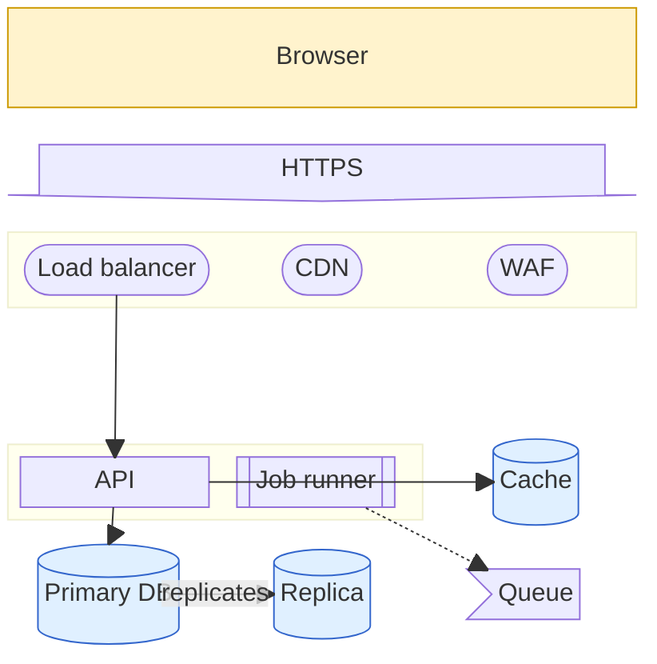
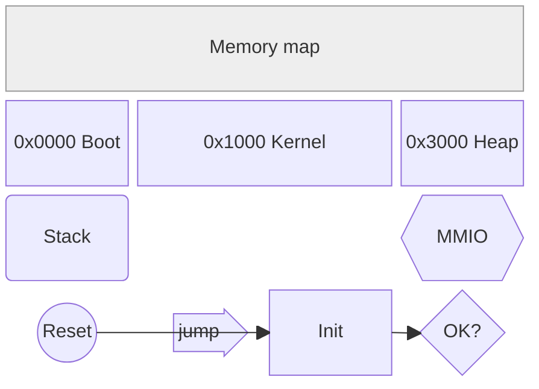

# Block diagram

Declaration: `block` (the older keyword `block-beta` also works)

Use a block diagram when you need control over the position of boxes in a grid, for example a system layout, a memory map, or a layered stack. You place the blocks; the layout does not move them.

## Syntax

### Columns and placement

```
block
  columns 3
  a b c
  d e f
```

- `columns N` sets the number of columns. `columns auto` (the default) puts all blocks in one row.
- Blocks fill the grid from left to right, then wrap to the next row.
- Many blocks can stand on one line, separated by spaces.

### Blocks

```
a
b["Text label"]
c["Wide block"]:2
```

`a` uses its ID as the label. `:2` makes `c` span 2 columns. A label must be in double quotes. `b[Text]` fails.

| Syntax | Shape |
|---|---|
| `id["Text"]` | Rectangle |
| `id("Text")` | Rounded rectangle |
| `id(["Text"])` | Stadium |
| `id[["Text"]]` | Subroutine |
| `id[("Text")]` | Cylinder |
| `id(("Text"))` | Circle |
| `id((("Text")))` | Double circle |
| `id(-"Text"-)` | Ellipse |
| `id>"Text"]` | Flag (asymmetric) |
| `id{"Text"}` | Diamond |
| `id{{"Text"}}` | Hexagon |
| `id[/"Text"/]` | Parallelogram, leans right |
| `id[\"Text"\]` | Parallelogram, leans left |
| `id[/"Text"\]` | Trapezoid |
| `id[\"Text"/]` | Inverted trapezoid |

### Space

```
space
space:3
```

`space` is one empty cell. `space:3` is three empty cells.

### Nested blocks

```
block:backend:2
  columns 2
  api["API"] worker["Worker"]
end
block
  x y
end
```

- `block:id:N ... end` makes a composite block with an ID that spans N columns. `block:id` spans one column. A plain `block ... end` has no ID.
- A nested block has its own `columns`.

### Block arrows

```
next<["Next step"]>(right)
both<["Sync"]>(left, right)
```

Directions: `right`, `left`, `up`, `down`, `x` (horizontal both ways), `y` (vertical both ways). Combine them with a comma.

### Edges

```
a --> b
a --- b
a ==> b
a -.-> b
a --x b
a --o b
a -- "label" --> b
```

Edges draw lines between blocks. They do not change the positions.

### Other statements

| Statement | Effect |
|---|---|
| `accTitle: text` / `accDescr: text` | Accessibility text |
| `%% text` | Comment |

## Styling and configuration

```
classDef hot fill:#f96,stroke:#333,stroke-width:2px
class a,b hot
style c fill:#bbf,stroke:#333,stroke-width:4px
```

`class` and `style` take a list of IDs. A composite block ID also works.

```
---
config:
  block:
    padding: 8   # space between blocks
---
```

## Examples





## Common mistakes

- An unquoted label fails: `a[API]`. Write `a["API"]`.
- The width goes after the shape: `a["API"]:2`. `a:2["API"]` fails.
- Markdown strings (`` "`text`" ``) fail in block diagrams. Use plain quoted text.
- Every `block` needs its own `end`.
- `end` is a keyword. Do not use it as a block ID.
- `%%` comments must be on their own line. A comment after a statement on the same line is parsed as part of it.
- A row that is wider than `columns` wraps to the next row. Count the widths per row.
- Edges do not place blocks. Use `columns`, widths, and `space` for layout.
