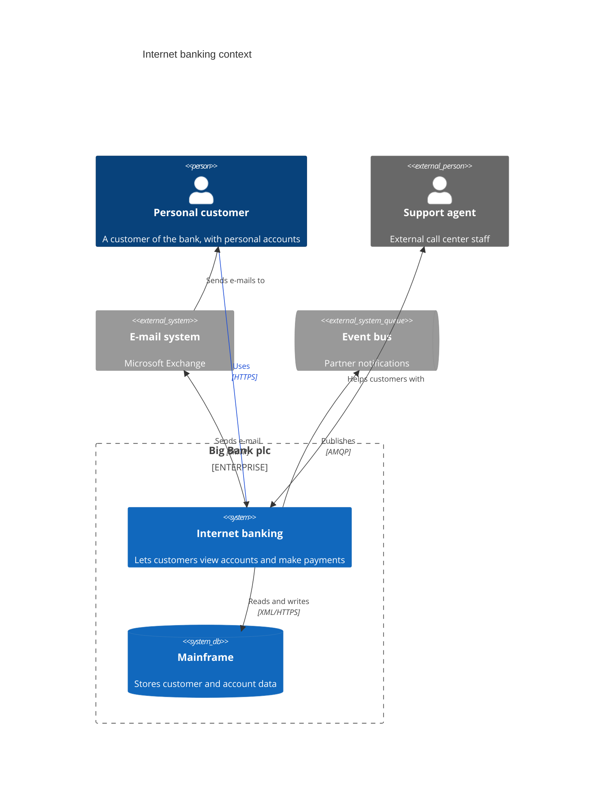
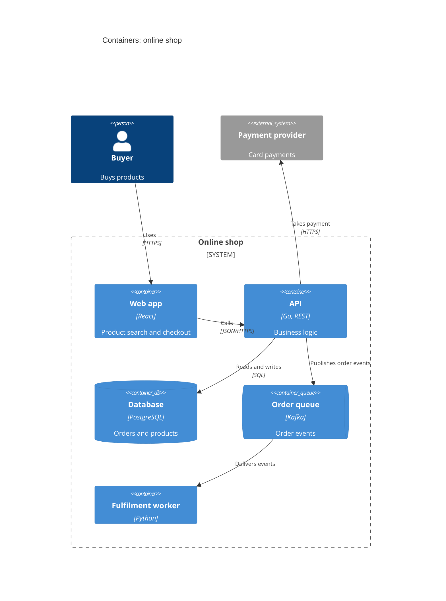
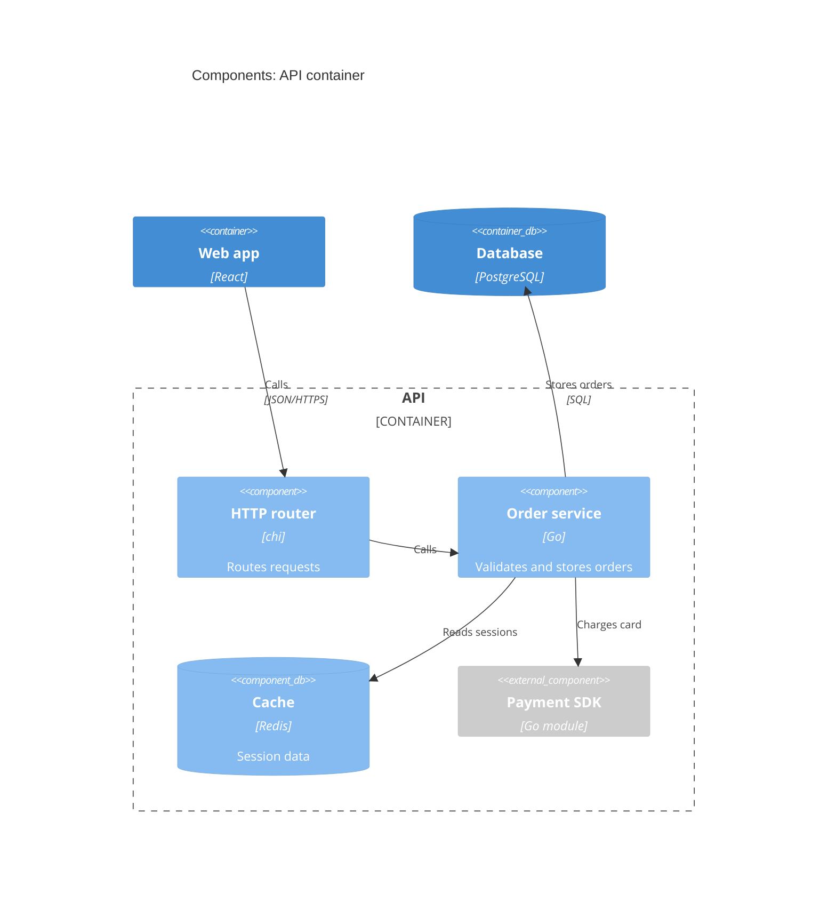
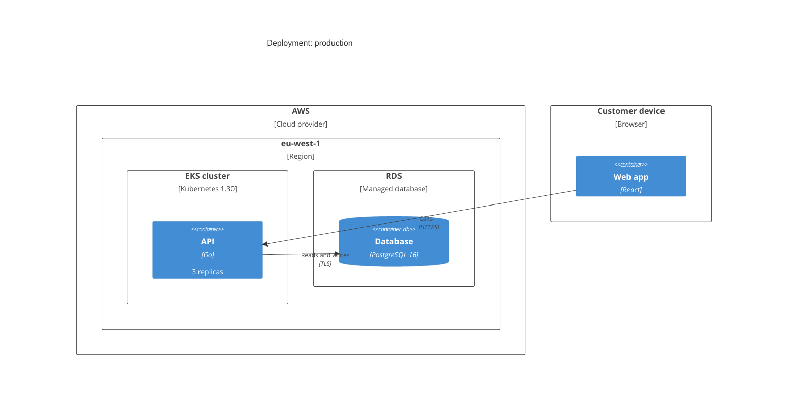
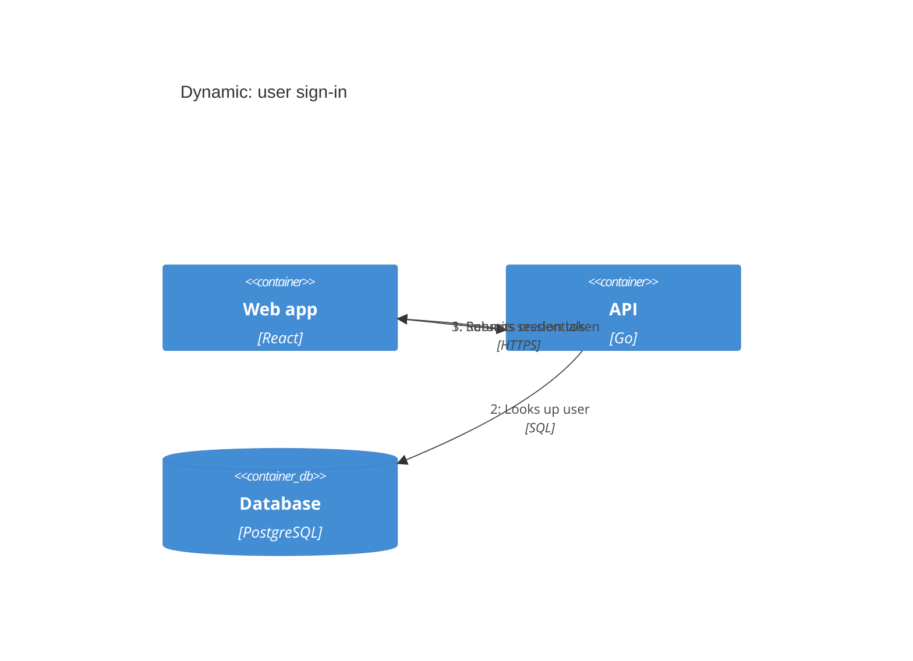

# C4 diagram

Declaration: `C4Context`, `C4Container`, `C4Component`, `C4Dynamic`, or `C4Deployment`

Use a C4 diagram to show software architecture at one level of the C4 model: system context, containers, components, a numbered runtime flow, or deployment. The syntax follows C4-PlantUML.

## Syntax

| Declaration | Level | Typical elements |
|---|---|---|
| `C4Context` | System context | `Person`, `System`, `Enterprise_Boundary` |
| `C4Container` | Containers of one system | `Container`, `ContainerDb`, `System_Boundary` |
| `C4Component` | Components of one container | `Component`, `Container_Boundary` |
| `C4Dynamic` | Numbered runtime flow | Containers or components and `RelIndex` |
| `C4Deployment` | Infrastructure | `Deployment_Node`, `Node`, containers |

All statements parse in all five declarations. Only `C4Dynamic` changes the output: it puts `1: `, `2: `, and so on before the relationship labels, in statement order.

Every statement is a function call: `Name(arg1, arg2, ...)`. Put one statement on each line. The `(` must follow the name with no space.

### Elements

| Statement | Arguments |
|---|---|
| `Person`, `Person_Ext` | `(alias, label, ?descr, ?sprite, ?tags, ?link)` |
| `System`, `SystemDb`, `SystemQueue` | `(alias, label, ?descr, ?sprite, ?tags, ?link)` |
| `System_Ext`, `SystemDb_Ext`, `SystemQueue_Ext` | `(alias, label, ?descr, ?sprite, ?tags, ?link)` |
| `Container`, `ContainerDb`, `ContainerQueue` | `(alias, label, ?techn, ?descr, ?sprite, ?tags, ?link)` |
| `Container_Ext`, `ContainerDb_Ext`, `ContainerQueue_Ext` | `(alias, label, ?techn, ?descr, ?sprite, ?tags, ?link)` |
| `Component`, `ComponentDb`, `ComponentQueue` | `(alias, label, ?techn, ?descr, ?sprite, ?tags, ?link)` |
| `Component_Ext`, `ComponentDb_Ext`, `ComponentQueue_Ext` | `(alias, label, ?techn, ?descr, ?sprite, ?tags, ?link)` |

- `alias` is the id. Use letters, digits, and `_`. Relationships use it.
- `Db` draws a cylinder. `Queue` draws a horizontal tube. `_Ext` draws the element in gray, as external.
- `?` marks an optional argument.

### Boundaries

A boundary groups elements. The `{` goes on the same line or on the next line. The `}` closes it. Boundaries can nest.

| Statement | Arguments |
|---|---|
| `Enterprise_Boundary` | `(alias, label, ?tags, ?link) { ... }` |
| `System_Boundary` | `(alias, label, ?tags, ?link) { ... }` |
| `Container_Boundary` | `(alias, label, ?tags, ?link) { ... }` |
| `Boundary` | `(alias, label, ?type, ?tags, ?link) { ... }` |
| `Deployment_Node`, `Node`, `Node_L`, `Node_R` | `(alias, label, ?type, ?descr, ?sprite, ?tags, ?link) { ... }` |

A boundary must contain at least one statement.

### Relationships

| Statement | Arguments | Effect |
|---|---|---|
| `Rel` | `(from, to, label, ?techn, ?descr, ?sprite, ?tags, ?link)` | Arrow from `from` to `to`. |
| `BiRel` | same as `Rel` | Arrows at both ends. |
| `Rel_Back` | same as `Rel` | Arrow head at `from`. |
| `Rel_U`, `Rel_Up`, `Rel_D`, `Rel_Down`, `Rel_L`, `Rel_Left`, `Rel_R`, `Rel_Right` | same as `Rel` | Accepted for C4-PlantUML compatibility. They draw like `Rel`. |
| `RelIndex` | `(index, from, to, label, ...)` | Like `Rel`. Mermaid ignores `index`. |

`from` and `to` can be an element alias or a boundary alias. Only one relationship per pair of aliases is kept. A second `Rel(a, b, ...)` replaces the first.

### Arguments

- Quote every text argument with double quotes: `"Web App"`. An unquoted last argument takes the `)` and fails.
- A quoted argument can contain commas, `#`, and colons. It cannot contain a double quote. Single quotes do not work as delimiters.
- Skip an optional argument with an empty position: `Person(a, "A", , "sprite")`.
- Give an optional argument by name with `$name="value"`: `Rel(a, b, "Uses", $techn="HTTPS")`. Names: `$descr`, `$techn`, `$sprite`, `$tags`, `$link`, `$type`.
- A statement must stay on one line.

### Style statements

| Statement | Effect |
|---|---|
| `UpdateElementStyle(alias, $bgColor="...", $fontColor="...", $borderColor="...")` | Colors of one element or boundary. |
| `UpdateRelStyle(from, to, $textColor="...", $lineColor="...", $offsetX="...", $offsetY="...")` | Colors of one relationship and the label offset in pixels. |
| `UpdateLayoutConfig($c4ShapeInRow="n", $c4BoundaryInRow="n")` | Number of elements and boundaries in each row. Defaults are 4 and 2. |

### Other statements

| Statement | Example |
|---|---|
| `title <text>` | `title Internet banking: context` |
| `accTitle: <text>` | `accTitle: Banking context` |
| `accDescr: <text>` | `accDescr: Customers and external systems`. Use `accDescr { ... }` for many lines. |
| `%% <text>` | Comment. |

## Styling and configuration

The layout is fixed: elements fill rows from left to right in statement order. Change the order of statements or use `UpdateLayoutConfig` to change the layout. There is no `direction` statement.

Frontmatter keys under `config.c4`:

| Key | Default | Effect |
|---|---|---|
| `c4ShapeInRow` | `4` | Elements in each row. |
| `c4BoundaryInRow` | `2` | Boundaries in each row. |
| `width`, `height` | `216`, `60` | Minimum element size. |
| `c4ShapeMargin`, `c4ShapePadding` | `50`, `20` | Space between and inside elements. |
| `diagramMarginX`, `diagramMarginY` | `50`, `10` | Space around the diagram. |
| `<type>_bg_color`, `<type>_border_color` | | Colors per element type, for example `person_bg_color`, `system_db_border_color`, `external_container_bg_color`. |
| `<type>FontSize`, `<type>FontFamily`, `<type>FontWeight` | | Fonts per type, for example `personFontSize`, `messageFontSize`, `boundaryFontWeight`. |

## Examples

A `C4Dynamic` diagram uses the same statements. Write the relationships in the order of the flow:

## Common mistakes

- Unquoted text arguments fail when they are last: `Rel(a, b, Uses)` fails. Quote all text.
- Single quotes and escaped double quotes fail: `Person(a, 'A')` and `"A \"B\""` fail.
- A space before `(` fails: `Person (a, "A")`.
- A statement that spans two lines fails.
- Names are case-sensitive. `person(...)` and `rel(...)` fail.
- C4-PlantUML macros that Mermaid does not have fail: `AddElementTag`, `AddRelTag`, `SHOW_LEGEND`, `LAYOUT_TOP_DOWN`, `LAYOUT_WITH_LEGEND`, `Lay_R`, `!include`.
- `direction LR` fails. Control the layout with statement order and `UpdateLayoutConfig`.
- An empty boundary `{ }` fails. Put at least one element in it.
- `title` text cannot contain `#` or `;`.
- A second `Rel` between the same two aliases replaces the first. Use `BiRel` for two directions.
- Text in other diagram types that contains a C4 keyword, such as `C4Container`, can make Mermaid detect the diagram as C4.
