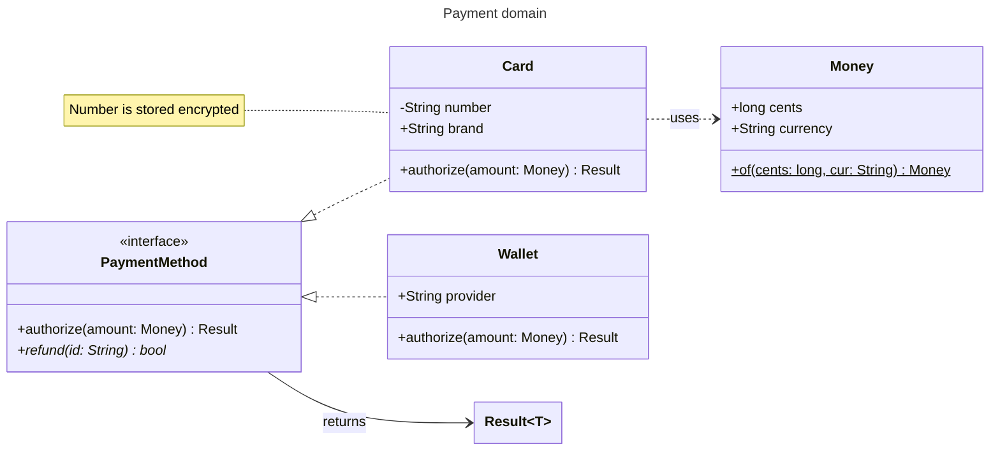
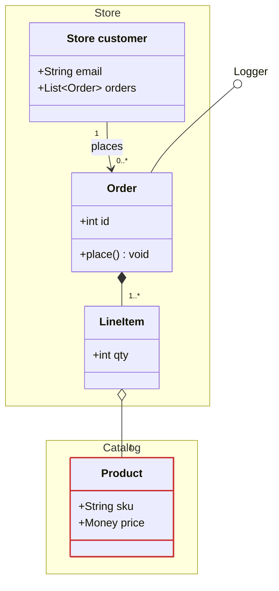

# Class diagram

Declaration: `classDiagram` (the alias `classDiagram-v2` also works)

Use a class diagram to show types, their fields and methods, and the relations between them, for example a domain model or an object-oriented design.

## Syntax

### Classes

```
class Order
class Order["Customer order"]
class Box~T~
class Order {
  +String id
  -List~Item~ items
  +total() Money
}
Order : +cancel(String reason) bool
```

- A class ID is letters, digits, and `_`. Use backticks for other names: ``class `Order-Line` ``.
- `["Label"]` sets a display label. The ID stays the reference name.
- `~T~` declares a generic. `List~int~` and `Map~String, int~` work in members. A class name cannot nest generics: `class A~List~int~~` fails.
- A body `{ ... }` holds one member per line. The `Class : member` form adds one member.

### Members

| Element | Syntax |
|---|---|
| Field | `+String name` or `+name String` (text is free) |
| Method | `+getName() String`. A `(` makes the member a method. |
| Parameters | `+find(id: int, opts: Options) Order` (`:` only in the body form) |
| Visibility | `+` public, `-` private, `#` protected, `~` package |
| Abstract method | `*` after the method: `+area()* double` |
| Static member | `$` at the end: `+create()$ Order`, `-int count$` |

### Annotations

```
class Shape {
  <<interface>>
  +area() double
}
class Animal
<<abstract>> Animal
```

The `<<word>> Id` form needs a declared class. Any word works: `<<interface>>`, `<<abstract>>`, `<<service>>`, `<<enumeration>>`.

### Relations

Form: `A <relation> B` with an optional `: label`. Add cardinality in quotes next to each class.

```
A <|-- B     inheritance: B extends A
A *-- B      composition
A o-- B      aggregation
A --> B      association
A -- B       link, solid
A ..> B      dependency
A ..|> B     realization: A implements B
A .. B       link, dashed
A ()-- B     lollipop interface on A
A --() B     lollipop interface on B
```

Ends can point both ways: `A <|--|> B`, `A <-- B`, `A --* B`, `A --o B`, `A <.. B`.

```
Customer "1" --> "0..*" Order : places
Order *-- "1..*" LineItem
```

### Namespaces

```
namespace Billing {
  class Invoice
  class Payment
}
namespace Billing.Tax {
  class Rate
}
namespace Shop["Online shop"] {
  class Cart
  namespace Checkout {
    class Step
  }
}
```

A dotted name or a nested `namespace` makes a child namespace. Only class declarations and notes go inside a namespace. Write relations outside it.

### Notes

```
note "A note for the whole diagram"
note for Order "Line one<br/>Line two"
```

### Other statements

| Statement | Effect |
|---|---|
| `direction LR` | `TB`, `BT`, `LR`, or `RL` |
| `link Order "https://url" "tooltip"` | Link on a class |
| `click Order href "https://url" "tooltip" _blank` | Same, `click` form |
| `callback Order "fnName" "tooltip"` / `click Order call fn()` | Callback (needs `securityLevel: loose`; the app uses `strict`) |
| `accTitle: text` / `accDescr: text` | Accessibility text |
| `%% text` | Comment |

## Styling and configuration

```
classDef hot fill:#f96,stroke:#333,stroke-width:2px
classDef default fill:#f4f4f4
class Order:::hot
class Payment:::hot {
  +amount
}
cssClass "Invoice,Rate" hot
style Cart fill:#bbf,stroke:#333
```

Apply a class with `class Id:::name` or `cssClass "Id1,Id2" name`.

```
---
config:
  class:
    hideEmptyMembersBox: true     # no empty compartment for classes without members
    hierarchicalNamespaces: true  # draw child namespaces inside parents
---
```

Top-level keys `look` (`classic`, `handDrawn`, `neo`) and `layout` (`elk`, `dagre`) also apply.

## Examples





## Common mistakes

- A relation inside a `namespace` block fails. Put relations after the block.
- A relation label with `:` fails: `A --> B : a: b`. Remove the extra colon.
- `Order:::hot` as a statement on its own fails. Write `class Order:::hot`.
- In the `Class : member` form, a `:` inside the member fails: `A : +f(x: int)`. Use the body form or `+f(int x)`.
- `<<interface>> A` before `class A` fails. Declare the class first.
- In `style`, a bare number fails: `stroke-dasharray: 4 2`. Use values with units or colors.
- Nested generics in a class name fail. Use `~T~` once in the name; nest only in member types.
- `<<interface>>` is an annotation, not a relation. Do not write `A <<interface>> B`.
- Use `~` for generics, not `<` and `>`: `List<int>` is wrong, `List~int~` is right.
- An unquoted class label with spaces is wrong: write `class A["My label"]`.
