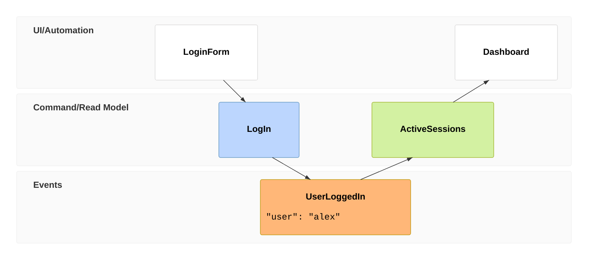
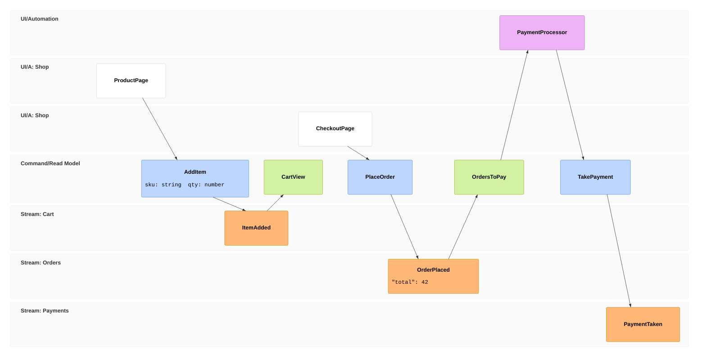

# Event model

Declaration: `eventmodeling`

Use an event model to show how a system changes state over time: the screens and automations, the commands they send, the events that the commands record, and the read models that the events update. The diagram is a timeline from left to right with one horizontal lane for each kind of element.

## Syntax

### Header

The first line is `eventmodeling`. There is no direction. Each statement goes on its own line. Indentation is free.

### Frames

A frame is one box on the timeline.

```
tf <id> <type> <Name> [->> <sourceId>]... [[[DataName]]] [{ inline data }]
```

| Part | Rule |
|---|---|
| `tf` or `timeframe` | A time frame. |
| `rf` or `resetframe` | A reset frame. It gets no automatic arrow from the frame before it. Use it to start a new slice. |
| `<id>` | 1 to 3 digits, for example `01` or `12`. Each id must be unique. |
| `<type>` | One of the types in the table below. |
| `<Name>` | One word: letters, digits, and `_`. It must not start with a digit. |

| Type | Short and long keyword | Box colour | Lane |
|---|---|---|---|
| UI screen | `ui` | white | UI/Automation |
| Processor (automation) | `pcr`, `processor` | purple | UI/Automation |
| Command | `cmd`, `command` | blue | Command/Read Model |
| Read model | `rmo`, `readmodel` | green | Command/Read Model |
| Event | `evt`, `event` | orange | Events |

Frames go from left to right in source order. The id does not set the order.

### Arrows

- `->> 01` draws an arrow from frame `01` to this frame. Repeat it for more sources: `->> 01 ->> 02`.
- A frame with no `->>` gets an arrow from the last earlier frame that is in a different lane.
- The first frame and every `rf` frame get no automatic arrow.

Use the usual event modeling flow. A command comes from a `ui` or `pcr`. An event comes from a `cmd`. A read model comes from an `evt`. A `ui` or `pcr` comes from an `rmo`.

### Namespaces

A name with one dot, `Namespace.Name`, puts the frame in its own lane. The box shows only `Name`.

| Type | Lane title |
|---|---|
| `ui`, `pcr` | `UI/A: Namespace` |
| `cmd`, `rmo` | `C/RM: Namespace` |
| `evt` | `Stream: Namespace` |

Frames with the same namespace share a lane. Use namespaces for event streams, for example `Orders.OrderPlaced` and `Payments.PaymentTaken`.

### Data in a box

Inline data goes at the end of the frame line in braces. Put a space after `{` and before `}`, because the last character before `}` is cut off.

```
tf 03 evt ItemAdded { "sku": "A1", "qty": 2 }
```

A `data` block holds longer data. A frame shows it with `[[Name]]`. The `{` must be the last character of its line. The closing `}` must be at the start of its own line, with no indent.

```
data CartItem {
  sku: string
  qty: number
}
tf 02 cmd AddItem [[CartItem]]
```

An optional type tag goes before the data: `` `json` ``, `` `md` ``, `` `text` ``, and others. The tag has no visible effect.

### Statements that do not show

These statements parse, but the diagram does not draw them:

- `note 02 {` … `}`, with the same rules as a `data` block.
- `gwt 03 given cmd AddItem when cmd AddItem then evt ItemAdded`
- `entity Cart`
- `%% comment`, `// comment`, and `/* comment */`.

## Styling and configuration

Frontmatter `config:` keys under `eventmodeling:` are `padding` (default 30) and `useMaxWidth`.

Theme variables set the colours: `emUiFill`, `emUiStroke`, `emProcessorFill`, `emProcessorStroke`, `emCommandFill`, `emCommandStroke`, `emReadModelFill`, `emReadModelStroke`, `emEventFill`, `emEventStroke`, `emRelationStroke`, `emArrowhead`, `emSwimlaneBackgroundOdd`, and `emSwimlaneBackgroundStroke`.

```
---
config:
  eventmodeling:
    padding: 20
  themeVariables:
    emEventFill: "#ffd8a8"
---
```

There is no title. A frontmatter `title:` parses but does not show.

## Examples





## Common mistakes

- A name with a space or a `-` fails: `tf 01 ui Login Form`. Use `LoginForm` or `Login_Form`.
- A name that starts with a digit fails.
- An id with more than 3 digits fails. A duplicate id fails.
- An unknown type, such as `screen` or `query`, fails.
- `title`, `accTitle`, and `accDescr` lines fail.
- A `data` or `note` block with an indented closing `}` fails.
- Inline data must stay on the frame line. A `{` on one line and `}` on a later line fails for a frame. Use a `data` block.
- Inline data in quotes (`"…"`) parses but shows nothing. Use braces.
- A `->>` to an id that does not exist draws no arrow and gives no error.
