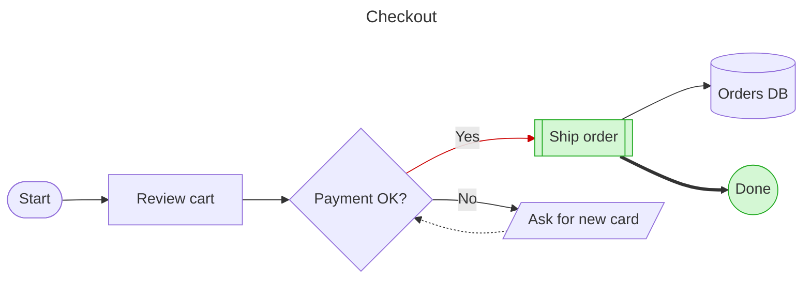
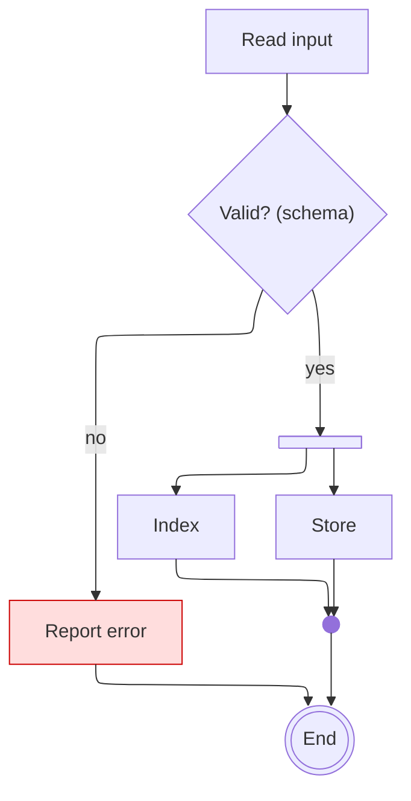

# Flowchart

Declaration: `flowchart <DIR>` (or the alias `graph <DIR>`; `flowchart-elk <DIR>` forces the ELK layout)

Use a flowchart to show a process, a decision path, a pipeline, or any set of boxes that connect with arrows.

## Syntax

### Header and direction

```
flowchart TD
```

| Direction | Meaning |
|---|---|
| `TB` or `TD` | Top to bottom (default when you omit the direction) |
| `BT` | Bottom to top |
| `LR` | Left to right |
| `RL` | Right to left |

The direction must be in upper case. Put each statement on its own line. A `;` at the end of a line is optional.

### Nodes

A node is an ID with an optional shape and label. Declare a node once and use its ID after that. The label of the first declaration stays.

| Syntax | Shape |
|---|---|
| `id` | Rectangle, label is the ID |
| `id[Text]` | Rectangle |
| `id(Text)` | Rounded rectangle |
| `id([Text])` | Stadium |
| `id[[Text]]` | Subroutine |
| `id[(Text)]` | Cylinder (database) |
| `id((Text))` | Circle |
| `id(((Text)))` | Double circle |
| `id>Text]` | Flag (asymmetric) |
| `id{Text}` | Diamond (decision) |
| `id{{Text}}` | Hexagon |
| `id[/Text/]` | Parallelogram, leans right |
| `id[\Text\]` | Parallelogram, leans left |
| `id[/Text\]` | Trapezoid |
| `id[\Text/]` | Inverted trapezoid |

### Extended shapes with `@{ }`

Attach a metadata block to a node ID. The block is YAML.

```
A@{ shape: cyl, label: "Orders DB" }
B@{ shape: doc }
C@{ icon: "fa:user", form: circle, label: "User", pos: b, h: 48 }
D@{ img: "https://example.com/logo.png", label: "Logo", pos: t, w: 60, h: 60, constraint: on }
```

Keys: `shape`, `label`, `labelType` (`markdown`, `string`, `text`), `icon`, `form` (`square`, `circle`, `rounded`), `img`, `pos` (`t` or `b`), `w`, `h`, `constraint` (`on` keeps the image aspect ratio). Shape names are lower case. An unknown shape name makes the parse fail.

| Short name | Aliases | Meaning |
|---|---|---|
| `rect` | `proc`, `process`, `rectangle` | Process |
| `rounded` / `stadium` | `event` / `terminal`, `pill` | Event / terminal point |
| `fr-rect` | `subprocess`, `subproc`, `subroutine` | Subprocess |
| `cyl` / `datastore` | `db`, `database` / `data-store` | Database / data store |
| `folder`, `bucket`, `console`, `browser`, `person`, `cloud`, `bang` | | Pictograms |
| `circle` / `sm-circ` | `circ` / `start` | Start |
| `fr-circ` / `dbl-circ` | `stop` / `double-circle` | Stop |
| `f-circ` / `cross-circ` | `junction` / `summary` | Junction / summary |
| `diam` / `hex` | `decision`, `question` / `prepare` | Decision / preparation |
| `lean-r` / `lean-l` | `in-out` / `out-in` | Data input or output |
| `trap-b` / `trap-t` | `priority` / `manual` | Priority / manual operation |
| `doc` / `docs` / `lin-doc` / `tag-doc` | `document` / `documents` | Document variants |
| `st-rect` / `lin-rect` / `div-rect` / `tag-rect` / `win-pane` | `processes` / `lined-process` / `div-proc` / `tag-proc` / `internal-storage` | Process variants |
| `notch-rect` / `sl-rect` / `delay` | `card` / `manual-input` | Card / manual input / delay |
| `h-cyl` / `lin-cyl` / `curv-trap` | `das` / `disk` / `display` | Storage / disk / display |
| `tri` / `flip-tri` / `notch-pent` / `hourglass` | `extract` / `manual-file` / `loop-limit` / `collate` | Flowchart symbols |
| `fork` / `bow-rect` / `flag` / `bolt` | `join` / `stored-data` / `paper-tape` / `com-link` | Flowchart symbols |
| `brace` / `brace-r` / `braces` / `text` / `odd` | `comment` | Comment, plain text, flag |

### Edges

| Syntax | Kind |
|---|---|
| `A --> B` | Arrow |
| `A --- B` | Line, no arrow |
| `A -.-> B` / `A -.- B` | Dotted arrow / dotted line |
| `A ==> B` / `A === B` | Thick arrow / thick line |
| `A ~~~ B` | Invisible link (layout only) |
| `A --o B` / `A --x B` | Circle end / cross end |
| `A <--> B`, `A o--o B`, `A x--x B` | Both ends |
| `A ---> B`, `A -..-> B`, `A ====> B` | Longer edge (more ranks) |

Edge labels:

```
A -->|label| B
A -- label --> B
A -.->|label| B
A -. label .-> B
A ==>|label| B
A == label ==> B
```

Chains and groups: `A --> B --> C` and `A & B --> C & D`.

Edge IDs and metadata: put `id@` in front of the edge, then add `id@{ ... }` after the edge exists.

```
A e1@--> B
e1@{ animate: true, curve: linear }
```

Edge keys: `animate` (`true`/`false`), `animation` (`fast`, `slow`), `curve` (same values as `flowchart.curve`).

### Subgraphs

```
subgraph id [Title]
  direction LR
  A --> B
end
subgraph "Title only"
  C
end
id --> C
id@{ view: collapsed }
```

A subgraph ID can be the start or end of an edge. With the `dagre` layout, `direction` inside a subgraph is ignored when a node in it links to a node outside it. `id@{ view: collapsed }` draws the subgraph as one compact node.

### Text

- Quote a label that has punctuation: `A["Total (net): 10"]`.
- Use `<br/>` for a line break.
- Use entity codes for special characters: `#quot;`, `#35;`, `#9829;`, or HTML entities such as `&quot;`.
- Markdown string: ``A["`**bold** and _italic_`"]``. Markdown strings wrap text automatically and keep real line breaks. They work in node labels, edge labels, and subgraph titles.
- `%%` starts a comment. It must be on its own line. `A --> B %% note` fails.
- `accTitle: text`, `accDescr: text`, and `accDescr { multi-line }` add accessibility text.

### Interaction

```
click A "https://example.com" "Tooltip" _blank
click B href "https://example.com" _self
click C callbackName "Tooltip"
click D call callbackName(arg)
```

Targets: `_self`, `_blank`, `_parent`, `_top`. Callbacks run only with `securityLevel: loose`. The app renders with `strict`, so use URL links only.

## Styling and configuration

```
classDef hot fill:#f96,stroke:#333,stroke-width:2px,color:#000
classDef default fill:#eee
class A,B hot
C:::hot --> D
style E fill:#bbf,stroke-dasharray: 5 5
linkStyle 0,2 stroke:#f00,stroke-width:3px
linkStyle default interpolate linear stroke:#999
```

`linkStyle` counts edges from 0 in the order of declaration. `class` and `style` also work on subgraph IDs.

Frontmatter keys:

```
---
title: Order flow
config:
  layout: elk            # elk (default in Mermaid 12) or dagre
  look: classic          # classic, handDrawn, neo
  elk:
    mergeEdges: true
    nodePlacementStrategy: BRANDES_KOEPF   # SIMPLE, NETWORK_SIMPLEX, LINEAR_SEGMENTS, BRANDES_KOEPF
    preset: default      # default, legacy, modelOrder, depthFirst
  flowchart:
    curve: basis         # basis, linear, step, stepBefore, stepAfter, monotoneX, monotoneY, natural, cardinal, catmullRom, bumpX, bumpY, rounded
    nodeSpacing: 50
    rankSpacing: 50
    padding: 15
    wrappingWidth: 120
    inheritDir: false    # true: subgraphs without a direction use the graph direction
---
```

The app sets the theme from its light or dark mode. Do not set `theme` unless the user asks.

## Examples



```mermaid
flowchart TB
  user@{ shape: person, label: "Customer" }
  subgraph web [Web tier]
    direction LR
    ui@{ shape: browser, label: "SPA" }
    api@{ shape: rounded, label: "API" }
    ui e1@--> api
  end
  subgraph data ["`**Data** tier`"]
    cache@{ shape: h-cyl, label: "Cache" }
    store@{ shape: datastore, label: "Event store" }
  end
  user --> ui
  api --> cache & store
  log@{ shape: docs, label: "Audit logs" }
  api -.-> log
  note@{ shape: brace-r, label: "Writes are async" }
  store ~~~ note
  e1@{ animate: true }
  click api "https://example.com/api" "API docs" _blank
```



## Common mistakes

- `end` in lower case is a keyword. `A --> end` fails. Use `End`, `finish`, or `id[end]`.
- A node ID that starts with `o` or `x` directly after an edge makes a circle or cross edge: `A---oB` is `A --o B`. Put a space before the ID (`A --- oB`) or rename the node.
- Parentheses, brackets, braces, or quotes inside unquoted text fail: `A[Text (x)]` fails. Write `A["Text (x)"]`.
- A `"` inside a quoted label breaks it. Use `#quot;`.
- Text between pipes cannot hold parentheses without quotes: write `-->|"text (x)"|`.
- The direction must be upper case: `flowchart lr` fails.
- `linkStyle 5` when the diagram has fewer than 6 edges fails.
- Do not mix stroke kinds in one labeled edge: `A -- x -.-> B` fails.
- `@{ shape: Rect }` fails: shape names are lower case with `-`, never `_`.
- Add edge metadata (`e1@{ ... }`) after the edge `A e1@--> B`, or it creates a node named `e1`.
- An edge ID directly after a `@{ }` block fails: `A@{ shape: doc } e1@--> B`. Declare the node first, then write `A e1@--> B`.
