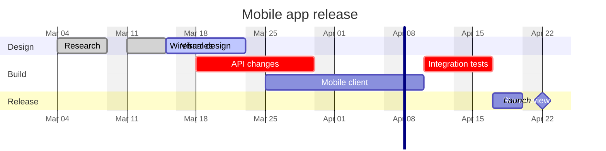
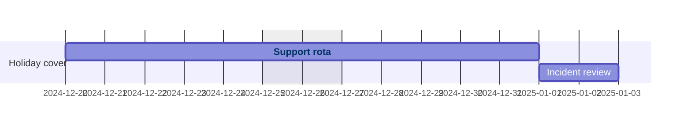

# Gantt chart

Declaration: `gantt`

Use a Gantt chart to show tasks on a time axis. It shows start dates, durations, dependencies between tasks, and milestones in a project plan.

## Syntax

Each statement is on its own line. Indentation has no effect.

```
gantt
    title Website launch
    dateFormat YYYY-MM-DD
    section Design
    Wireframes      :done, des1, 2024-01-08, 5d
    Visual design   :active, des2, after des1, 7d
```

### Settings statements

| Statement | Example | Effect |
|---|---|---|
| `title <text>` | `title Release plan` | Diagram title. |
| `dateFormat <format>` | `dateFormat YYYY-MM-DD` | Format of the dates in task data. Uses Day.js tokens. Default is `YYYY-MM-DD`. |
| `axisFormat <format>` | `axisFormat %b %d` | Format of the axis labels. Uses d3 time format (`%Y`, `%m`, `%d`, `%b`, `%H`, `%M`, `%a`). |
| `tickInterval <n><unit>` | `tickInterval 1week` | Distance between axis ticks. Units: `millisecond`, `second`, `minute`, `hour`, `day`, `week`, `month`. |
| `weekday <day>` | `weekday monday` | First day of a week for `week` ticks. Any day `monday` to `sunday`. |
| `excludes <list>` | `excludes weekends, 2024-12-25` | Days that tasks skip. Values: `weekends`, day names (`friday`), or dates in `dateFormat`. Separate with commas or spaces. |
| `includes <list>` | `includes 2024-12-28` | Dates that are work days, also when `excludes` matches them. |
| `weekend friday` / `weekend saturday` | `weekend friday` | First day of the two-day weekend for `excludes weekends`. Default is `saturday`. |
| `todayMarker off` | `todayMarker off` | Hides the line for today. |
| `todayMarker <css>` | `todayMarker stroke-width:3px,stroke:#f66` | Styles the line for today. Separate CSS rules with commas. |
| `inclusiveEndDates` | `inclusiveEndDates` | An end date includes the full end day. |
| `section <name>` | `section Build` | Starts a group of tasks. The name ends at the end of the line. |
| `accTitle: <text>` | `accTitle: Launch plan` | Accessible title. |
| `accDescr: <text>` | `accDescr: Tasks for Q1` | Accessible description. Use `accDescr { ... }` for many lines. |

### Tasks

A task is `<name> :<data>`. The name is the text before the first colon. The data is a comma-separated list:

```
Task name :[tags,] [id,] [start,] end-or-duration
```

| Data form | Example | Start | End |
|---|---|---|---|
| `<duration>` | `:3d` | End of the previous task | Start plus duration |
| `<start>, <duration>` | `:2024-01-08, 3d` | Given date | Start plus duration |
| `<start>, <end>` | `:2024-01-08, 2024-01-12` | Given date | Given date |
| `<id>, <start>, <duration or end>` | `:t1, 2024-01-08, 3d` | Given date | As above |
| `<id>, after <ids>, <duration>` | `:t3, after t1 t2, 2d` | End of the latest listed task | Start plus duration |
| `<id>, <start>, until <ids>` | `:t4, 2024-01-08, until m1` | Given start | Start of the earliest listed task |

- Durations: a number and a unit. Units: `ms`, `s`, `m` (minutes), `h`, `d`, `w`, `M` (months), `y`. Decimals are allowed (`1.5d`).
- An id is necessary when other tasks use `after` or `until` with this task. Separate many ids with spaces: `after a b c`.
- Tags come first, in any order: `done`, `active`, `crit`, `milestone`, `vert`.

| Tag | Effect |
|---|---|
| `done` | Completed task style. |
| `active` | In-progress task style. |
| `crit` | Critical task style (red). Combine with others: `crit, done`. |
| `milestone` | Diamond marker. Give a duration, usually `0d`. |
| `vert` | Vertical line across the chart at the task start. Use `0d`. |

### Interaction

```
click t1 href "https://example.com/t1"
click t2 call showDetails("t2")
```

`call` needs `securityLevel: loose` at render time. The default security level ignores it.

### Comments

A line that starts with `%%` is a comment.

## Styling and configuration

Frontmatter keys under `config.gantt`:

| Key | Default | Effect |
|---|---|---|
| `displayMode` | `""` | `compact` puts tasks of one section on shared rows when they do not overlap. |
| `topAxis` | `false` | Adds date labels at the top of the chart. |
| `axisFormat` | `%Y-%m-%d` | Axis label format. The `axisFormat` statement overrides it. |
| `tickInterval` | none | Same values as the statement. |
| `weekday` | `sunday` | First day of a week. |
| `barHeight`, `barGap` | `20`, `4` | Task bar size and space between bars. |
| `topPadding`, `leftPadding`, `rightPadding`, `gridLineStartPadding` | | Layout spaces in pixels. |
| `fontSize`, `sectionFontSize` | `11`, `11` | Text sizes. |
| `numberSectionStyles` | `4` | Number of alternating section colors. |
| `titleTopMargin` | `25` | Space above the title. |
| `useMaxWidth` | `true` | Scales the chart to the container width. |

Theme variables (in `config.themeVariables`): `taskBkgColor`, `taskBorderColor`, `taskTextColor`, `activeTaskBkgColor`, `doneTaskBkgColor`, `critBkgColor`, `critBorderColor`, `sectionBkgColor`, `altSectionBkgColor`, `gridColor`, `todayLineColor`, `vertLineColor`, `excludeBkgColor`.

## Examples

```mermaid
gantt
    title Deployment window
    dateFormat HH:mm
    axisFormat %H:%M
    todayMarker off

    section Preparation
    Announce downtime :done, a1, 08:00, 30m
    Back up database  :crit, a2, after a1, 45m

    section Migration
    Run migrations    :crit, active, m1, after a2, 1h
    Smoke tests       :m2, after m1, 20m
    Rollback window   :m3, 08:00, until m2

    section Done
    Service online    :milestone, done1, after m2, 0d
```







## Common mistakes

- `topAxis` as a statement fails in Mermaid 12.2.0 (`yy.TopAxis is not a function`). Set `config.gantt.topAxis: true` in frontmatter.
- A task name must not contain `:`. The first colon starts the task data.
- Task data must not contain `#` or `;`. A `#` causes a parse error.
- A line that starts with `#` is not a comment. It causes a parse error. Use `%%`.
- A task name must not start with a keyword. The lexer does not check case. `Call customer :3d` and `Click here :3d` fail. `Title page :3d` becomes the diagram title. `Includes tests :3d` and `Dateformat review :3d` become settings statements. Change the first word.
- `after` and `until` need task ids. A milestone also needs an id and a duration: `Launch :milestone, m1, 2024-04-08, 0d`.
- Write each date in the `dateFormat` format. The parse step does not check dates. An invalid date makes the render fail with `Invalid date`.
- `axisFormat` uses d3 tokens (`%Y-%m-%d`). `dateFormat` uses Day.js tokens (`YYYY-MM-DD`). Do not mix them.
- A duration needs a unit with no space: `3d`, not `3 d` or `3 days`.
- Tags must come before the id: `:crit, t1, 2024-01-08, 3d`. A tag after the id is not a tag.
