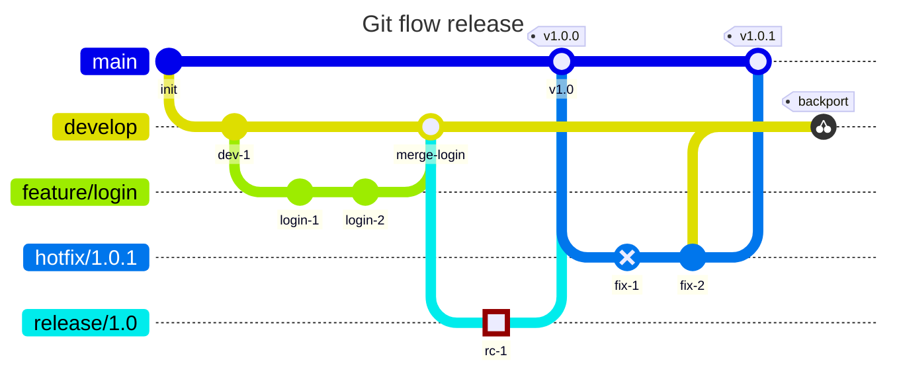
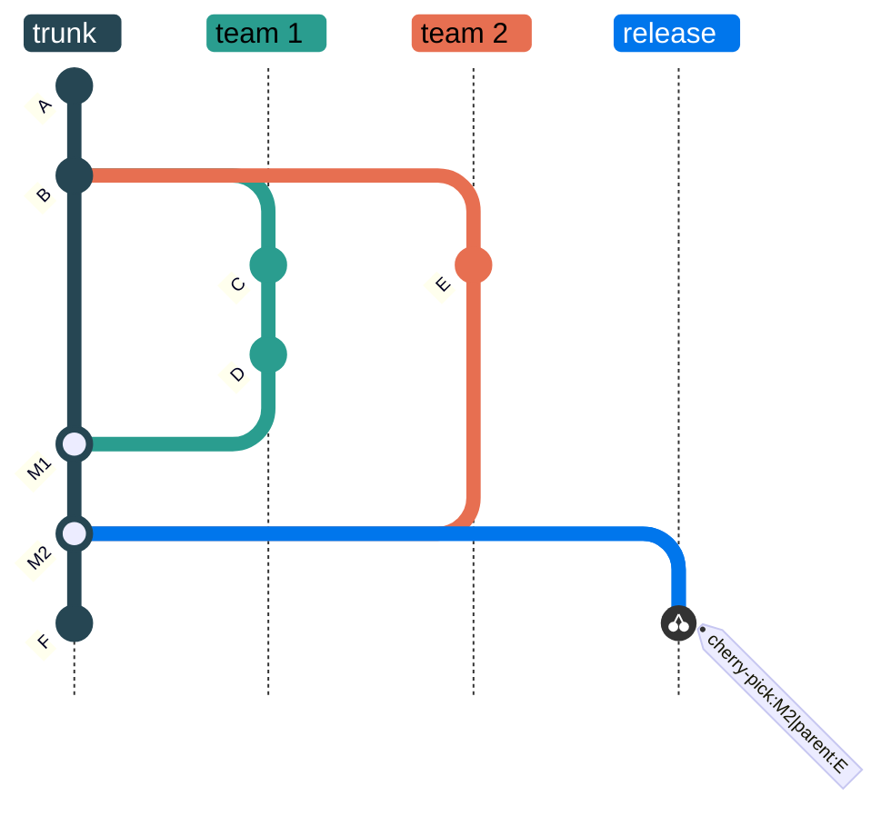

# Git graph

Declaration: `gitGraph` (with a direction: `gitGraph LR:`, `gitGraph TB:`, `gitGraph BT:`)

Use a git graph to show commits, branches, merges, and cherry-picks in a Git history. It explains a branching strategy or a release flow.

## Syntax

The diagram starts on the `main` branch. Statements run in order, like Git commands. Put one statement on each line.

```
gitGraph
    commit
    branch develop
    commit
    checkout main
    merge develop
```

### Header

| Header | Effect |
|---|---|
| `gitGraph` | Left to right. |
| `gitGraph:` | Same as `gitGraph`. |
| `gitGraph LR:` | Left to right. |
| `gitGraph TB:` | Top to bottom. |
| `gitGraph BT:` | Bottom to top. |

The colon after the direction is necessary. `RL` is not supported.

### Statements

| Statement | Example | Effect |
|---|---|---|
| `commit` | `commit` | Adds a commit to the current branch. Mermaid makes a random id. |
| `commit <attrs>` | `commit id: "a1" msg: "Fix" tag: "v1.0" type: HIGHLIGHT` | Adds a commit with attributes, in any order. |
| `branch <name>` | `branch develop` | Creates a branch from the current commit and switches to it. |
| `branch <name> order: <n>` | `branch hotfix order: 1` | Sets the lane position. Lower numbers go nearer to `main`. |
| `checkout <name>` | `checkout main` | Switches to an existing branch. |
| `switch <name>` | `switch main` | Same as `checkout`. |
| `merge <name>` | `merge develop` | Merges the named branch into the current branch. Adds a merge commit. |
| `merge <name> <attrs>` | `merge develop id: "m1" tag: "v2.0" type: REVERSE` | Merge with attributes. `msg:` is not allowed. |
| `cherry-pick id: "<id>"` | `cherry-pick id: "a1"` | Copies a commit from another branch to the current branch. |
| `cherry-pick id: "<id>" parent: "<id>"` | `cherry-pick id: "m1" parent: "c3"` | Cherry-picks a merge commit. `parent` must be a direct parent of it. |
| `cherry-pick ... tag: "<text>"` | `cherry-pick id: "a1" tag: "backport"` | Adds a tag to the copied commit. |
| `title <text>` | `title Release flow` | Diagram title. |
| `accTitle: <text>` | `accTitle: Release flow` | Accessible title. |
| `accDescr: <text>` | `accDescr: Feature and hotfix branches` | Accessible description. Use `accDescr { ... }` for many lines. |
| `%% <text>` | `%% note` | Comment. |

### Commit attributes

| Attribute | Value | Effect |
|---|---|---|
| `id:` | Quoted string | Commit label and reference for `cherry-pick`. Keep ids unique. |
| `msg:` | Quoted string | Commit message. The `msg:` keyword is optional: `commit "Fix login"`. |
| `tag:` | Quoted string | Tag label next to the commit. Repeat for more tags. |
| `type:` | `NORMAL`, `REVERSE`, `HIGHLIGHT` | Commit shape. `REVERSE` shows a crossed circle. `HIGHLIGHT` shows a filled square. |

### Names and strings

- Strings use `"double"` or `'single'` quotes. Escape a quote with a backslash: `"say \"hi\""`.
- A branch name without quotes can contain letters, digits, `_`, `-`, `.`, and `/`. It must start with a letter or `_`. Examples: `feature/login`, `release-1.2`, `hotfix_v2`.
- Quote a branch name that has spaces, starts with a digit, or is a keyword: `branch "2024-hotfix"`, `branch "checkout"`.

## Styling and configuration

Frontmatter keys under `config.gitGraph`:

| Key | Default | Effect |
|---|---|---|
| `mainBranchName` | `main` | Name of the first branch. Use it in `checkout` and `merge`. |
| `mainBranchOrder` | `0` | Lane position of the main branch. |
| `showBranches` | `true` | Shows branch names and lines. |
| `showCommitLabel` | `true` | Shows commit ids. |
| `rotateCommitLabel` | `true` | Rotates commit labels 45 degrees. |
| `parallelCommits` | `false` | Puts commits on different branches at the same position when they are at the same distance from their parents. |
| `titleTopMargin` | `25` | Space above the title. |
| `diagramPadding` | `8` | Space around the diagram. |

Theme variables: `git0` to `git7` (branch colors), `gitInv0` to `gitInv7` (highlight colors), `gitBranchLabel0` to `gitBranchLabel7` (branch label text), `commitLabelColor`, `commitLabelBackground`, `commitLabelFontSize`, `tagLabelColor`, `tagLabelBackground`, `tagLabelBorder`, `tagLabelFontSize`. After 8 branches, the colors repeat.

## Examples





## Common mistakes

- `commit id: abc` fails. Quote ids, messages, and tags: `commit id: "abc"`.
- `gitGraph LR` fails. Add the colon: `gitGraph LR:`. `RL` does not exist.
- `type:` values are uppercase. `type: highlight` fails.
- One statement per line. `commit commit` fails.
- `#` does not start a comment. Use `%%`.
- `branch` fails when the branch exists. Use `checkout` to return to it.
- `checkout` fails when the branch does not exist yet. Create it with `branch` first.
- `merge` fails when the branch is the current branch, does not exist, or has the same head commit as the current branch. Add a commit on the branch before you merge it.
- `cherry-pick` fails when the id does not exist or when the commit is already on the current branch.
- A cherry-pick of a merge commit fails without `parent:`. The parent must be one of the two parents of the merge commit.
- A branch name that starts with a digit or is a keyword (`commit`, `branch`, `merge`, `checkout`, `switch`) fails without quotes.
- With a `mainBranchName` in config, use that name. `checkout main` fails when the main branch is `trunk`.
