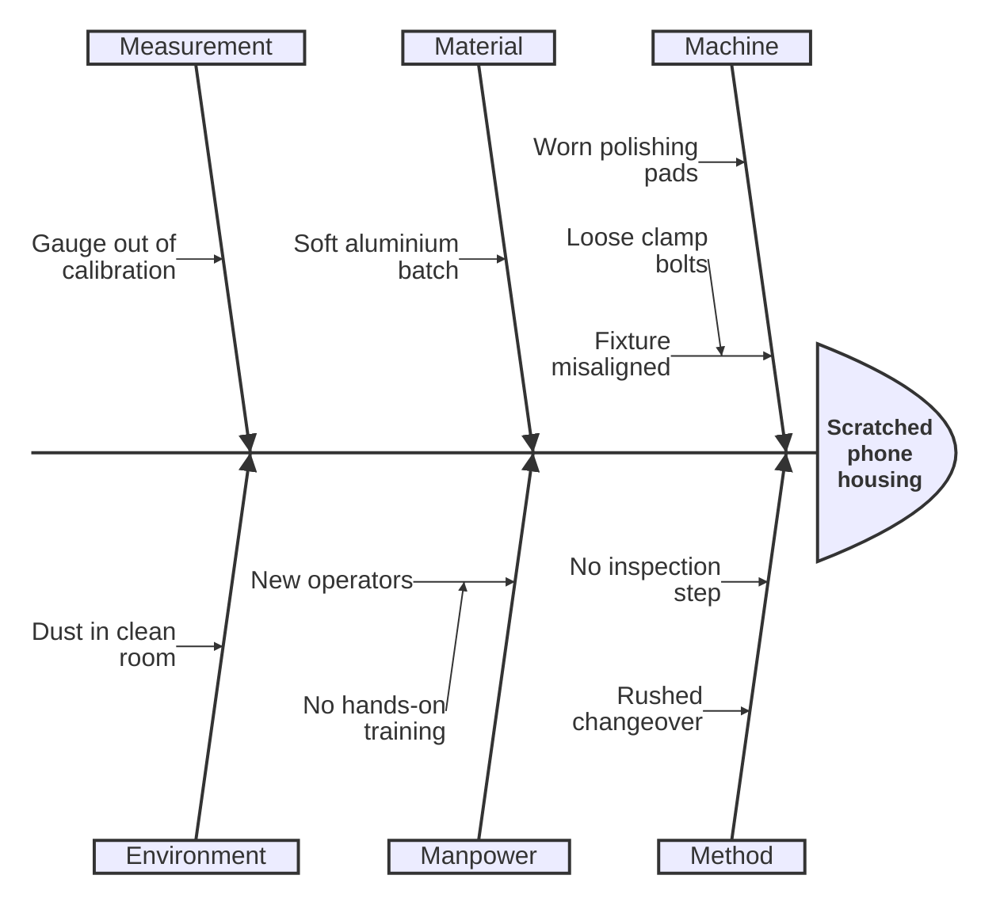
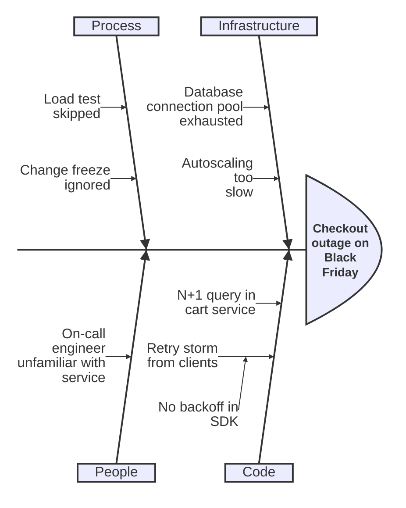
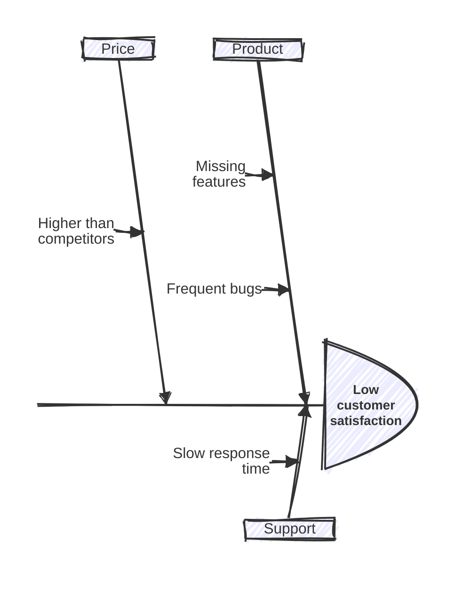

# Ishikawa (fishbone) diagram

Declaration: `ishikawa` (alias: `ishikawa-beta`)

Use this diagram to show the possible causes of one effect or problem. The effect is the fish head, the main causes are the bones, and sub-causes branch from the bones.

## Syntax

The diagram is an indented outline. Each non-empty line is one node. Indentation sets the parent-child relation.

```
ishikawa
    Effect text
    Main cause A
        Sub-cause A1
            Detail A1a
    Main cause B
```

| Line | Meaning |
| --- | --- |
| `ishikawa` or `ishikawa-beta` | Header. Must be the first statement. Case-insensitive. |
| First text line | The effect (fish head). It is also the diagram title. |
| Next lines | Causes. A line with more indentation than the line above is a child of that line. |
| `%% text` | Comment. Only on its own line. |
| Empty line | Ignored. |

Rules for indentation and nesting:

- The indentation of the first cause sets the base level. All lines at that indentation are main causes (bones).
- A line that is indented more than the line above it becomes a child of that line.
- A line with less indentation goes back up to the nearest line with less indentation.
- A cause with less indentation than the first cause is still a main cause.
- The effect line can have any indentation. It does not set the base level.
- Each indentation character counts as one level step. Use spaces only. Do not mix tabs and spaces.
- Nesting depth has no limit. Two or three levels below the main causes are easy to read.

You can also write the effect on the header line:

```
ishikawa Late delivery
  People
  Process
```

Text rules:

- The text is the full line after the indentation. Quotes, colons, brackets, and `#` are kept as literal text.
- Write `<br>` in a line to force a line break.
- Some labels wrap at spaces automatically: the effect at about 11 characters (default font size), sub-causes at 15 characters. Main cause labels do not wrap. Keep main cause labels short.
- `%%` after text on the same line is not a comment. It becomes part of the label.

Layout: main causes alternate above and below the spine. The 1st, 3rd, and 5th causes go above. The 2nd, 4th, and 6th causes go below.

The diagram has no `title`, `accTitle`, or `accDescr` statements. A line such as `title X` becomes a cause with the text "title X".

## Styling and configuration

Frontmatter `config:` keys under `ishikawa`:

| Key | Default | Effect |
| --- | --- | --- |
| `diagramPadding` | `20` | Space around the drawing, in pixels. |
| `useMaxWidth` | `true` | Scales the SVG to the width of its container. |

Other settings that have an effect:

- `look: handDrawn` draws the spine, bones, and head with a sketch style.
- `fontSize` (top-level config) sets the label size and the minimum spacing between bones.
- Theme variables `lineColor` (lines and arrows), `mainBkg` (head fill), and `textColor` (labels).

```
---
config:
  look: handDrawn
  theme: neutral
  ishikawa:
    diagramPadding: 40
---
```

## Examples

Classic 6M analysis for a manufacturing defect:



Software incident with the effect on the header line, a forced line break, and comments:



Hand-drawn look with custom padding:



## Common mistakes

- A cause line that starts with the word `ishikawa` (any case, for example "Ishikawa method") fails to parse. The lexer reads it as the header keyword. Reword the line.
- `title`, `accTitle`, and `accDescr` are not statements. They become ordinary causes.
- Inline `%%` comments do not work. Put each comment on its own line.
- Mixed tabs and spaces give a wrong tree, because each character counts as one level step.
- The first text line is always the effect. Do not start the outline with a cause.
- `<` in a label shows as its HTML entity text, not as the character. When a line contains `<br>`, `&` also shows as its entity text. Write "less than" and "and" instead.
- Do not wrap text in quotes to escape it. The quotes show in the label.
