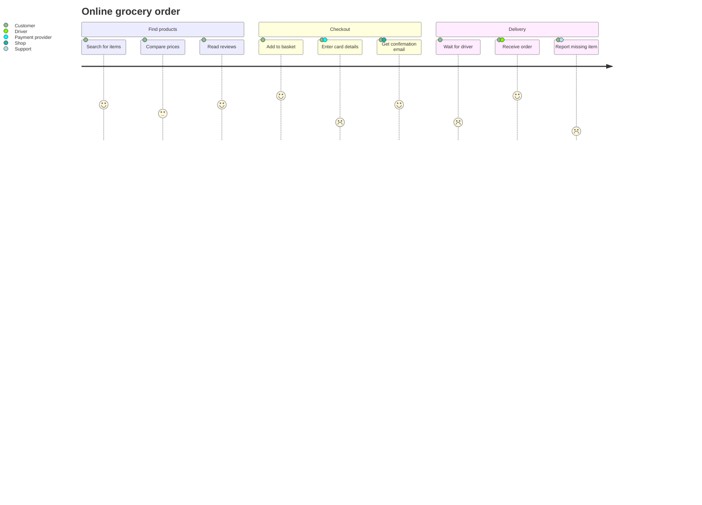
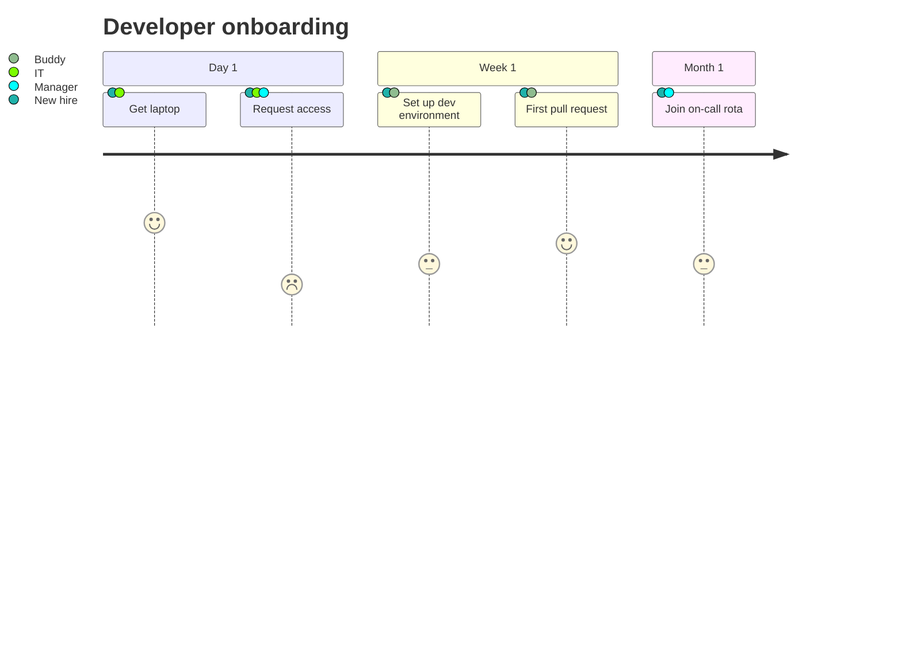

# User journey

Declaration: `journey`

Use a user journey diagram to show the steps that users take to complete a goal. Each step has a satisfaction score and the actors that take part in it.

## Syntax

```
journey
    title My working day
    section Go to work
        Make tea: 5: Me
        Go upstairs: 3: Me, Cat
```

| Statement | Example | Effect |
|---|---|---|
| `journey` | `journey` | Declares the diagram. It has no direction option. |
| `title <text>` | `title Checkout flow` | Diagram title. |
| `section <name>` | `section Discover` | Starts a stage of the journey. The tasks after it belong to it. |
| `<task>: <score>: <actors>` | `Pay: 2: Customer, Bank` | A step with a score and a comma-separated list of actors. |
| `<task>: <score>` | `Wait for email: 3` | A step with no actors. |
| `accTitle: <text>` | `accTitle: Checkout journey` | Accessible title. |
| `accDescr: <text>` | `accDescr: Steps to buy a product` | Accessible description. Use `accDescr { ... }` for many lines. |
| `%% <text>` | `%% note` | Comment. A line that starts with `#` is also a comment. |

### Scores

- The score is a number from 1 to 5. 5 is the best experience.
- A score above 3 shows a happy face. A score of 3 shows a neutral face. A score below 3 shows a sad face.
- The score also sets the vertical position of the face. Use only 1 to 5. Other numbers parse, but the face moves out of the chart area.

### Actors

- Separate actors with commas. Spaces around names are removed.
- Each actor gets one color. The legend at the left lists all actors.
- Use the same spelling for one actor in all tasks. `Me` and `me` are two actors.

### Text rules

- A task name ends at the first colon.
- Task names, section names, and the title cannot contain `#` or `;`.
- A section name cannot contain a colon.
- Indentation has no effect. Use it to make the text easy to read.

## Styling and configuration

Frontmatter keys under `config.journey`:

| Key | Default | Effect |
|---|---|---|
| `actorColours` | 6 colors | List of colors for the actors, in order. |
| `sectionFills` | 7 colors | List of fill colors for the sections, in order. |
| `sectionColours` | `["#fff"]` | List of text colors for the sections. |
| `width`, `height` | `150`, `50` | Size of a task box. |
| `taskMargin` | `50` | Space between task boxes. |
| `leftMargin` | `150` | Space for the actor legend. |
| `maxLabelWidth` | `360` | Maximum width of an actor label in the legend. |
| `taskFontSize`, `taskFontFamily` | `14`, `"Open Sans", sans-serif` | Task text font. |
| `titleColor`, `titleFontFamily`, `titleFontSize` | | Title text style. |
| `useMaxWidth` | `true` | Scales the diagram to the container width. |

Theme variables `fillType0` to `fillType7` color the sections. `faceColor` colors the faces. `actor0` to `actor5` color the actors when the theme sets them.

## Examples





## Common mistakes

- Each task needs a score. `Make tea` and `Make tea:` fail. Write `Make tea: 3`.
- A task name cannot contain a colon. The first colon ends the name.
- `#` in a task line fails. `Fix bug #12: 3: Dev` fails. Write `Fix bug 12: 3: Dev`.
- `;` in a task line fails.
- `section Stage 1: Plan` fails. Use `section Stage 1 - Plan`.
- A task that starts with `title` becomes the diagram title. `Title search: 4: Me` sets the title. Change the first word.
- Actors go after the score, not before it. `Make tea: Me: 5` gives the score `NaN`.
