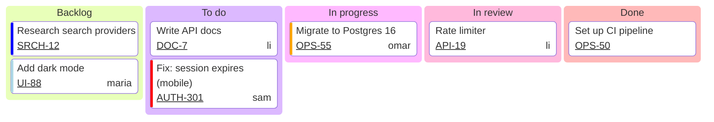
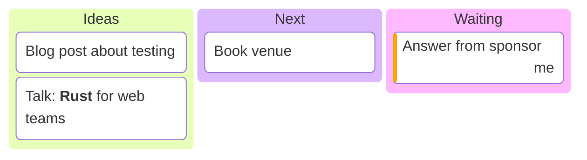

# Kanban

Declaration: `kanban`

Use a kanban diagram to show work items in columns, for example the status of tasks on a team board. Each item can show a ticket number, an assignee, and a priority.

## Syntax

Indentation defines the structure. The first node sets the column level. Every node at that indentation is a column. Every node with a different indentation is an item in the column above it.

```
kanban
  todo[To do]
    t1[Write the release notes]
    t2[Fix the login bug]
  done[Done]
    t3[Set up CI]
```

### Nodes

| Form | Example | Effect |
|---|---|---|
| `<id>[<text>]` | `t1[Fix login bug]` | Node with an id and a label. Use this form. |
| `<text>` | `Fix login bug` | Node whose id and label are the text. |
| `<id>["<text>"]` | `t1["Fix: login (OAuth)"]` | Quoted label. Necessary for `(`, `)`, `[`, `]`, `{`, `}`. |
| `<id>["`<markdown>`"]` | ``t1["`**Urgent** fix`"]`` | Markdown label: `**bold**`, `*italic*`. |
| `<id>[<text>]@{ <metadata> }` | `t1[Fix]@{ priority: 'High' }` | Item with metadata. |

Columns and items always render as kanban cards and column boxes. Other bracket shapes, such as `(text)` or `((text))`, parse but do not change the shape. Use `[ ]`.

Ids must be unique in the diagram.

### Item metadata

Metadata goes in `@{ ... }` directly after the node, on the same line. It uses YAML key-value pairs, separated by commas. It can also span many lines.

| Key | Example | Effect |
|---|---|---|
| `ticket` | `ticket: MC-2037` | Ticket number on the card. With `ticketBaseUrl`, it becomes a link. |
| `assigned` | `assigned: 'knsv'` | Assignee name on the card. |
| `priority` | `priority: 'Very High'` | Colored left border. Values: `'Very High'` (red), `'High'` (orange), `'Medium'` (no border), `'Low'` (blue), `'Very Low'` (light blue). |
| `label` | `label: 'New text'` | Replaces the label text. |

```
    t1[Create docs]@{ ticket: MC-2037, assigned: 'knsv', priority: 'High' }
    t2[Update API]@{
      ticket: MC-2040
      priority: 'Low'
    }
```

### Comments

A line that starts with `%%` is a comment.

## Styling and configuration

Frontmatter keys under `config.kanban`:

| Key | Default | Effect |
|---|---|---|
| `ticketBaseUrl` | `""` | URL for ticket links. `#TICKET#` is replaced by the ticket value. Example: `https://jira.example.com/browse/#TICKET#`. |
| `sectionWidth` | `200` | Width of each column in pixels. |
| `padding` | `8` | Space inside the cards. |
| `useMaxWidth` | `true` | Scales the diagram to the container width. |

Theme variables `cScale0` to `cScale11` set the column colors. Use `theme: base` when you change them.

## Examples





## Common mistakes

- Unquoted parentheses in a label fail. `t1[Fix login (OAuth)]` fails. Write `t1["Fix login (OAuth)"]`.
- The first node sets the column indentation. Indent all columns the same. A column with a different indentation becomes an item.
- More nesting does not make sub-items. All deeper nodes become items of the column.
- `title`, `classDef`, `class`, and `accTitle` are not statements here. They become columns or items. Do not use them.
- `:::class` and `::icon()` parse, but kanban does not show them.
- A space before `@{` fails. Write `@{` directly after the node: `t1[Fix]@{ ticket: A-1 }`.
- Write `priority` values exactly as listed, with the same capital letters. Other values, such as `'high'`, show no border.
- Metadata is YAML. A value with `: ` fails without quotes. A value with `,` loses the text after the comma. Quote such values: `assigned: 'Lee, Ann'`.
- A shape name in metadata must be lowercase. `@{ shape: KanbanItem }` fails.
