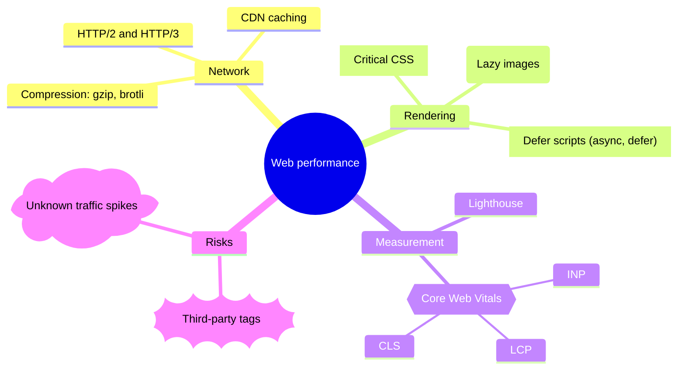
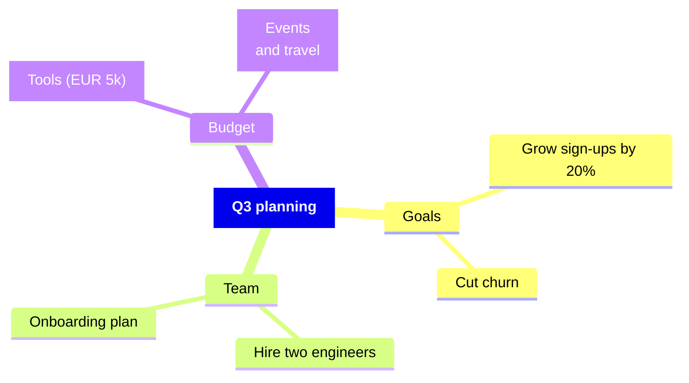

# Mindmap

Declaration: `mindmap`

Use a mindmap to show ideas as a tree around one central topic. It suits brainstorming, topic overviews, and outlines.

## Syntax

Indentation defines the tree. A node is a child of the nearest node above it with less indentation. The diagram must have exactly one root node, which is the first node.

```
mindmap
  root((Product launch))
    Marketing
      Blog post
      Social media
    Engineering
      Release build
```

Use spaces for indentation. The amount of indentation per level is free, but keep it consistent.

### Node shapes

| Syntax | Shape |
|---|---|
| `Text` | Default shape (text with an underline). The text is also the id. |
| `id[Text]` | Square |
| `id(Text)` | Rounded square |
| `id((Text))` | Circle |
| `id))Text((` | Bang (explosion) |
| `id)Text(` | Cloud |
| `id{{Text}}` | Hexagon |

The id is optional for the display. Only the text shows.

### Text

| Form | Example | Effect |
|---|---|---|
| Plain | `Plan the budget` | Any text without brackets or parentheses. |
| Quoted | `id["Cost (EUR) [draft]"]` | Necessary for `(`, `)`, `[`, `]`, `{`, `}` in the text. |
| Markdown | ``id["`**Bold** and *italic*`"]`` | Markdown string. A new line in the string makes a line break. |

Colons, `#`, commas, and other symbols are allowed in plain text.

### Decorations

Put a decoration on its own line, directly after the node. Indent it like the node.

| Syntax | Effect |
|---|---|
| `::icon(fa fa-book)` | Adds an icon. The page must load the icon font (for example Font Awesome). |
| `:::class1 class2` | Adds CSS classes to the node. The classes must exist in the page CSS or in `themeCSS`. |

### Comments

A line that starts with `%%` is a comment.

## Styling and configuration

Frontmatter keys under `config.mindmap`:

| Key | Default | Effect |
|---|---|---|
| `colorBy` | `branch` | `branch` gives each top-level branch one color. `depth` gives each tree level one color. |
| `padding` | `10` | Space inside the nodes. |
| `maxNodeWidth` | `200` | Maximum node width. Longer text wraps. |
| `useMaxWidth` | `true` | Scales the diagram to the container width. |

The default layout is `cose-bilkent`.

Theme variables `cScale0` to `cScale11` set the branch colors. `cScaleLabel0` to `cScaleLabel11` set the text colors. Use `theme: base` when you change them.

## Examples





## Common mistakes

- Two nodes at the root level fail: `There can be only one root`. Indent every node under the first node.
- A node with less indentation than the root fails for the same reason.
- Unquoted brackets or parentheses in the text fail. `root[Text (draft)]` fails. Write `root["Text (draft)"]`.
- `title`, `accTitle`, `classDef`, and `style` are not statements here. `title X` becomes the root node. `accTitle: X` before the root creates a second root and fails.
- `@{ shape: ... }` is not supported in a mindmap. It fails. Use the bracket shapes.
- `A:::urgent` on one line does not add a class. The `:::urgent` becomes part of the text. Put `:::urgent` on the next line.
- Edges and arrows do not exist in a mindmap. `A --> B` becomes node text.
