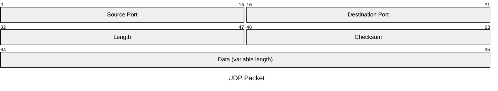
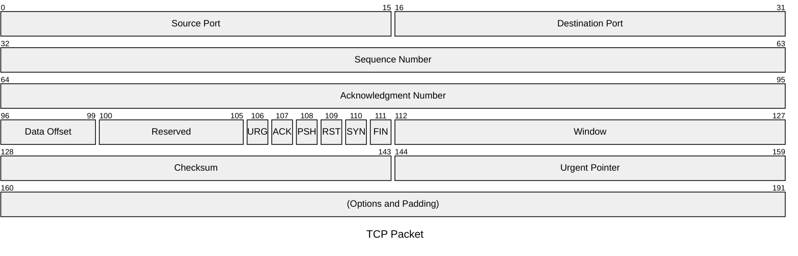
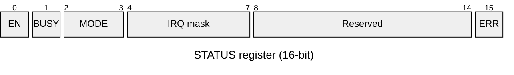

# Packet diagram

Declaration: `packet` (the older `packet-beta` also works)

Use a packet diagram to show the bit layout of a network packet header, a file format record, or a hardware register. Each field is a box whose width is its number of bits.

## Syntax

The first line is `packet`. After it, each line is one field.

| Field form | Example | Meaning |
|---|---|---|
| Bit range | `0-15: "Source Port"` | Bits 0 to 15, both included. |
| Single bit | `106: "URG"` | One bit. |
| Bit count | `+16: "Length"` | The next 16 bits after the previous field. |

Other statements:

| Statement | Form | Notes |
|---|---|---|
| Title | `title Text` | Text to end of line. |
| Accessibility | `accTitle: Text`, `accDescr: Text`, `accDescr { ... }` | Not shown. |
| Comment | `%% text` | |

Rules:

- Bit numbers start at `0`. The first field must start at bit `0`.
- Fields must be contiguous. Each field starts at the bit after the end of the previous field. Gaps and overlaps cause an error.
- Declare fields from the lowest bit to the highest bit.
- In a range, the end must not be less than the start.
- `+0` causes an error.
- You can mix the three field forms. `+n` is the safest form, because it computes the start for you.
- The label must be in double or single quotes. Use `\"` for a double quote inside a double-quoted label.
- Spaces around `-` and `:` are allowed.
- A field that crosses the end of a row continues on the next row.
- Bit numbers are non-negative integers. Hex (`0x10`) is not allowed.

To show a reserved or unused area, add a field with a label such as `"Reserved"`.

## Styling and configuration

Frontmatter `config.packet` keys:

| Key | Default | Effect |
|---|---|---|
| `bitsPerRow` | `32` | Number of bits in each row. |
| `bitWidth` | `32` | Width of one bit, in pixels. |
| `rowHeight` | `32` | Height of one row, in pixels. |
| `showBits` | `true` | Show bit numbers above the boxes. |
| `bitOrder` | `ascending` | `descending` mirrors each row so the highest bit is on the left, as in register maps. You still declare fields from the lowest bit. |
| `paddingX` | `5` | Horizontal space between boxes. |
| `paddingY` | `5` | Vertical space between rows. |
| `useMaxWidth` | `true` | Scale to the container width. |

Theme variables go under `config.themeVariables.packet`: `byteFontSize`, `startByteColor`, `endByteColor`, `labelColor`, `labelFontSize`, `titleColor`, `titleFontSize`, `blockStrokeColor`, `blockStrokeWidth`, `blockFillColor`.

## Examples

## Common mistakes

- `0-15: Source Port` fails. Labels need quotes.
- `0-15: "A"` then `17-31: "B"` fails. Bit 16 is missing. Use `16-31`.
- `1-15: "A"` as the first field fails. Start at `0`.
- `+0: "A"` fails.
- Fields in high-to-low order fail. Use `bitOrder: descending` to draw high bits on the left.
- `packet` with no fields renders an empty diagram.
