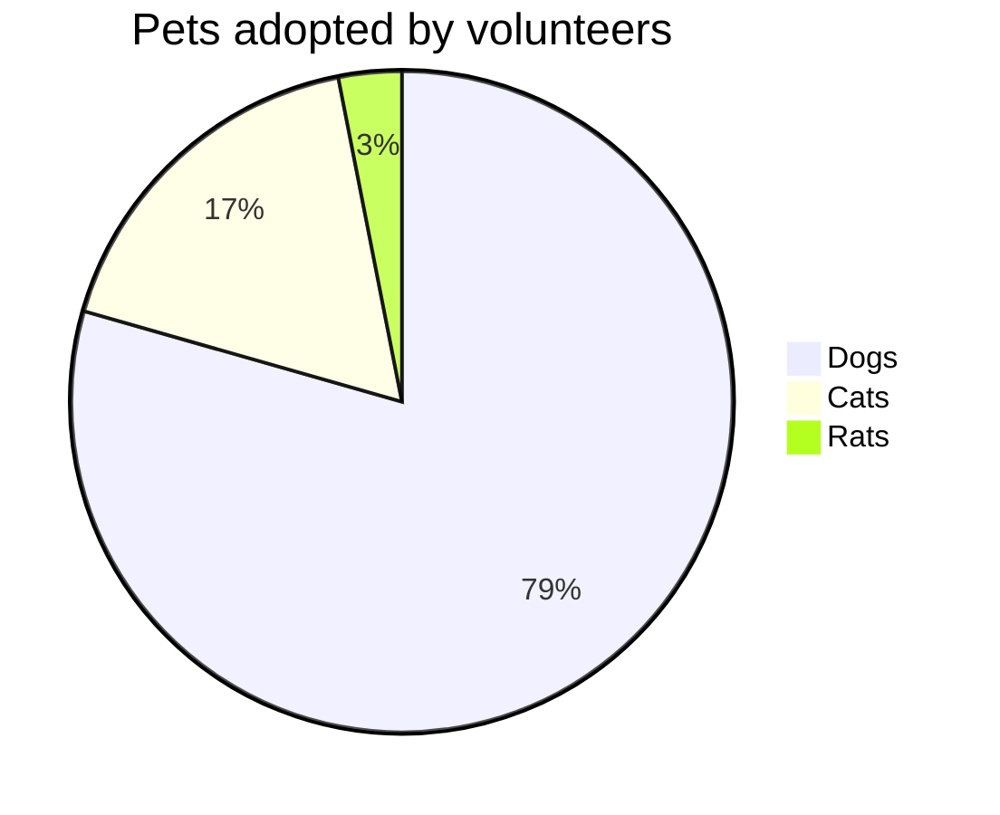
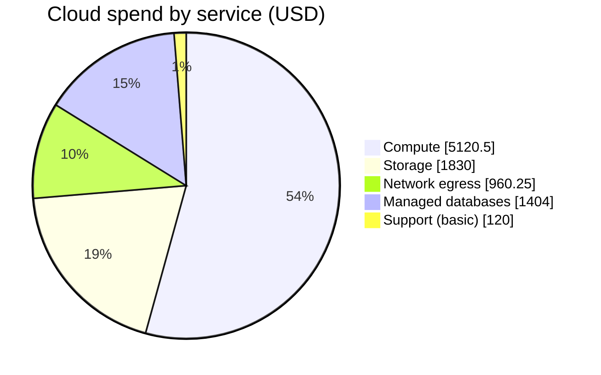
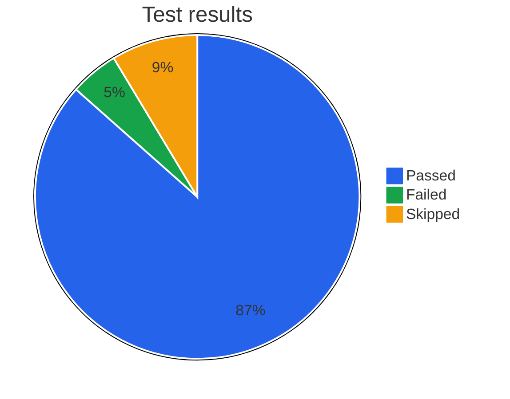

# Pie chart

Declaration: `pie`

Use a pie chart to show how a whole divides into a small number of parts. Use it for proportions, not for trends or exact comparisons.

## Syntax

The first statement is `pie`. You can add `showData` and a title on the same line.

```
pie
pie showData
pie title Pets adopted
pie showData title Pets adopted
```

Each following line is one statement.

| Statement | Form | Notes |
|---|---|---|
| Slice | `"Label" : value` | The label must be in double or single quotes. Spaces around `:` are optional. |
| Title | `title Text to end of line` | No quotes and no colon after `title`. |
| Accessible title | `accTitle: Text` | Not shown. Goes into the SVG for screen readers. |
| Accessible description | `accDescr: Text` | One line. |
| Multi-line description | `accDescr { ... }` | The text can go across lines until `}`. |
| Comment | `%% text` | Can be on its own line or at the end of a line. |

Slice values:

- A value is an integer (`42`) or a decimal with digits on both sides of the point (`42.5`).
- `0` is allowed. A negative value causes an error.
- Do not use exponents (`1e3`), thousands separators (`1,000`), units, or `%`.
- Slices show in the order you write them. Mermaid does not sort them.
- Mermaid does not draw slices that are smaller than 1% of the total.
- If two slices have the same label, Mermaid keeps the first and ignores the second.

Labels:

- Use `\"` for a double quote in a double-quoted label: `"The \"best\" one" : 3`.
- A label can contain `:`, `(`, `)`, `%` and other characters.

`showData` adds the raw value of each slice next to its label in the legend. The slices always show percentages.

## Styling and configuration

Frontmatter `config.pie` keys:

| Key | Default | Effect |
|---|---|---|
| `textPosition` | `0.75` | Position of the percentage text, from `0` (center) to `1` (outer edge). |
| `donutHole` | `0` | Hole ratio for a donut chart. Valid range is `0` to `0.9`. |
| `legendPosition` | `right` | `top`, `bottom`, `left`, `right`, or `center`. |
| `highlightSlice` | `""` | A slice label to enlarge it, or `hover` to enlarge the slice under the pointer. |
| `useMaxWidth` | `true` | Scale the chart to the width of the container. |

Theme variables (`config.themeVariables`): `pie1` to `pie12` (slice colors, in slice order), `pieTitleTextSize`, `pieTitleTextColor`, `pieSectionTextSize`, `pieSectionTextColor`, `pieLegendTextSize`, `pieLegendTextColor`, `pieStrokeColor`, `pieStrokeWidth`, `pieOuterStrokeWidth`, `pieOuterStrokeColor`, `pieOpacity`. Use the `base` theme if you set colors, because other themes can override them.

There is no per-slice style statement. Use `pie1` to `pie12` to set slice colors.

## Examples







## Common mistakes

- Unquoted labels fail: `Dogs : 386` is an error. Write `"Dogs" : 386`.
- `showData` must be on the `pie` line, before any other statement.
- `title: Pets` fails. Write `title Pets`.
- `1.` and `.5` fail. Write `1.0` and `0.5`.
- `1,000` and `1e3` fail. Write `1000`.
- A negative value fails with an error.
- More than 12 slices reuse the same colors. Group small slices into one "Other" slice.
- Each slice must be on its own line. Do not separate slices with `;` or `,`.
