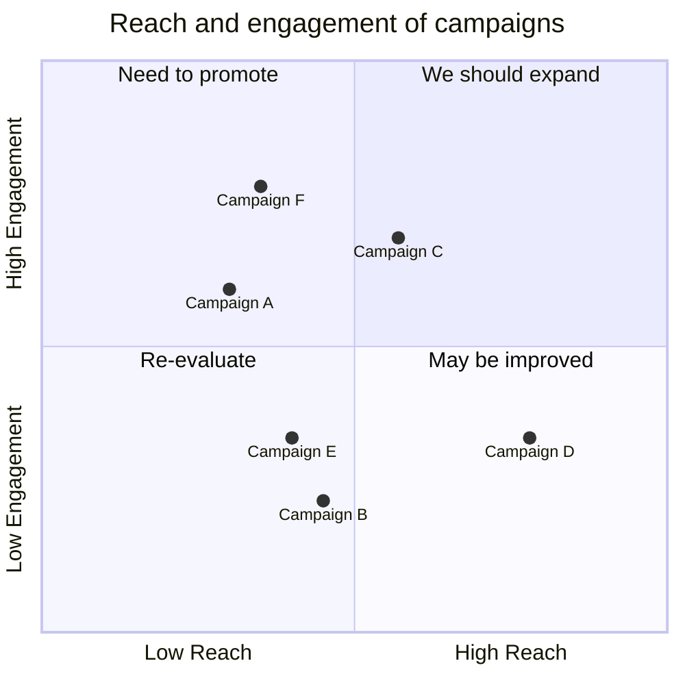
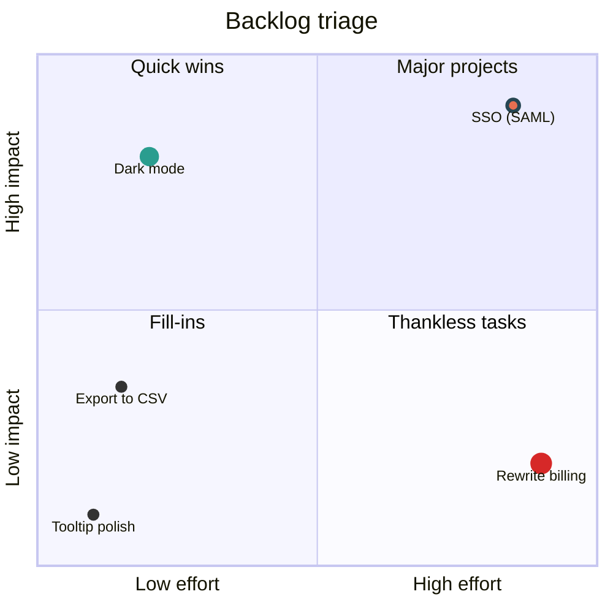
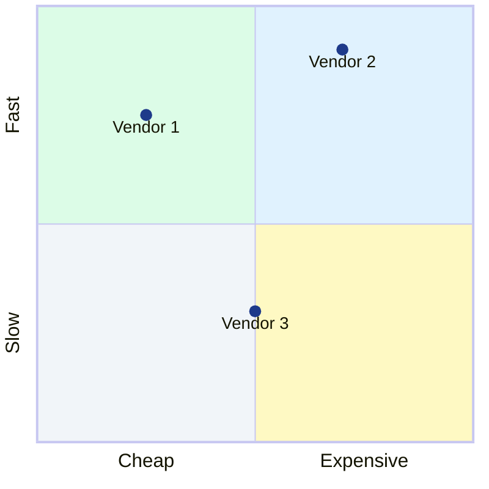

# Quadrant chart

Declaration: `quadrantChart`

Use a quadrant chart to place items on two axes and sort them into four groups. Typical uses are priority matrices, effort-and-impact grids, and competitor maps.

## Syntax

The first statement is `quadrantChart`. Each following line is one statement.

| Statement | Form | Notes |
|---|---|---|
| Title | `title Text` | Text to end of line. |
| X axis | `x-axis Left text --> Right text` | Labels the left and right ends. |
| X axis, one end | `x-axis Left text` | Labels only the left end. |
| Y axis | `y-axis Bottom text --> Top text` | Labels the bottom and top ends. |
| Y axis, one end | `y-axis Bottom text` | Labels only the bottom end. |
| Quadrant label | `quadrant-1 Text` to `quadrant-4 Text` | See the layout below. |
| Point | `Label: [x, y]` | `x` and `y` are from `0` to `1`. |
| Point with class | `Label:::className: [x, y]` | Uses the styles of a `classDef`. |
| Point with styles | `Label: [x, y] radius: 10, color: #ff3300` | Inline styles, comma-separated. |
| Class | `classDef className style: value, style: value` | Shared point styles. |
| Accessibility | `accTitle: Text`, `accDescr: Text`, `accDescr { ... }` | Not shown. |
| Comment | `%% text` | On its own line. |

Quadrant layout:

```
quadrant-2 | quadrant-1      (top-left | top-right)
-----------+-----------
quadrant-3 | quadrant-4      (bottom-left | bottom-right)
```

Point coordinates:

- `x` grows to the right. `y` grows up. `[0, 0]` is bottom-left.
- A coordinate is `0`, `1`, or `0.` followed by digits (`0.25`).
- `1.0`, `.5`, values above `1`, and negative values fail.

Point styles (inline or in `classDef`):

| Style | Value format | Example |
|---|---|---|
| `radius` | Integer | `radius: 12` |
| `color` | Hex color, 3 or 6 digits | `color: #ff3300` |
| `stroke-color` | Hex color, 3 or 6 digits | `stroke-color: #10f0f0` |
| `stroke-width` | Integer with `px` | `stroke-width: 2px` |

Inline styles override class styles. A `classDef` can come after the points that use it.

Text rules:

- `title` takes all text to the end of the line. It can contain any character.
- Unquoted point, axis, and quadrant text can contain letters (also non-ASCII), digits, spaces, and `- _ . , + * & # ! ? ' / = %`.
- Put that text in double quotes when it has `(`, `)`, `:`, `[`, or `]`: `"Plan (2025)": [0.4, 0.7]`.
- A quoted text cannot contain a double quote.

## Styling and configuration

Frontmatter `config.quadrantChart` keys: `chartWidth` (500), `chartHeight` (500), `titleFontSize` (20), `titlePadding` (10), `quadrantPadding` (5), `quadrantTextTopPadding` (5), `quadrantLabelFontSize` (16), `xAxisLabelFontSize` (16), `yAxisLabelFontSize` (16), `xAxisLabelPadding` (5), `yAxisLabelPadding` (5), `pointRadius` (5), `pointLabelFontSize` (12), `pointTextPadding` (5), `xAxisPosition` (`top` or `bottom`), `yAxisPosition` (`left` or `right`), `quadrantInternalBorderStrokeWidth` (1), `quadrantExternalBorderStrokeWidth` (2), `useMaxWidth` (true).

Theme variables (`config.themeVariables`): `quadrant1Fill` to `quadrant4Fill`, `quadrant1TextFill` to `quadrant4TextFill`, `quadrantPointFill`, `quadrantPointTextFill`, `quadrantXAxisTextFill`, `quadrantYAxisTextFill`, `quadrantInternalBorderStrokeFill`, `quadrantExternalBorderStrokeFill`, `quadrantTitleFill`.

## Examples







## Common mistakes

- `1.0` fails as a coordinate. Write `1`.
- `.5` fails. Write `0.5`.
- Coordinates outside `0` to `1` fail. Scale your data to `0` to `1` first.
- `color: red` fails. Colors must be hex: `color: #ff0000`.
- `stroke-width: 2` fails. Add the unit: `stroke-width: 2px`.
- `radius: 1.5` fails. `radius` takes an integer.
- Only `radius`, `color`, `stroke-color`, and `stroke-width` are valid point styles.
- `Point (big): [0.5, 0.5]` fails. Quote it: `"Point (big)": [0.5, 0.5]`. The same applies to axis and quadrant text.
- HTML such as `<br>` in text fails.
- A trailing `-->` with no right text is valid but shows an arrow after the left text.
