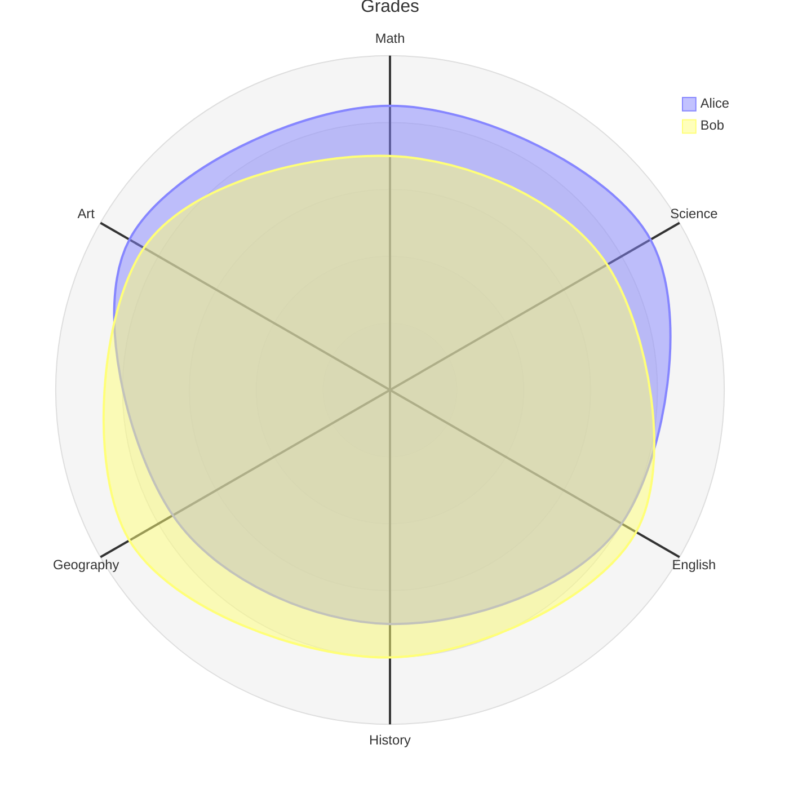
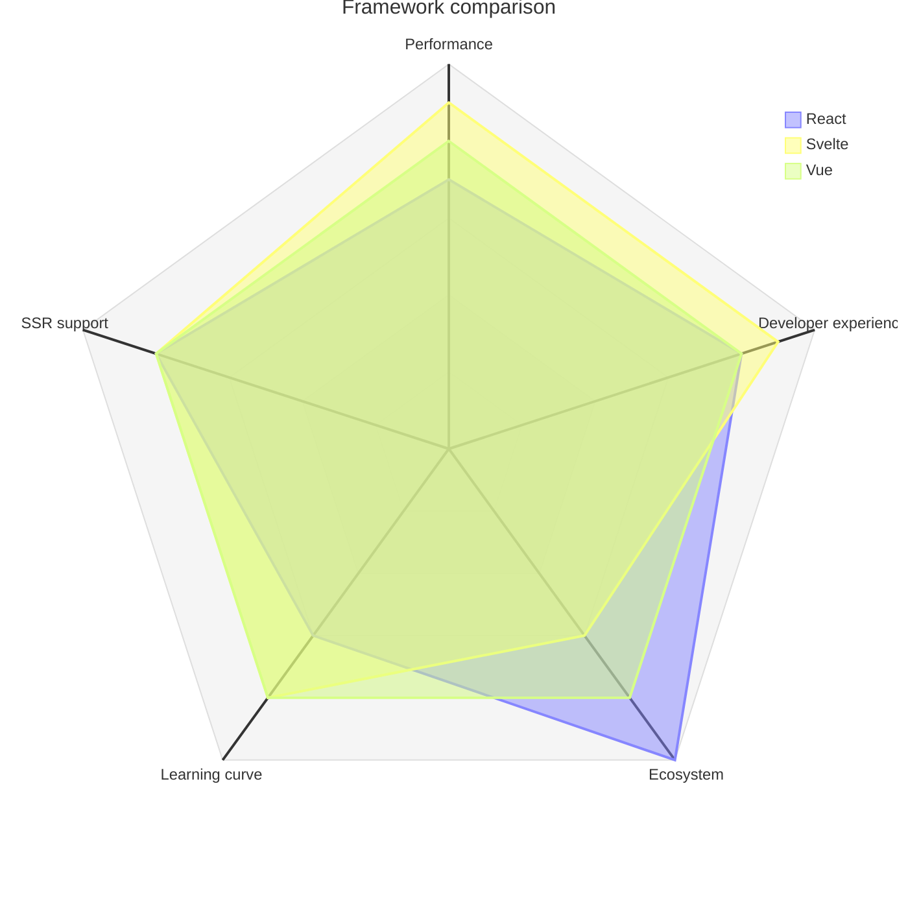
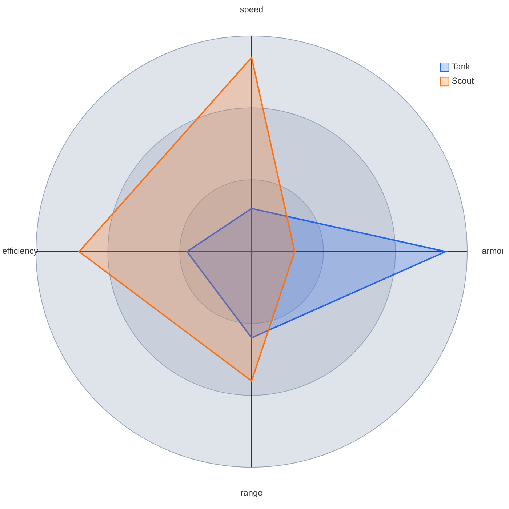

# Radar chart

Declaration: `radar-beta`

Use a radar chart (spider chart) to compare several items over the same set of three or more measures. Typical uses are skill profiles, product comparisons, and assessment scores.

## Syntax

The first line is `radar-beta`. The forms `radar-beta:` and `radar-beta :` also work. There is no `radar` keyword without `-beta`.

| Statement | Form | Notes |
|---|---|---|
| Axis | `axis id` or `axis id["Label"]` | Many axes can go on one line, separated by commas. |
| Curve, values by position | `curve id{1, 2, 3}` | One value per axis, in axis order. |
| Curve, values by axis | `curve id{ axisId: 1, axisId2: 2 }` | Any order. The `:` is optional. |
| Curve with label | `curve id["Label"]{1, 2, 3}` | The label shows in the legend. |
| Several curves | `curve a{1, 2}, b{3, 4}` | Separated by commas. |
| `max` | `max 100` | Outer value of the scale. Default: the largest value in the data. |
| `min` | `min 0` | Center value of the scale. Default `0`. |
| `ticks` | `ticks 5` | Number of grid rings. Default `5`. Maximum `32`. |
| `graticule` | `graticule circle` or `graticule polygon` | Shape of the grid. Default `circle`. |
| `showLegend` | `showLegend true` or `showLegend false` | Default `true`. |
| Title | `title Text` | Text to end of line. |
| Accessibility | `accTitle: Text`, `accDescr: Text`, `accDescr { ... }` | Not shown. |
| Comment | `%% text` | |

You can put several options on one line, separated by commas: `max 100, min 0, ticks 4`.

Identifiers (`id`):

- An identifier contains letters, digits, `_`, and `-`. It must not start or end with `-`.
- Do not start an identifier with a digit. `1st` fails.
- Keywords cannot be identifiers: `axis`, `curve`, `title`, `max`, `min`, `ticks`, `graticule`, `showLegend`, `circle`, `polygon`, `true`, `false`.
- Use a label in `["..."]` to show text with spaces or symbols. Without a label, the identifier is the shown text.

Values:

- A value is a non-negative integer or decimal: `0`, `85`, `7.5`.
- Negative values fail.
- Declare all axes before the curves that use axis names.
- A curve with axis names must give a value for every axis.
- A curve with plain values must give one value per axis. Mermaid does not check the count.
- A curve body can go across lines. Break the line after `{` or after a comma.

## Styling and configuration

Frontmatter `config.radar` keys: `width` (600), `height` (600), `marginTop`, `marginRight`, `marginBottom`, `marginLeft` (50 each), `axisScaleFactor` (1), `axisLabelFactor` (1.05; label distance from center), `curveTension` (0.17; `0` gives straight edges), `useMaxWidth` (true).

Theme variables:

- `cScale0` to `cScale11` set the curve colors, in curve order.
- `config.themeVariables.radar` takes `axisColor`, `axisStrokeWidth`, `axisLabelFontSize`, `curveOpacity`, `curveStrokeWidth`, `graticuleColor`, `graticuleStrokeWidth`, `graticuleOpacity`, `legendBoxSize`, `legendFontSize`.

## Examples

## Common mistakes

- `radar` without `-beta` is not a valid declaration.
- `curve c{1, -2}` fails. Values must not be negative. Use `min` and shift the data.
- An axis or curve named `max`, `curve`, `title`, or another keyword fails.
- `axis "Math"` fails. Write `axis math["Math"]`.
- A curve that names axes must name all of them. A missing axis causes an error.
- `ticks` above 32 is reduced to 32.
- A chart with fewer than three axes is valid but is hard to read.
