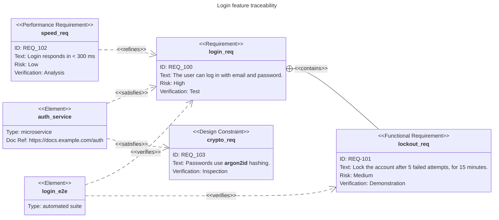
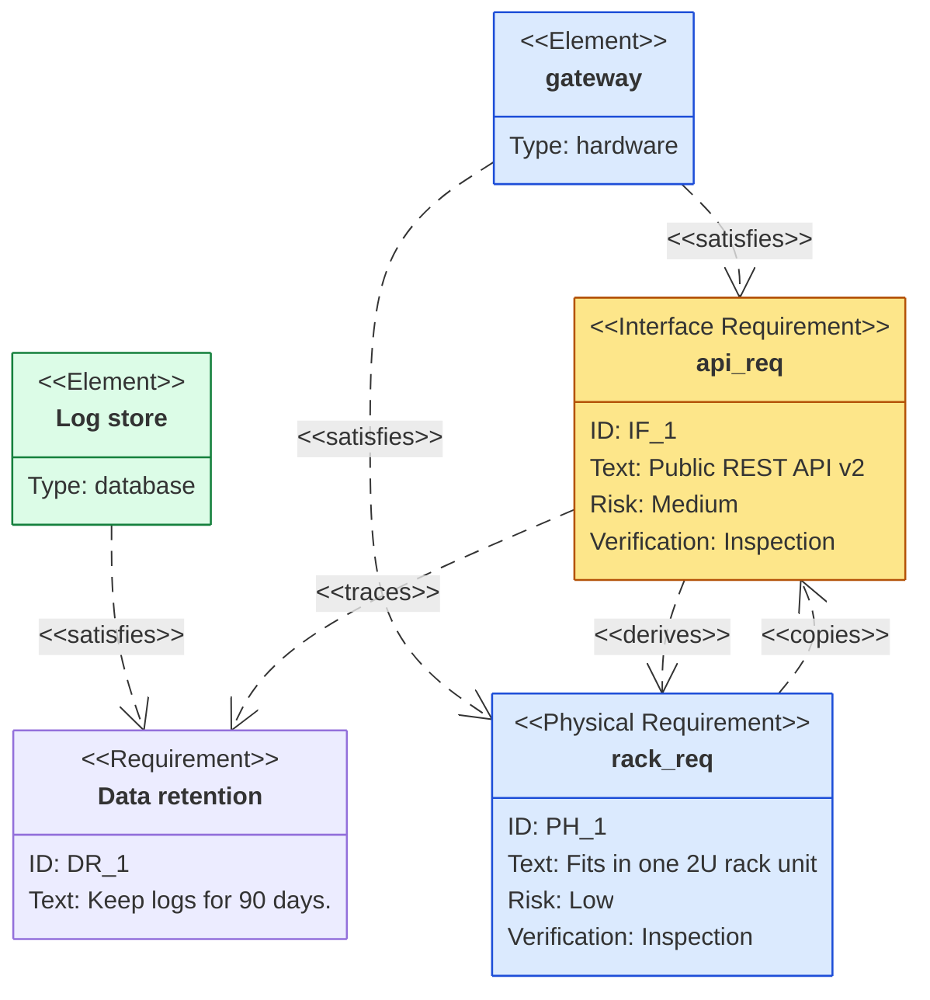

# Requirement diagram

Declaration: `requirementDiagram`

Use a requirement diagram to show requirements, the elements that satisfy or verify them, and the relationships between them (SysML style). It suits traceability views from requirements to designs and tests.

## Syntax

```
requirementDiagram
    requirement login_req {
        id: REQ_1
        text: The user can log in.
        risk: high
        verifymethod: test
    }
    element login_page {
        type: web page
    }
    login_page - satisfies -> login_req
```

### Requirements

```
<type> <name> {
    id: <value>
    text: <value>
    risk: <low | medium | high>
    verifymethod: <analysis | demonstration | inspection | test>
}
```

| Requirement type | Shown as |
|---|---|
| `requirement` | `<<Requirement>>` |
| `functionalRequirement` | `<<Functional Requirement>>` |
| `interfaceRequirement` | `<<Interface Requirement>>` |
| `performanceRequirement` | `<<Performance Requirement>>` |
| `physicalRequirement` | `<<Physical Requirement>>` |
| `designConstraint` | `<<Design Constraint>>` |

- All four fields are optional. Put each field on its own line. The order is free.
- `risk` and `verifymethod` accept only the listed words.
- The opening `{` must be on the same line as the name. The closing `}` must be on its own line.

### Elements

```
element <name> {
    type: <value>
    docref: <value>
}
```

Both fields are optional. An element has no other fields.

### Relationships

```
<source> - <type> -> <target>
<target> <- <type> - <source>
```

Types: `contains`, `copies`, `derives`, `satisfies`, `verifies`, `refines`, `traces`.

Both ends can be requirements or elements. Use the names from the definitions.

### Names and values

- A name or value without quotes must start with a letter, digit, or `_`. It can contain spaces. It ends at `:`, `,`, `-`, `<`, `>`, `=`, `{`, or the end of the line.
- Use double quotes for all other text: `"REQ-1"`, `"Fast, < 200 ms"`, `"https://example.com/spec"`.
- Quoted values can use Markdown: `text: "**Must** be encrypted"`.
- Keywords are case-insensitive. `risk: HIGH` and `verifyMethod: Test` are valid.

### Direction, classes, and styles

| Statement | Example | Effect |
|---|---|---|
| `direction <dir>` | `direction LR` | Layout direction: `TB` (default), `BT`, `LR`, `RL`. |
| `classDef <name> <css>` | `classDef critical fill:#f96,stroke:#333` | Defines a style class. |
| `class <names> <class>` | `class req1,req2 critical` | Applies a class to nodes. |
| `<name>:::<class>` | `req1:::critical` | Applies a class on its own line. |
| `<type> <name>:::<class> {` | `requirement req1:::critical {` | Applies a class in the definition. |
| `style <names> <css>` | `style req1,el1 fill:#eef,stroke:#00f` | Styles nodes directly. |
| `accTitle: <text>` | `accTitle: Login requirements` | Accessible title. |
| `accDescr: <text>` | `accDescr: Traceability for login` | Accessible description. Use `accDescr { ... }` for many lines. |
| `%% <text>` | `%% note` | Comment. |

## Styling and configuration

The diagram has no `title` statement. Set the title in frontmatter: `title: My title`.

The requirement diagram uses `theme: redux-color` and `look: neo` by default. Set `config.theme` or `config.look` to change them.

Frontmatter keys under `config.requirement`: `rect_fill`, `text_color`, `rect_border_size`, `rect_border_color`, `rect_min_width` (default `200`), `rect_min_height` (default `200`), `fontSize` (default `14`), `rect_padding` (default `10`), `line_height` (default `20`), `useMaxWidth`.

Theme variables: `requirementBackground`, `requirementBorderColor`, `requirementBorderSize`, `requirementTextColor`, `relationColor`, `relationLabelBackground`, `relationLabelColor`.

## Examples





## Common mistakes

- The header must be `requirementDiagram`. `requirement` alone fails.
- `title X` in the body fails. Use frontmatter `title:`.
- An unquoted `-` fails: `id: REQ-1` and `requirement login-req {` fail. Quote the value or use `_`.
- An unquoted `:` or `,` in a value fails or cuts the value. Quote URLs and sentences with commas.
- A name or value cannot start with a keyword followed by a space or symbol. `text: test the login`, `element test {`, and `requirement high availability {` fail. Keywords: `requirement`, `functionalRequirement`, `interfaceRequirement`, `performanceRequirement`, `physicalRequirement`, `designConstraint`, `element`, `id`, `text`, `risk`, `verifymethod`, `type`, `docref`, `low`, `medium`, `high`, `analysis`, `demonstration`, `inspection`, `test`, `contains`, `copies`, `derives`, `satisfies`, `verifies`, `refines`, `traces`, `style`, `classDef`, `class`. Quote the text or change the first word.
- A body on one line fails: `requirement r1 { id: 1 }`. Put each field and the `}` on their own lines.
- `risk: critical` fails. Use `low`, `medium`, or `high`.
- An unknown field fails, for example `owner:` in an element.
- A relationship needs a type. `a --> b` fails. Write `a - satisfies -> b`.
