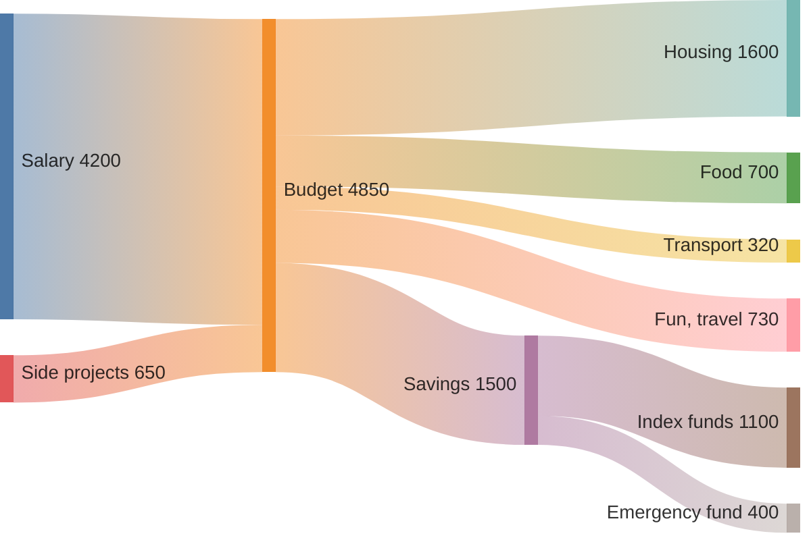
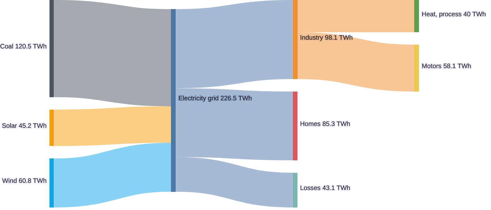
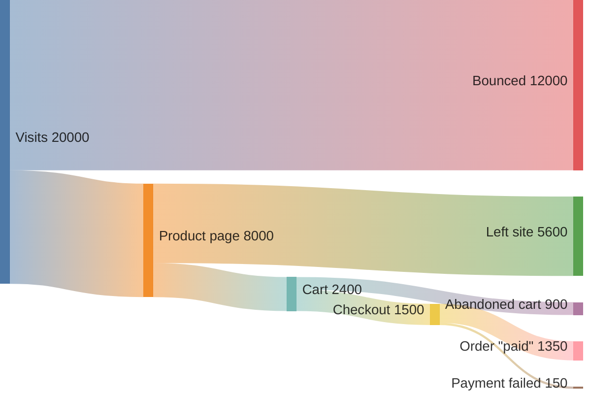

# Sankey diagram

Declaration: `sankey` (the older `sankey-beta` also works)

Use a Sankey diagram to show how a quantity flows from sources to targets through stages. The width of each link is in proportion to its value. Typical uses are energy flows, budgets, and traffic funnels.

## Syntax

The first line is `sankey`. After it, each line is one link in CSV form: source, target, value.

```
sankey
Source,Target,Value
```

| Element | Rules |
|---|---|
| Link row | Exactly three fields, separated by commas: `source,target,value`. |
| Node | A node is created the first time its name occurs. Use the same name to link to the same node. |
| Value | A number such as `10`, `0.597`, or `1.5e2`. Use positive values. |
| Plain field | ASCII text without `,` and `"`. Spaces are allowed. Spaces at the start and end are removed. |
| Quoted field | `"Heat, power"`. Use this when a name contains a comma. |
| Quote in a quoted field | Write two double quotes: `"The ""best"" route"`. |
| Empty lines | Allowed. Mermaid removes them. |
| Comment | `%% text` on its own line. |

There is no header row, no title, and no accessibility statement. If you write a header row such as `source,target,value`, Mermaid draws it as a link.

Two rows with the same source and target make two separate links.

Mermaid computes the node value from the links. A node with more input than output is valid.

## Styling and configuration

Frontmatter `config.sankey` keys:

| Key | Default | Effect |
|---|---|---|
| `width` | `600` | Width of the drawing area. |
| `height` | `400` | Height of the drawing area. |
| `linkColor` | `gradient` | `source`, `target`, `gradient`, or a color such as `"#a0a0a0"`. |
| `nodeAlignment` | `justify` | `left`, `right`, `center`, or `justify`. |
| `showValues` | `true` | Show the value under each node name. |
| `prefix` | `""` | Text before each shown value, for example `"$"`. |
| `suffix` | `""` | Text after each shown value, for example `" TWh"`. |
| `nodeWidth` | `10` | Width of the node bars. |
| `nodePadding` | `12` | Vertical space between nodes. |
| `labelStyle` | `legacy` | `outlined` adds a light outline behind labels for better contrast. |
| `nodeColors` | none | A map from node name to color. Other nodes use the default color scheme. |
| `useMaxWidth` | `true` | Scale to the container width. |

## Examples







## Common mistakes

- Every row needs exactly three fields. `A,B` and `A,B,10,` fail.
- Non-ASCII characters fail, also in quotes. `Café` fails. Write `Cafe`.
- A name with a comma must be in double quotes.
- An unquoted `;` in a name fails. Quote the name or remove the `;`.
- A cycle (A to B and B to A, directly or through other nodes) parses but fails to render.
- Do not add a header row.
- Do not use thousands separators in values. `1,500` splits the row into four fields.
- A value that is not a number parses but breaks the drawing.
