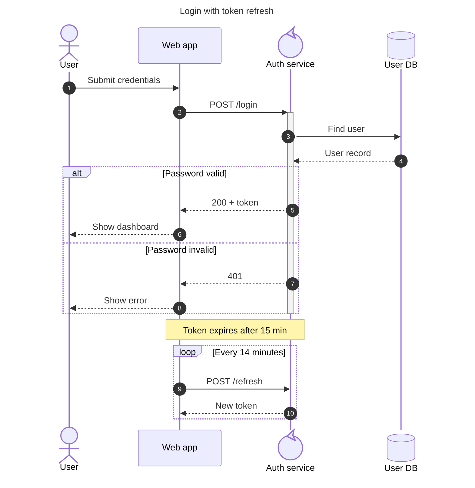
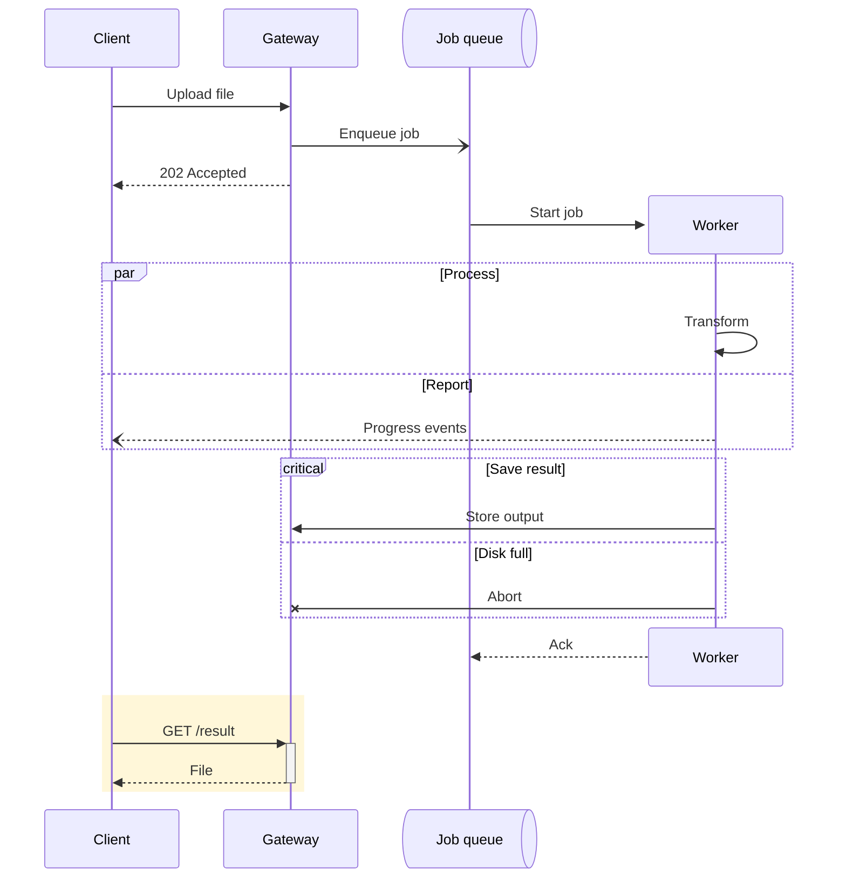

# Sequence diagram

Declaration: `sequenceDiagram`

Use a sequence diagram to show messages between participants in time order, for example an API call chain, a login handshake, or a protocol.

## Syntax

### Participants

Participants appear in the order of first use. Declare them to set the order, a display name, or a type.

```
participant API
participant DB as Orders database
actor User
participant Q@{ type: queue }
participant S@{ type: database, alias: "Main store" }
participant C@{ type: control } as Controller
```

| Type (`@{ type: ... }`) | Symbol |
|---|---|
| `participant` | Box (default) |
| `actor` | Stick figure (same as the `actor` keyword) |
| `boundary`, `control`, `entity` | UML robustness symbols |
| `database` | Cylinder |
| `collections` | Stacked boxes |
| `queue` | Queue |

Create and destroy a participant during the flow. The next message must involve it.

```
create participant W as Worker
API->>W: spawn
destroy W
W-->>API: done
```

Group participants in a colored box. The color is optional: a CSS name, `rgb(...)`, `rgba(...)`, `hsl(...)`, or `transparent`. Hex colors are not supported.

```
box Aqua Backend
  participant API
  participant DB
end
```

### Messages

Form: `From<arrow>To: text`. The text is optional after the colon.

| Arrow | Meaning |
|---|---|
| `->>` | Solid line, filled arrowhead (call) |
| `-->>` | Dotted line, filled arrowhead (reply) |
| `->` / `-->` | Solid / dotted line, no arrowhead |
| `-x` / `--x` | Solid / dotted line, cross at the end |
| `-)` / `--)` | Solid / dotted line, open arrow (async) |
| `<<->>` / `<<-->>` | Solid / dotted, arrowheads at both ends |

Half arrowheads draw only the top or bottom half of the head. The table cannot show them, so they are listed here, one per line:

```
A-|\B: solid, filled top half       A--|\B: dotted form
A-|/B: solid, filled bottom half    A--|/B: dotted form
A-\\B: solid, stick top half        A--\\B: dotted form
A-//B: solid, stick bottom half     A--//B: dotted form
A/|-B: reverse filled top half      A/|--B: dotted form
A\|-B: reverse filled bottom half   A\|--B: dotted form
A//-B: reverse stick top half       A//--B: dotted form
A\\-B: reverse stick bottom half    A\\--B: dotted form
```

Activation shortcuts: `A->>+B: call` activates `B`. `B-->>-A: reply` deactivates `B`. Explicit form: `activate B` and `deactivate B`. Activations can nest.

Central connection markers: `A->>()B: msg`, `A()->>B: msg`, `A()->>()B: msg` draw a small circle at the lifeline end.

### Notes

```
Note right of A: text
Note left of A: text
Note over A: text
Note over A,B: text across two lifelines
```

### Blocks

Every block ends with `end`.

```
loop Every 5 seconds
  A->>B: poll
end
alt Success
  B-->>A: 200
else Not found
  B-->>A: 404
end
opt Cache hit
  A->>A: read cache
end
par Send email
  A->>M: email
and Send SMS
  A->>S: sms
end
critical Open connection
  A->>DB: connect
option Timeout
  A->>A: log
end
break Validation fails
  A-->>U: error
end
rect rgba(0, 128, 255, 0.1)
  A->>B: highlighted
end
```

`par_over` works like `par` but draws the branches over each other.

### Other statements

| Statement | Effect |
|---|---|
| `autonumber` | Number all following messages |
| `autonumber 10` / `autonumber 10 5` | Start at 10 / start at 10, step 5 |
| `autonumber off` | Stop numbering |
| `title Text` | Diagram title |
| `link A: Label @ https://url` | Menu link on a participant |
| `links A: {"Docs": "https://url", "Repo": "https://url"}` | Many menu links |
| `accTitle: text` / `accDescr: text` | Accessibility text |
| `%% text` | Comment |

Use `<br/>` for a line break in message and note text. Use entity codes for reserved characters: `#59;` for `;`, `#35;` for `#`.

## Styling and configuration

Sequence diagrams have no `classDef` or `style`. Use `rect` blocks and `box` colors for emphasis.

```
---
config:
  sequence:
    mirrorActors: false        # do not repeat participants at the bottom
    showSequenceNumbers: true  # same as autonumber
    wrap: true                 # wrap long message text
    messageAlign: center       # left, center, right
    rightAngles: true          # self-messages as right angles
    hideUnusedParticipants: false
    actorMargin: 50
    noteAlign: center
---
```

## Examples





## Common mistakes

- `;` ends a statement. `A->>B: a; b` fails. Write `#59;`.
- `#` starts a comment and cuts the text. Write `#35;`.
- `else`, `and`, and `option` are valid only inside `alt`, `par`, and `critical`.
- Each block needs its own `end`. A missing or extra `end` fails.
- `-` (deactivate) on a participant that is not active fails: "Trying to inactivate an inactive participant".
- A participant can be in only one `box`.
- Do not use a hex color in `box` or `rect`: `#` starts a comment, so the color is lost. Use `rgb(...)`, `rgba(...)`, or a color name.
- `end` as a participant name breaks block parsing. Use another name or an alias: `participant E as end`.
