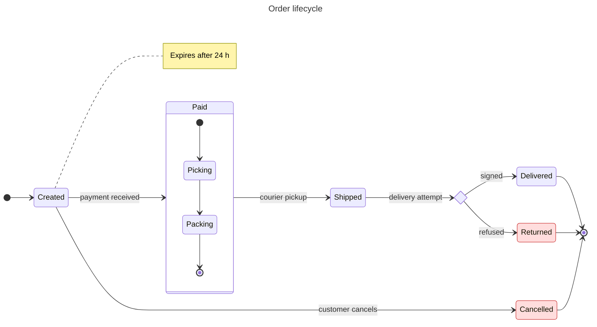
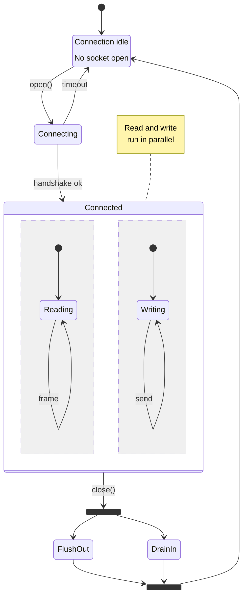

# State diagram

Declaration: `stateDiagram-v2` (the older keyword `stateDiagram` uses the same parser and renderer; prefer `stateDiagram-v2`)

Use a state diagram to show the states of one thing and the events that move it between them, for example an order lifecycle, a connection, or a UI mode.

## Syntax

### States

```
Idle
state "Waiting for payment" as Waiting
Waiting : Second line of description
state "Shipped" as Shipped : Left the warehouse
```

- A state ID is letters, digits, and `_`. A `-` in an ID fails.
- `state "Text" as Id` gives a state a label with spaces.
- `Id : text` adds a description line to the state.

### Transitions

```
[*] --> Idle
Idle --> Running : start
Running --> Idle : stop
Running --> [*]
```

- `[*]` is the start state when it is on the left, and the end state when it is on the right.
- The label after `:` is free text. It can hold more `:` characters.
- Write one transition per line. A chain `A --> B --> C` fails.

### Composite states

```
state Running {
  direction LR
  [*] --> Loading
  Loading --> Ready
  Ready --> [*]
}
```

Composite states can nest. Each composite state has its own `[*]`. A transition can target the composite state from outside.

### Concurrency

Split a composite state into regions with a line that holds only `--`.

```
state Active {
  [*] --> Audio
  --
  [*] --> Video
}
```

### Pseudo-states

```
state split <<fork>>
state merge <<join>>
state decide <<choice>>
```

`[[fork]]`, `[[join]]`, and `[[choice]]` are the same as `<<fork>>`, `<<join>>`, and `<<choice>>`.

### Notes

```
note right of Idle : Single-line note
note left of Running
  Multi-line note
  second line
end note
```

### Other statements

| Statement | Effect |
|---|---|
| `direction LR` | `TB`, `BT`, `LR`, or `RL`; also valid inside a composite state |
| `hide empty description` | Draw states without a description as simple boxes |
| `click Id "https://url" "tooltip"` | Link on a state |
| `click Id href "https://url"` | Link on a state, no tooltip |
| `accTitle: text` / `accDescr: text` | Accessibility text |
| `%% text` | Comment |

## Styling and configuration

```
classDef failed fill:#f66,color:#fff,font-weight:bold
class Error,Timeout failed
Done:::failed
[*] --> Start:::failed
style Idle fill:#bbf,stroke:#333
```

- `classDef` takes one class name per statement.
- `class A,B name` and `style A,B ...` take a list of IDs.
- `Id:::name` works on its own line or inside a transition.

```
---
config:
  layout: elk     # default for state diagrams in Mermaid 12; dagre also works
  look: classic   # classic, handDrawn, neo
  state:
    padding: 8
---
```

## Examples





## Common mistakes

- `-` in a state ID fails: `a-b --> c`. Use `a_b` or `state "a-b" as a_b`.
- A multi-line note ends with `end note`, not `end`.
- `classDef default ...` fails in state diagrams. Name the class and apply it.
- `classDef a,b fill:#f00` fails. Write one `classDef` per class name.
- A transition chain on one line fails. Split it into lines.
- A label with spaces needs `state "..." as Id`. Do not put spaces in a bare ID.
- `click Id href "url" "tooltip"` fails. Use `click Id "url" "tooltip"` to add a tooltip.
- `end` is not a keyword here, but avoid it as a state ID for clarity.
