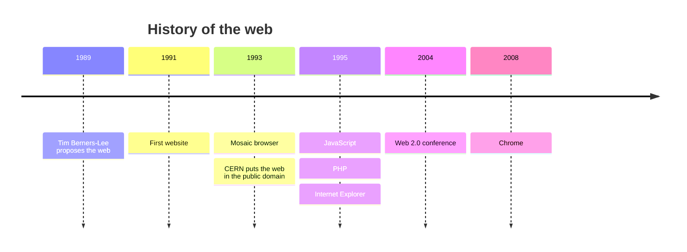
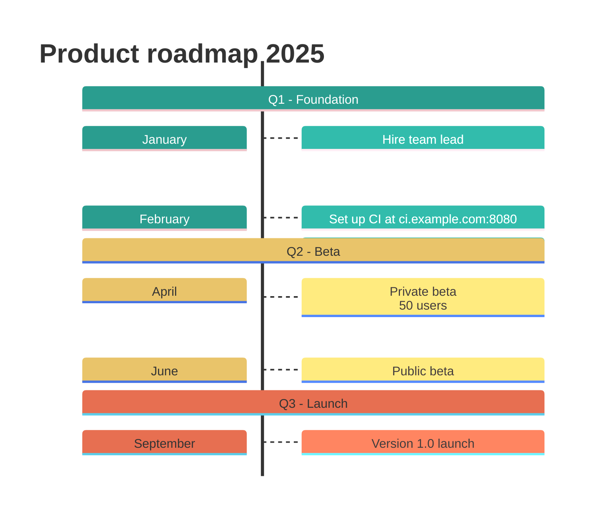
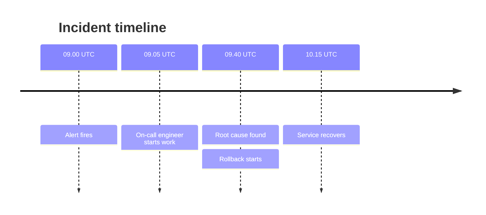

# Timeline

Declaration: `timeline` (also `timeline LR` or `timeline TD`)

Use a timeline to show events in chronological order. Each time period holds one or more events. Sections group the periods into eras or phases.

## Syntax

```
timeline
    title History of social media
    section 2000s
        2002 : LinkedIn
        2004 : Facebook : Google
             : Flickr
```

| Statement | Example | Effect |
|---|---|---|
| `timeline` | `timeline` | Declares the diagram. Periods go from left to right. |
| `timeline LR` | `timeline LR` | Same as `timeline`. |
| `timeline TD` | `timeline TD` | Periods go from top to bottom. |
| `title <text>` | `title Product history` | Diagram title. |
| `section <name>` | `section Early days` | Starts a group of periods. All periods after it belong to it, until the next `section`. |
| `<period>` | `2021` | A time period with no events. |
| `<period> : <event>` | `2021 : First release` | A time period with one event. |
| `<period> : <e1> : <e2>` | `2021 : Beta : Launch` | A time period with many events. |
| `: <event>` | `     : Hotfix` | Adds an event to the previous period. Put it on its own line. |
| `accTitle: <text>` | `accTitle: Company history` | Accessible title. |
| `accDescr: <text>` | `accDescr: Main events since 2010` | Accessible description. Use `accDescr { ... }` for many lines. |
| `%% <text>` | `%% note` | Comment. A line that starts with `#` is also a comment. |

### Text rules

- A period is free text. It can contain spaces, digits, and most symbols, for example `Q1 2024` or `Jan - Mar`.
- An event starts after a colon and a space (`: `). The space is necessary.
- An event can contain a colon that is not followed by a space, for example `10:30` or `https://example.com`.
- A colon followed by a space always starts a new event.
- Use `<br>` to break a line inside a period or an event.
- Indentation has no effect. Use it to make the text easy to read.

## Styling and configuration

Without sections, each period gets its own color. With sections, each section gets its own color, and its periods and events use that color.

Frontmatter keys under `config.timeline`:

| Key | Default | Effect |
|---|---|---|
| `disableMulticolor` | `false` | `true` gives all periods one color when there are no sections. |
| `padding` | `50` | Space around the diagram. |
| `leftMargin` | `150` | Space at the left of the first period. |
| `width`, `height` | `150`, `50` | Minimum size of a period box. |
| `useMaxWidth` | `true` | Scales the diagram to the container width. |

Theme variables `cScale0` to `cScale11` set the section and period colors. `cScaleLabel0` to `cScaleLabel11` set the text colors. Use `theme: base` when you change them.

```
---
config:
  theme: base
  themeVariables:
    cScale0: "#ff9f1c"
    cScaleLabel0: "#000000"
---
```

## Examples







## Common mistakes

- A period cannot contain a colon. `10:30 : Standup` fails. Write `10.30 : Standup` or `10h30 : Standup`.
- A colon after a period needs a space after it. `2024 :Launch` fails.
- `Note: details` inside an event makes two events, `Note` and `details`. Do not use `: ` inside event text.
- A section name cannot contain a colon. `section Phase 1: Plan` fails. Use `section Phase 1 - Plan`.
- An event line (`: text`) needs a period before it. An event line directly after `section` or at the start fails.
- Only `LR` and `TD` are directions. `timeline TB` does not fail, but `TB` becomes a period.
- A period that starts with `title` or `section` becomes a statement. `Title fight : 1990` sets the diagram title. Change the first word.
- A period cannot contain `#`. The text after `#` becomes a comment.
