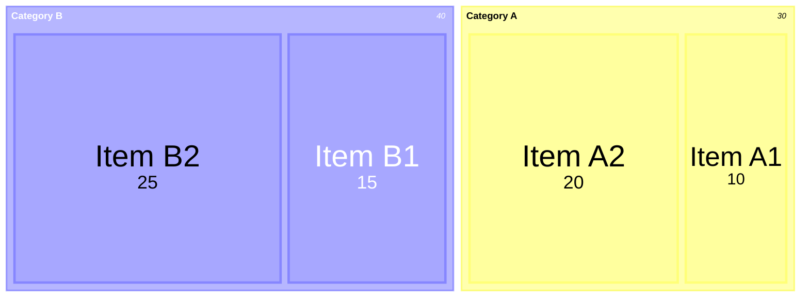
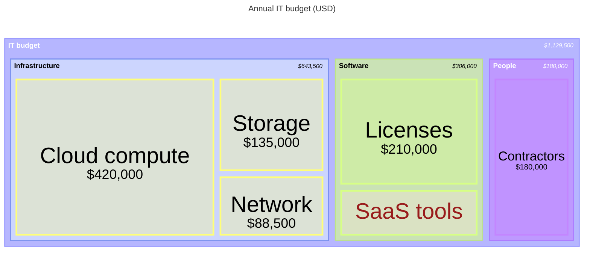
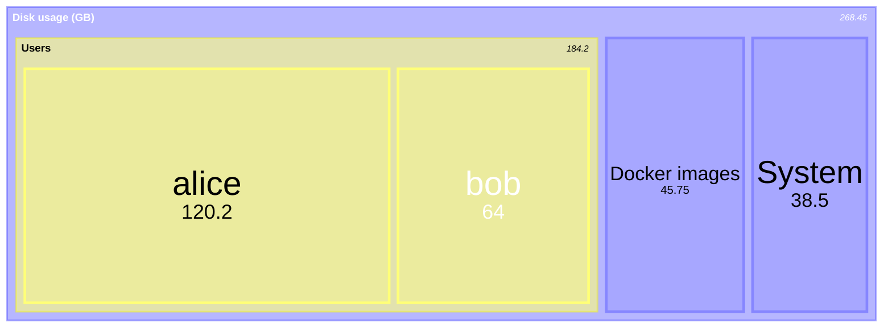

# Treemap

Declaration: `treemap` (the older `treemap-beta` also works)

Use a treemap to show a hierarchy where each item has a size. Each leaf is a rectangle with an area in proportion to its value. Typical uses are budgets, disk usage, and market share by segment.

## Syntax

The first line is `treemap`. After it, each line is one node. Indentation sets the hierarchy.

| Node | Form | Notes |
|---|---|---|
| Section (parent) | `"Name"` | Has no value. Its size is the sum of its children. |
| Leaf | `"Name": 10` | Has a value. Cannot have children. |
| Leaf, comma form | `"Name", 10` | Same as `:`. |
| Section with class | `"Name":::className` | Applies a `classDef`. |
| Leaf with class | `"Name": 10:::className` | The class goes after the value. |

Other statements:

| Statement | Form | Notes |
|---|---|---|
| Class | `classDef name fill:#f96,stroke:#333,stroke-width:2px` | CSS properties, separated by `,`. A `;` at the end is optional. |
| Title | `title Text` | On its own line. Text to end of line. |
| Accessibility | `accTitle: Text`, `accDescr: Text`, `accDescr { ... }` | Not shown. |
| Comment | `%% text` | |

Hierarchy:

- A node with more indentation than the node above it is a child of that node.
- Use spaces or tabs. Keep the same indentation for siblings.
- Write a section at the top level with no indentation. Several top-level sections are allowed.
- A leaf cannot have children. A more-indented line under a leaf goes to the section above the leaf.

Names:

- A name must be in double or single quotes: `"Cloud costs"` or `'Cloud costs'`.
- A name cannot contain its own quote character. There is no escape. Use the other quote type: `'The "best" plan'`.

Values:

- Digits, with optional `.` for decimals and `,` for thousands: `10`, `2.5`, `1,200`.
- Negative values fail. A `-` in a value is a lexer error.
- Do not use `_` in a value. `1_000` is read as `1`.

Class names start with a letter or `_`, contain letters, digits, and `_`, and have at least two characters.

## Styling and configuration

Frontmatter `config.treemap` keys:

| Key | Default | Effect |
|---|---|---|
| `padding` | `10` | Space inside each section, around its children. |
| `diagramPadding` | `8` | Space around the whole diagram. |
| `showValues` | `true` | Show values in the rectangles. |
| `valueFormat` | `,` | A d3-format string, for example `,.2f`, `.1%`, `$0,0`, `$,.2f`. |
| `nodeWidth` | `100` | Scales the diagram width. |
| `nodeHeight` | `40` | Scales the diagram height. |
| `borderWidth` | `1` | Border width of rectangles. |
| `labelFontSize` | `14` | Label font size. |
| `valueFontSize` | `12` | Value font size. |
| `useMaxWidth` | `true` | Scale to the container width. |

The top-level sections take their colors from the theme variables `cScale0` to `cScale11`.

Use `classDef` for one node. Common properties are `fill`, `stroke`, `stroke-width`, and `color` (text color).

## Examples

## Common mistakes

- `Item: 10` fails. Names need quotes: `"Item": 10`.
- `"Item": -5` fails. Values must not be negative.
- `"Item \"x\"": 1` fails. There is no escape in names.
- `"Leaf": 10:::cls` is valid, but `"Leaf":::cls: 10` fails. The class goes after the value.
- Do not mix tabs and spaces between siblings.
- Children of a leaf do not nest under it. Make the parent a section without a value.
- `classDef` names need at least two characters. `classDef a fill:#f00` fails.
