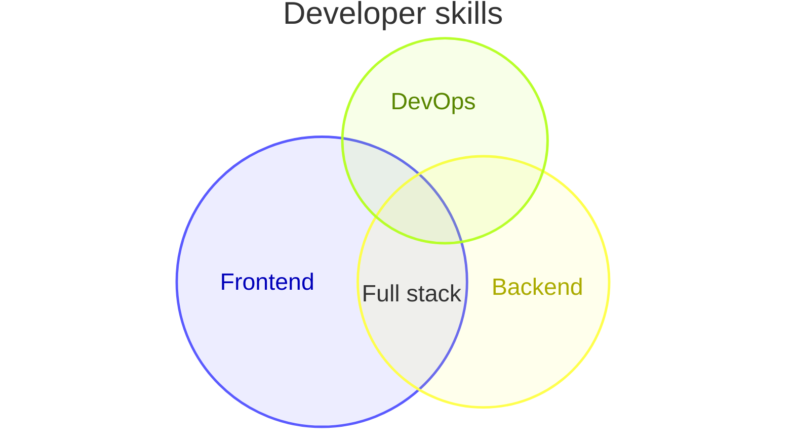
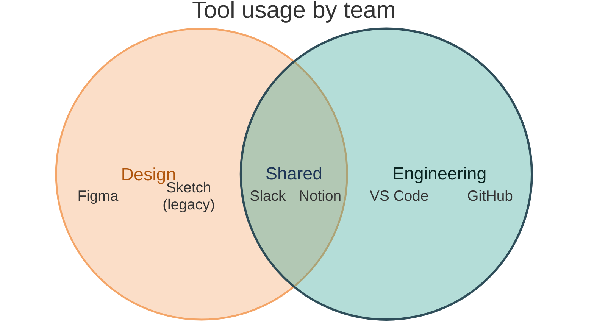
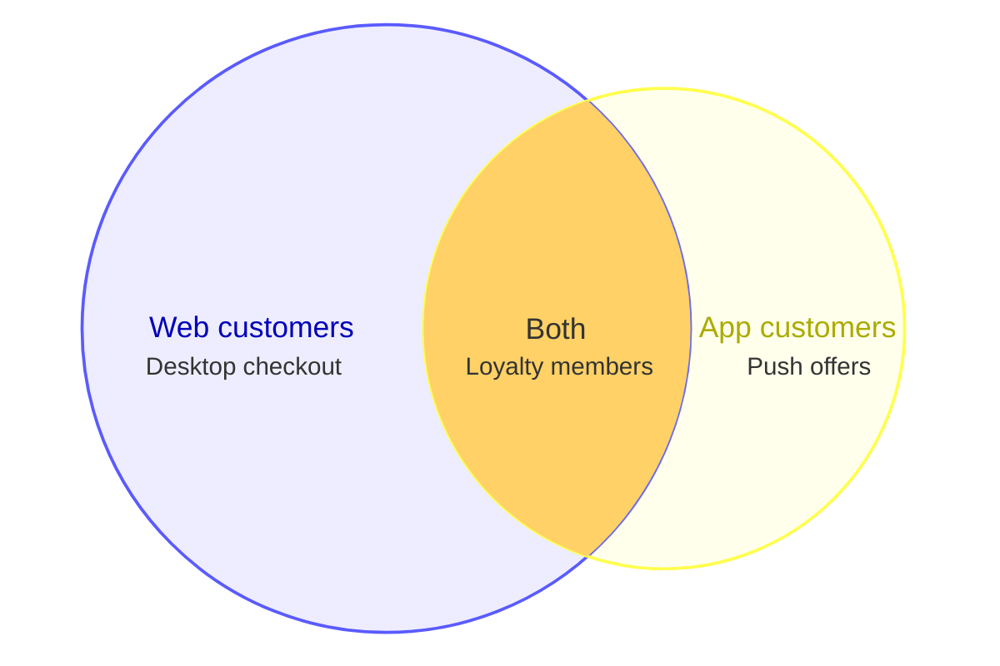

# Venn diagram

Declaration: `venn-beta`

Use a Venn diagram to show how two or more sets overlap. Typical uses are shared skills, overlapping customer groups, and feature coverage across products.

## Syntax

The first line is `venn-beta`. There is no `venn` keyword without `-beta`.

| Statement | Form | Notes |
|---|---|---|
| Set | `set A` | Declares a set. |
| Set with label | `set A["Frontend"]` | The label shows instead of the identifier. |
| Set with size | `set A["Frontend"] : 20` | Relative circle area. Default `10`. |
| Overlap | `union A,B` | An overlap of two or more declared sets. |
| Overlap with label and size | `union A,B["Full stack"] : 5` | Default size is `10 / n²` for `n` sets. |
| Text in an area | `text A,B "React"` | Adds a text item to the area of sets `A` and `B`. |
| Text with id and label | `text A myId ["Shown text"]` | The label shows. The id is internal. |
| Text under a set | an indented `text "React"` after a `set` or `union` line | Goes into the area of that `set` or `union`. |
| Style | `style A fill:#ff6b6b, fill-opacity:0.4` | For a set or for an overlap (`style A,B ...`). |
| Title | `title Text` | Text to end of line. |
| Comment | `%% text` | |

Identifiers:

- An identifier starts with a letter or `_`. It can contain letters, digits, `_`, and `-`: `set front-end`.
- A quoted string also works as an identifier: `set "My set"`, then `union "My set",B`.
- Declare each set with `set` before you use it in `union`. Unknown sets in `union` cause an error.

Labels:

- `["Text"]` is a label. It cannot contain a double quote.
- `[Text]` without quotes also works. It cannot contain `]` or `"`.

Text items:

- The text after the sets is a plain identifier or a quoted string: `text A item1` or `text A "Item one"`.
- Add `["Label"]` after it to show a different text.
- Indented text belongs to the `set` or `union` directly above it. In that form, do not repeat the set names.
- Write all other statements without indentation. An indented `text A "x"` after a `set` line is read as text under that set, not as a top-level statement.

Style properties:

| Property | Example |
|---|---|
| `fill` | `fill:#2a9d8f` or `fill:rgb(42, 157, 143)` or `fill:teal` |
| `fill-opacity` | `fill-opacity:0.3` |
| `stroke` | `stroke:#264653` |
| `stroke-width` | `stroke-width:3` |
| `color` | `color:#000000` (text color) |

Separate properties with commas. Colors can be hex (3 to 8 digits), `rgb(...)`, `rgba(...)`, or a color name.

## Styling and configuration

Frontmatter `config.venn` keys: `width` (800), `height` (450), `padding` (8), `useDebugLayout` (false), `useMaxWidth` (true). The Venn diagram uses `theme: redux-color` and `look: neo` by default. You can set `config.venn.theme` and `config.venn.look` (`classic`, `handDrawn`, `neo`).

Theme variables (`config.themeVariables`): `venn1` to `venn8` (set colors, in set order), `vennTitleTextColor`, `vennSetTextColor`.

## Examples

## Common mistakes

- `venn` without `-beta` is not a valid declaration.
- `union A,B` before `set A` and `set B` fails.
- `union A` with one set fails. A union needs two or more sets.
- `set 1A` fails. An identifier must not start with a digit.
- `set A["Say "hi""]` fails. A label cannot contain a double quote.
- `title Team #1` fails. A title cannot contain `#` or `;`.
- `accTitle` and `accDescr` are not supported and fail.
- `stroke-width:3px` gives the value `3 px`, which is not valid CSS. Write `stroke-width:3`.
- An overlap size larger than a set size gives a poor layout. Keep each overlap smaller than its sets.
