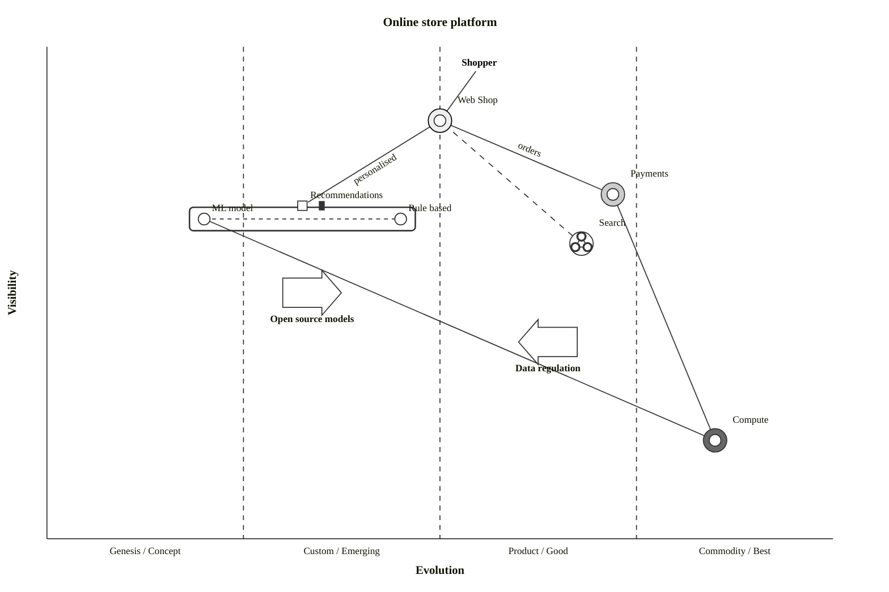

# Wardley map

Declaration: `wardley-beta`

Use this diagram to map the components of a value chain by visibility to the user (vertical) and by evolution stage (horizontal). Use it for strategy talks: build or buy decisions, inertia, and expected movement of components.

## Syntax

Write one statement per line after the `wardley-beta` header. Statements can come in any order, but a component must exist before a `pipeline` or `evolve` statement that names it.

### Coordinates

Every position is `[visibility, evolution]`. Visibility is the vertical axis (1.0 is at the top, near the user). Evolution is the horizontal axis (0.0 is Genesis, 1.0 is Commodity).

- Write each value as a decimal number with a dot: `0.5`, `0.0`, `1.0`. A plain integer such as `50` fails to parse.
- A value from `0.0` to `1.0` is a fraction. A value above `1.0` is a percentage (`75.0` is 75%). Do not mix the two scales. Use fractions.

### Statements

| Statement | Example | Effect |
| --- | --- | --- |
| `title <text>` | `title Tea shop` | Title above the map. |
| `accTitle: <text>` / `accDescr: <text>` | `accDescr: Map of a tea shop` | Accessibility text. |
| `size [<width>, <height>]` | `size [1100, 800]` | Canvas size in pixels. Integers. Default 900 x 600. |
| `evolution <stage> -> <stage> ...` | `evolution Genesis -> Custom -> Product -> Commodity` | Labels of the evolution stages. Two or more stages. |
| `anchor <name> [v, e]` | `anchor Customer [0.95, 0.6]` | User need. Drawn as bold text without a circle. |
| `component <name> [v, e]` | `component Kettle [0.43, 0.35]` | Component. Drawn as a circle with a label. |
| `<from> -> <to>` | `Cup -> Tea` | Dependency link. |
| `evolve <name> <target>` | `evolve Kettle 0.62` | Red arrow from the component to a new evolution value at the same visibility. |
| `pipeline <name> { ... }` | see below | Pipeline of variants under a component. |
| `note "<text>" [v, e]` | `note "Commodity soon" [0.3, 0.5]` | Bold free text at a position. |
| `annotation <n>, [v, e] "<text>"` | `annotation 1, [0.48, 0.85] "Key risk"` | Numbered circle at a position. |
| `annotations [v, e]` | `annotations [0.97, 0.02]` | Position of the box that lists all annotation texts. |
| `accelerator <name> [v, e]` | `accelerator Open source [0.5, 0.4]` | Large right-pointing arrow. |
| `deaccelerator <name> [v, e]` | `deaccelerator Regulation [0.5, 0.7]` | Large left-pointing arrow. |
| `%% text` | `%% comment` | Comment. |

### Stage boundaries and two-line stage names

```
evolution Genesis@0.2 -> Custom Built@0.45 -> Product@0.75 -> Commodity@1.0
evolution Genesis / Concept -> Custom / Emerging -> Product / Good -> Commodity / Best
```

`@<number>` sets the right edge of a stage as a fraction. The boundaries apply only when every stage has one. Otherwise, the stages have equal widths. `A / B` shows both names. Without an `evolution` statement, the stages are Genesis, Custom Built, Product, Commodity.

### Component options

```
component <name> [v, e] label [<dx>, <dy>] (<strategy>) inertia
```

The options are optional, but their order is fixed: `label`, then strategy, then inertia.

| Option | Effect |
| --- | --- |
| `label [dx, dy]` | Moves the label by integer pixels. Negative values are allowed: `label [-57, 4]`. |
| `(build)`, `(buy)`, `(outsource)`, `(market)` | Sourcing strategy marker around the node. `(market)` replaces the circle with a market symbol. |
| `inertia` or `(inertia)` | Vertical bar to the right of the node. |

### Names

- A name can contain letters, digits, spaces, `_`, `-`, `(`, `)`, and `&`. It must start with a letter: `Hot Water`, `R&D`, `Cup-of-tea`.
- Use double quotes for other names: `"3D Printer"`, `"Tea, hot"`, `"note taker"`. Refer to the name with the same quotes in links.
- Links use the exact name. A link to an unknown name is not drawn.

### Links

| Form | Effect |
| --- | --- |
| `A -> B`, `A --> B`, `A > B` | Solid line. |
| `A -.-> B` | Dashed line. |
| `A +> B` | Flow arrow toward B. |
| `A +< B` | Flow arrow toward A. |
| `A +<> B` | Flow arrows in both directions. |
| `A +'label'> B` | Flow arrow with a label. `+'label'<` and `+'label'<>` also work. |
| `A -> B ; text` | Line with a label. The text runs to the end of the line. |

### Pipelines

```
component Kettle [0.43, 0.35]
pipeline Kettle {
  component Campfire Kettle [0.3]
  component Electric Kettle [0.6] label [-20, 10]
}
```

The pipeline parent must be a declared component. Each pipeline component takes only an evolution value. It uses the visibility of the parent. The parent becomes a square above a box that holds the variants. Links can refer to a pipeline component by its own name.

## Styling and configuration

- Set the canvas size with the `size [w, h]` statement.
- The renderer reads a `wardley-beta` config block (`width`, `height`, `padding`, `nodeRadius`, `nodeLabelOffset`, `axisFontSize`, `labelFontSize`, `showGrid`). In 12.2.0, frontmatter and `%%{init}%%` drop this key. It works only through `mermaid.initialize`.
- Colors come from `themeVariables.wardley` in frontmatter: `backgroundColor`, `axisColor`, `axisTextColor`, `gridColor`, `componentFill`, `componentStroke`, `componentLabelColor`, `linkStroke`, `evolutionStroke`, `annotationStroke`, `annotationTextColor`, `annotationFill`.

```
---
config:
  themeVariables:
    wardley:
      evolutionStroke: "#d9480f"
      componentFill: "#f1f3f5"
---
```

## Examples

Tea shop value chain with strategy markers, inertia, evolution arrows, a note, and annotations:

```mermaid
wardley-beta
title Tea shop
size [1000, 700]
anchor Business [0.95, 0.63]
anchor Public [0.95, 0.78]
component Cup of Tea [0.79, 0.61] label [19, -4]
component Cup [0.73, 0.78]
component Tea [0.63, 0.81]
component Hot Water [0.52, 0.80]
component Water [0.38, 0.82]
component Kettle [0.43, 0.35] label [-57, 4] (build)
component Power [0.10, 0.70] (outsource) inertia
Business -> Cup of Tea
Public -> Cup of Tea
Cup of Tea -> Cup
Cup of Tea -> Tea
Cup of Tea -> Hot Water
Hot Water -> Water
Hot Water -> Kettle
Kettle -> Power
evolve Kettle 0.62
evolve Power 0.89
note "Standard power lets kettles evolve" [0.30, 0.49]
annotation 1, [0.48, 0.85] "Water quality varies by region"
annotation 2, [0.20, 0.55] "Kettle market is crowded"
annotations [0.97, 0.02]
```

Platform map with custom stages, flows, labels, a pipeline, and market forces:



## Common mistakes

- Integer coordinates fail: `[50, 40]`. Write `[0.50, 0.40]`.
- The order is `[visibility, evolution]`, not `[x, y]`.
- An unquoted name must not start with the letters of a lowercase keyword, also inside a longer word: `notes`, `evolve x`, `component x`, `sizes`, `labels`, `buyers`, `market data`, `title x`. Keywords are `size`, `evolution`, `evolve`, `anchor`, `component`, `label`, `inertia`, `pipeline`, `note`, `annotation`, `annotations`, `accelerator`, `deaccelerator`, `build`, `buy`, `outsource`, `market`. Quote such names or capitalise them: `component "notes" [0.5, 0.4]`, `component Market data [0.5, 0.4]`.
- A name that starts with a digit and has spaces fails. Quote it: `"3D Printer"`. Dots and commas also need quotes.
- `inertia` before the strategy fails: write `(build) inertia`, not `inertia (build)`.
- A `pipeline` that names an undeclared component causes an error. Declare the component first.
- Notes and annotation texts need quotes: `note "text" [0.3, 0.5]`.
- `size` values are integers. `label` offsets are integers.
- `annotation` needs the comma after the number: `annotation 1, [0.4, 0.5] "text"`.
- The header is lowercase `wardley-beta`.
