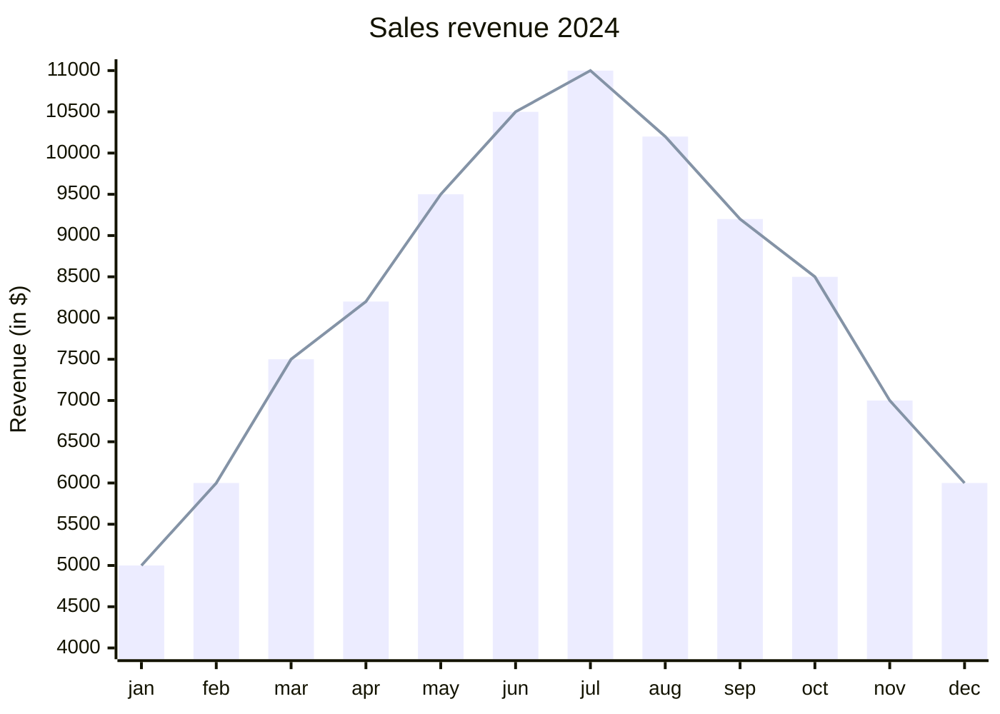
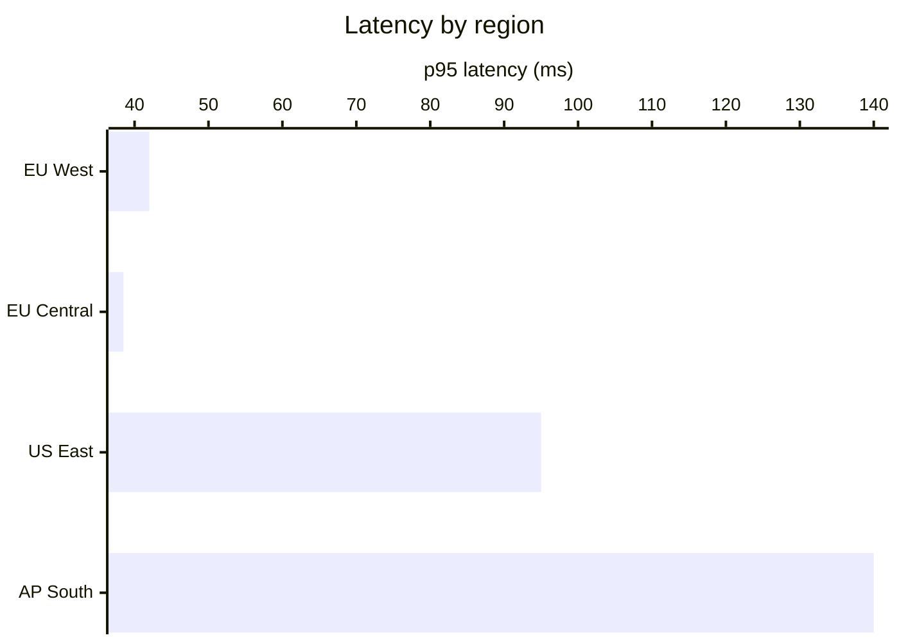
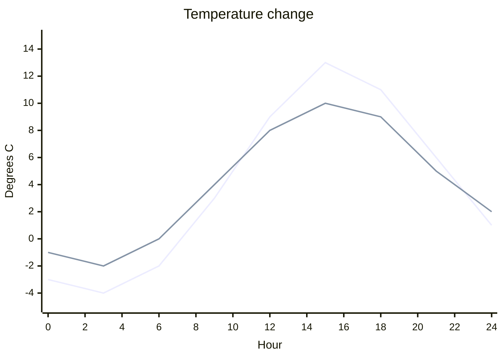

# XY chart

Declaration: `xychart` (the older `xychart-beta` also works)

Use an XY chart to show numeric values as bars, lines, or both, over categories or a numeric range. Typical uses are monthly revenue, measurements over time, and plan-versus-actual comparisons.

## Syntax

The first line is `xychart`. Add `horizontal` to turn the chart so the bars go left to right. `vertical` is the default.

```
xychart
xychart horizontal
xychart-beta vertical
```

Each following line is one statement.

| Statement | Form | Notes |
|---|---|---|
| Title | `title "Text"` | |
| X axis, categories | `x-axis "Title" [cat1, "cat 2", cat3]` | The title is optional. |
| X axis, numeric range | `x-axis "Title" 0 --> 100` | The title is optional. |
| X axis, title only | `x-axis "Title"` | The axis runs from `1` to the number of values. |
| Y axis, range | `y-axis "Title" 0 --> 100` | The title is optional. |
| Y axis, title only | `y-axis "Title"` | The range comes from the data. |
| Bar series | `bar [1, 2, 3]` or `bar "Name" [1, 2, 3]` | |
| Line series | `line [1, 2, 3]` or `line "Name" [1, 2, 3]` | |
| Line point label | `line [10, 25 "Peak", 12]` | A quoted text after a value labels that point. |
| Accessibility | `accTitle: Text`, `accDescr: Text`, `accDescr { ... }` | Not shown. |
| Comment | `%% text` | |

Rules for text:

- Always put titles, series names, and categories with spaces in double quotes.
- Unquoted text loses its spaces: `title Sales report` shows as `Salesreport`.
- Unquoted text can contain only letters, digits, and `+ = * . # & - _`.

Rules for numbers:

- A number is an integer or decimal, with an optional sign: `5`, `-3`, `2.75`, `.5`, `+4`.
- Exponents (`1e3`) and thousands separators fail.
- With a category x axis, each series takes values in category order. Extra values are dropped.
- Without an x axis, the x axis runs from `1` to the number of values.

Series:

- You can add many `bar` and `line` series. Each series takes the next palette color.
- Bar series do not stack or group. They draw at the same positions, and a later series covers an earlier one. Write the series with the largest values first.
- A named series shows in the legend.

## Styling and configuration

Frontmatter `config.xyChart` keys: `width` (700), `height` (500), `titleFontSize` (20), `titlePadding` (10), `showTitle` (true), `showDataLabel` (false; shows values on bars), `showDataLabelOutsideBar` (false), `showLegend` (true), `legendFontSize` (14), `legendPadding` (10), `chartOrientation` (`vertical` or `horizontal`), `plotReservedSpacePercent` (50), `useMaxWidth` (true).

`config.xyChart.xAxis` and `config.xyChart.yAxis` keys: `showLabel`, `labelFontSize`, `labelPadding`, `labelRotation` (degrees), `showTitle`, `titleFontSize`, `titlePadding`, `showTick`, `tickLength`, `tickWidth`, `showAxisLine`, `axisLineWidth`.

Theme variables go under `config.themeVariables.xyChart`: `backgroundColor`, `titleColor`, `dataLabelColor`, `legendTextColor`, `xAxisLabelColor`, `xAxisTitleColor`, `xAxisTickColor`, `xAxisLineColor`, `yAxisLabelColor`, `yAxisTitleColor`, `yAxisTickColor`, `yAxisLineColor`, `plotColorPalette` (a comma-separated string of colors, one per series).

## Examples



```mermaid
---
config:
  xyChart:
    showDataLabel: true
    xAxis:
      labelRotation: 45
  themeVariables:
    xyChart:
      plotColorPalette: "#94a3b8, #2563eb, #dc2626"
---
xychart
    title "Plan versus actual deliveries"
    accTitle: Deliveries per quarter
    accDescr: Planned and actual deliveries for each quarter, with the defect rate.
    x-axis "Quarter" ["Q1 2025", "Q2 2025", "Q3 2025", "Q4 2025"]
    y-axis "Units" 0 --> 120
    bar "Planned" [100, 110, 115, 120]
    bar "Delivered" [92, 104, 117, 98]
    line "Defects" [12, 8 "New QA process", 5, 9]
```





## Common mistakes

- Unquoted multi-word text loses spaces. Quote it: `title "Monthly sales"`.
- `title Q1: sales` fails because of `:`. Quote it.
- Parentheses, `$`, `%`, `:` and `/` need quotes in categories and titles.
- `1e3` and `1,000` fail in data.
- A chart with no `bar` or `line` series fails to render.
- Put each statement on its own line. A `;` also ends a statement, but new lines are clearer.
- A point label works only on `line`. A label on a `bar` value is ignored.
- `horizontal` goes on the `xychart` line only. It is not a separate statement.
